# Movy — Manual

This manual explains how to use **Movy**, an Elektron-style knob UI and 16-track
sequencer for Schwung on Ableton Move. For an overview and screenshots, see the
[README](README.md).

> **Movy is an early prototype.** Behaviour may change, and some things described
> here are deliberately minimal. If something doesn't work as written, that's a
> [bug report](#reporting-bugs) waiting to happen.

### A note on Move

Movy's sequencer is **deliberately aligned with Ableton Move's own sequencer**.
Rather than re-document everything Move already explains well, this manual:

- **points you to the official Move manual** for the shared concepts, and
- **focuses on what's different** — the Movy-specific gestures, the three new
  parameter pages, and the current limitations.

If you're new to Move's clips, Session view, recording, and automation, read the
official docs first:

- [Move manual (PDF)](https://cdn-resources.ableton.com/resources/pdfs/move-manual/1/2024-10-04/move1-manual-en.pdf)
- [Move beta release notes](https://www.ableton.com/en/release-notes/move-1-beta/)

---

## Contents

1. [Concepts & screen layout](#1-concepts--screen-layout)
   - [Opening Movy](#opening-movy)
2. [Parameter pages](#2-parameter-pages)
3. [The module chain](#3-the-module-chain)
   - [The MIX page](#the-mix-page)
   - [The Session mixer](#the-session-mixer)
   - [Send FX](#send-fx)
4. [Keyboard & drums](#4-keyboard--drums)
   - [Muting one voice](#muting-one-voice)
   - [External MIDI keyboard](#external-midi-keyboard)
5. [The sequencer (aligned with Move)](#5-the-sequencer-aligned-with-move)
6. [Beyond Move: Step, Clip & Set parameters](#6-beyond-move-step-clip--set-parameters)
   - [CPU meter](#cpu-meter--shift--step-12)
   - [Sets](#sets--shift--step-1)
   - [Settings](#settings--shift--step-2)
6a. [Undo & redo](#6a-undo--redo)
6b. [Generators: Smart Quantize & Variation](#6b-generators-smart-quantize--variation)
7. [Limitations vs Move](#7-limitations-vs-move)
8. [Controls reference](#8-controls-reference)
9. [Troubleshooting & recovery](#9-troubleshooting--recovery)

---

## 1. Concepts & screen layout

Movy runs as a Schwung **tool** on top of Move. While it's open, Move's firmware
and the Schwung audio chain keep running underneath — Movy just takes over the
screen, pads, knobs, and buttons.

You're always working with **one of sixteen tracks** at a time — four groups of
four, all of them chains Movy hosts itself
([Tracks and groups](#tracks-and-groups)). A track is a chain of up to four
module slots, plus a per-track **LFO** page:

```
MIDI FX  →  SYNTH  →  FX 1  →  FX 2  →  LFO
```

### Movy runs on its own

Movy is a **standalone** Schwung tool: while it is open it runs in place of
Move's own software, not on top of it. Move's screens are not running
underneath, so there is nothing to switch back to while Movy plays — Movy owns
the pads, knobs, screen, audio, master volume and the power button. (Movy
0.35 and earlier ran beside Move; see *What changed from the Move-side Movy*
below.)

There are two ways in:

- **From the Tools menu**, like any tool. Move's software stops while Movy
  runs and starts again when you leave, so opening and closing take a few
  seconds each way.
- **Straight from power-on.** Installing Movy adds a **Movy** row to Schwung's
  boot picker. At power-on the screen shows `Loading <name> — press Back to
  change` for about two seconds: press **Back** there, turn the jog to
  **Movy** and click. Movy is then the default and opens at every power-on, in
  a few seconds and with no Move in between. To go back to Schwung, press
  **Back** in that window again and pick **Schwung**. Installing or updating
  Movy never makes it the default by itself.

**Leaving.** **Back** at the top level opens **Leave Movy?** with one choice,
**Close Movy**: turn the jog wheel to it and click. Movy saves the Set first.
Either way you land in Move with Schwung, never straight back in Movy, even
when Movy is your power-on default. Opened from the Tools menu, the screen shows
`Loading Movy` for about 2 seconds on the way out, then Move starts.

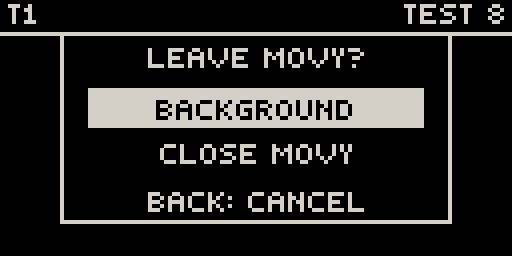

**If Movy ever stops responding:** hold **Shift**, touch the **volume knob**,
and click the **jog wheel**. Movy closes and saves as usual; if it cannot (for
example a stuck script), it closes anyway after two seconds, without saving,
so the device always comes back.

**Master volume.** The **volume knob** on its own is the master volume. Touch
it to see the **MASTER VOLUME** slider; each detent is 1 dB, from silence up to
0 dB (full scale). Movy remembers the level across Sets and restarts; the
first time it opens it starts at −12 dB. Holding a **track button** and
turning the knob still sets that track's volume, on any of the 16 tracks.

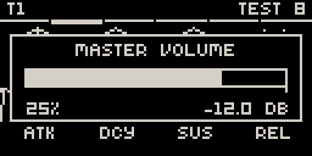

**Powering off.** Tap the **power button** and Movy asks **Power off?**: click
the jog wheel to confirm, or turn to **Cancel** (or press **Back**) to carry
on. On confirm Movy saves the Set first, then the device shuts down: until the
power goes, the screen reads **Powering off...**, a rainbow slowly drifts
across the pads and every other light is dark. Nothing powers off from the button alone.

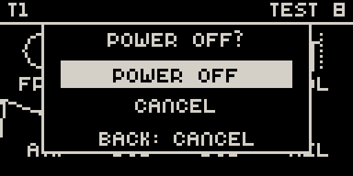

**Your Sets.** Movy keeps its own Sets (see [Sets](#sets--shift--step-1)).
The first time it opens it copies every Set the Move-side Movy kept into that
library; the originals are left exactly where they were. If the library
folder cannot be written, Movy says **SETS FOLDER NOT WRITABLE** and does not
start a Set, rather than letting you play into something it cannot keep.

#### What changed from the Move-side Movy

Movy 0.35 and earlier opened on top of Move. Running on its own retires the
things that only existed to share the device with Move: **Background** mode
(parking Movy under Move's screens), **LINK** to Move's transport, Sets tied to
Move's Set pads, Move's own master volume and master FX slots, and tracks
played on Schwung's slots. Your existing Sets come across (above), and so does
the master chain of each Set, the first time that Set opens. Nothing of the
old install is deleted, so going back to an older Movy finds it as it was.

**Known limitations.** Move shapes the sound of its built-in speaker with its
own EQ; Movy does not yet, so the speaker sounds different from the same Set
under Move. Headphones and line out are unaffected.

### Opening Movy

For the first few seconds Movy shows **STARTING ENGINE**, then **LOADING SET**:

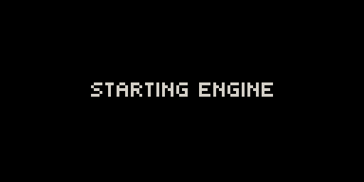

Reading the Set is only the first half. Its instruments are loaded one at a time
— a full Set is twelve of them — so the screen then counts them in with
**LOADING MODULES**:

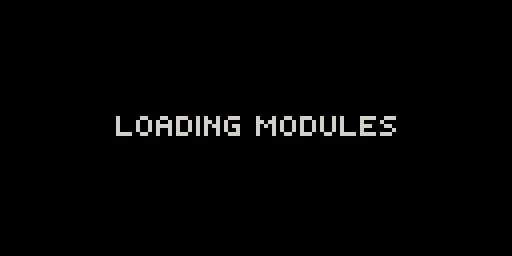

and finishes on **PREPARING SET** while the Set's last pieces settle.

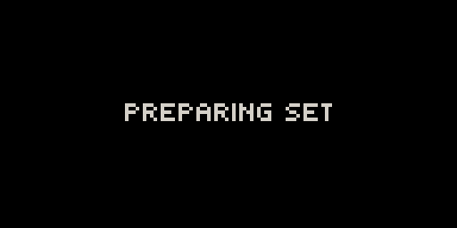

The pads, knobs and buttons are inert until all of that is done, and that is
deliberate. Everything you play or enter after that point belongs to the Set,
and to the instruments the Set actually loaded; nothing you do before it can be
lost or land on the wrong module. (**Back** always works, so a Movy that cannot
start is never a trap.)

Switching Sets shows the same screens again — the incoming Set's instruments
have to be loaded just like the first one's — and the screen stays up until the
module page underneath it is showing the new Set's own modules, not an empty
slot or the Set you just left.

If a module never loads, Movy gives up waiting after ten seconds and starts
anyway: what did load still plays.

If a Set's saved sequence cannot be read, Movy says so instead of starting
empty and letting you discover it later:

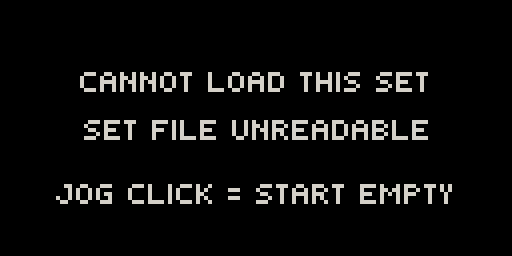

**Jog click** then starts that Set with an empty sequence. Movy does not do this
on its own — the unreadable file is left untouched, so it can still be recovered
from the device by hand. Your modules and their settings are Schwung's and are
not affected either way.

A different screen means a different problem, and there is no jog click on it:

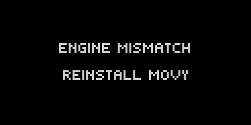

This one is about the install, not your Set: Movy's engine comes from a
different build than the rest of Movy, which only a partial install or update
leaves behind. **Reinstall Movy** from the Module Store. Your Sets are
untouched: Movy never became live, so it never wrote anything.

`ENGINE DID NOT START` on the same screen means the engine did not load at all.
The remedy is the same reinstall.

### Backups

Movy keeps older versions of every Set and can put one back without a computer.
Open **Settings** (Shift + Step 2); **BACKUPS** is the first row:


Each row is one saved version: how long ago it was kept, why it was kept, and
how many clips are in it — the clip count is the quickest way to spot the one
that still has your work. **Jog** scrolls; **Shift + jog** jumps eight rows at a
time. A `*` after the count means *sequence only*: that version restores your
notes and leaves your instruments exactly as they are.

A version is kept when you **open** a Set, roughly every ten minutes while you
work, when you **leave**, and always **before** anything that would wipe the
Set. Up to 32 are kept per Set, thinned so you get the last hour in detail,
today by the hour, this week by the day, and older ones by the week.

**Jog click** on a row asks to confirm, because restoring replaces what you have
now:

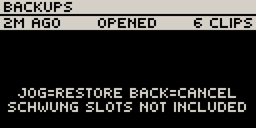

**Jog click** again restores it; **Back** cancels. Restoring is itself
undoable — the state you had is kept as a version first, so a mis-press costs
you nothing.

A Set's versions belong to that Set and go with it when you delete it on the
[Sets](#sets--shift--step-1) page — into
`/data/UserData/UserLibrary/Movy/Trash/`, from where it can still be recovered
by hand.

### Which Set your sequence belongs to

Each Set on Movy's [Sets](#sets--shift--step-1) page is one whole Movy project:
its sequence, its instruments and their settings, and its master chain. The
Set that was open when you left reopens next time.

The **screen** is the 128×64 OLED. A typical parameter page looks like this:

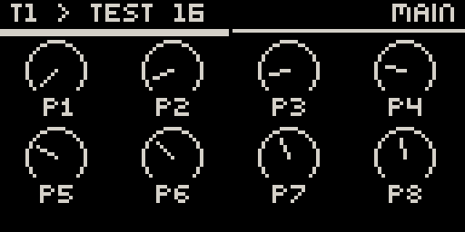

- **Header** (top): the track on the left (e.g. `T1`), the module/bank name on
  the right.
- **Knob row(s)**: up to 8 parameters, drawn as knobs with a value and a short
  label. The currently-touched knob shows its full value in an inverted style.
- **Page indicator**: a thin strip showing which page of the module you're on.

The general UI rule (borrowed from Move): **only controls that do something are
lit**. A dark button does nothing where you are; a dim one is waiting to be
pressed; and a button goes to full brightness while it's actively doing its job
— or simply while you're holding it down.

### The views

| View | What it shows |
| --- | --- |
| **Chain** | The current track's module slots (MIDI FX, Synth, FX 1, FX 2) and the LFO page; jog scrolls them. |
| **Knobs** | One module's parameter page; jog scrolls that module's pages. |
| **Keys** | The melodic keyboard (or a drum rack on drum tracks). |
| **Browse** | The module browser (pick a module to load into a slot). |
| **Session** | The clip grid for launching clips; also exposes the master FX chain (MFX 1-4 plus an LFO page). |

You move between Chain → Knobs by **clicking the jog wheel** to drill in, and
**Back** to step back out (and eventually out of Movy).

Not sure what the jog does on the page you are on? **Rest a finger on it** for
about a second without turning: a prompt at the bottom tells you what a click
will do there. Turning it (or letting go) dismisses the prompt, so scrolling
never puts it in your way.

---

## 2. Parameter pages

Every module's parameter pages are **Schwung's own**: Schwung's page planner
reads the module's declared hierarchy and draws the eight knob cells, exactly as
Schwung's Slot Settings would. Movy keeps three bands around them — the header,
the page indicator under it, and the hint row at the bottom — and writes your
edits to the module, its automation lanes and the undo history. You don't
configure anything for most modules.


The cells are drawn as what they are: an arc for a continuous value, a switch
for on/off, the option name for a list, a framed number for an octave or a voice
count, a fader for a level, and grouped graphics where a module declares them —
an envelope across its stages, a filter response across cutoff and resonance, a
sample's waveform with its playback position:

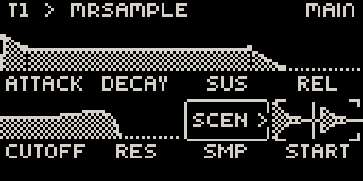

**While a module is loading** its knob rows stay blank and the knobs do nothing
— there is nothing to edit yet. The page appears as soon as the module has
published it; heavy modules (Osirus, MiniJV) take longer to get there.

**Multiple pages.** A module with more than eight parameters is split into pages
under its own section names. Scroll them with the jog wheel (or Left/Right when
the sequencer isn't using those buttons); the line under the header is the page
indicator, the current page drawn taller:

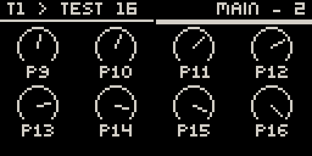

**Jumping between sections.** Hold **Shift** and click the jog for Schwung's
section list, and pick the section to jump to. (Shift + jog turns one page at a
time, like a plain jog.)

**Presets.** On a module's preset page, **knob 1** browses the presets,
loading each as you pass it. It doesn't take over the jog: the next jog turn
still pages away. To browse with the jog instead, click in; Back comes out.
**Shift + knob 1** jumps to the next or previous **bank** and loads its first
preset, on modules that declare banks (OB-Xd, Dexed). On other modules it
browses presets like a plain turn. The Loop strip stays visible along the bottom
while you browse.

**Lists.** Turning a list knob steps through its options and shows them in a
pop-up while you turn; click the jog on it for the whole list as a menu:

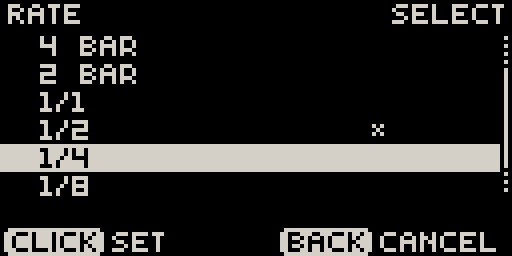

**The header and the hint row.** **While a knob is under your hand** the header
becomes that parameter — its full name on the left, its current value on the
right, drawn inverted:


Let go and Movy's own header comes back — the track, the module and, on a drum
module, the pad grid. The bottom row stays the Loop strip unless the page has
something to say there.

**Files.** A parameter that points at a file — a sample, a wavetable, a
soundfont, an SFZ — cannot be turned, so the click is the only way in, and it
is the one knob that gets a hint. Hold it and the header names the parameter
and the file it is set to, and the bottom row reads `CLK BROWSE`:

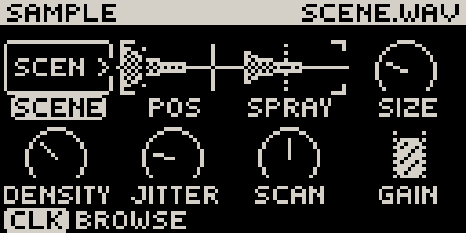

Click the jog and **Movy's file browser** opens in that parameter's folder, on
the file it is set to:

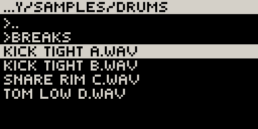

Turn the jog to move the highlight, click to load the highlighted file, **Back**
to cancel. Folders come first and are marked with a `>`, so you can walk down
into a library and back out through the `..` row. The folder you last used for a
parameter is remembered, so the second visit starts where the first one ended —
per parameter rather than per module, because a drum module has one of these for
every pad.

**Preview.** Some modules ask to be heard while you browse — mrdrums' and
MrSample's samples, granny's, tablor's wavetables. There, the file under the
cursor loads once the cursor rests, so you hear it before you choose; **Back**
puts back what was loaded before you opened the browser. A module can also ask
for something to change while it is open — mrdrums stops a pad you hit from
moving the selected pad, so you can audition other pads without losing the one
you are filling — and that is put back when you leave.

Loading is **one undo step**, named after the parameter it went into. When a
module says what a valid file contains — a drum-rack preset as opposed to a
synth one, say — a file that fails that test is refused with a toast instead of
loaded, and the browser stays open so you can pick another.

**Module screens.** Some modules draw a whole screen of their own for one knob —
DR32's **ENGN** knob opens its engine picker (Sample, Simian, Urchin, 9W9…, each
with its own list), its **Resample** knob its resampler, and Breakbeat's
**Status** and **Edit A / Edit B** knobs its playback view and slice editors.
These knobs do not turn, so like a file knob they carry the hint: hold one and the
bottom row reads `CLK OPEN`. Click the jog and the screen opens; a screen that
shows something live (Breakbeat's playback status) keeps updating while it is
open. The module then owns the jog, the click and
the eight knobs; the pads still play, and a pad you hit is the pad the screen
fills. **Back** climbs out one level at a time and leaves from the top;
**Shift + jog** always leaves at once. Some modules close the screen themselves
when you pick something.

**Pages a module draws itself.** A module can ship a page it draws itself, as
MonkSynth does with its singing face. It sits in the jog rotation like any
other page, and the eight knobs keep editing that section while you watch it. If
the module lets you *enter* the page, click to go in: from then on the jog and
the click belong to the module, and Back steps up one level inside it until the
module has nowhere left to go, then leaves the page.

**Pages that follow a setting.** A module can hide pages that do not apply right
now — DR32 shows only the pages of the engine the selected pad runs (a sample
pad's Shape, a 9W9 kick's Voice), not every engine's at once. Pick a different
engine, or hit a pad that runs one, and the pages change with it.

**Curated layouts.** A few older drum modules play better from a hand-tuned page
layout that Movy ships for them (*mrdrums*, *Forge*, *Weird Dreams*, *Signal*,
*libpo32*, and the *6W6* / *8W8* / *9W9* / *CW78* kits): Movy hands that layout
to Schwung's planner in place of the module's own, so their pages are grouped
and named by voice:


---

## 3. The module chain

In **Chain** view you see the slots of the current track:

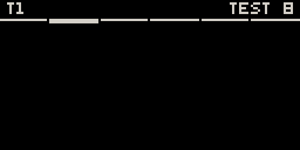

- **Jog wheel** scrolls between slots (MIDI FX, Synth, FX 1, FX 2, the LFO page
  and the MIX page).
- **Jog click** on a loaded slot **drills into** that module's parameter pages.
- **Jog click** on an empty slot — or **Shift + jog click** on any slot — opens
  the **module browser** to load/swap the module in that slot:

  

  Scroll with the jog wheel; click to load; Back to cancel. Choosing **NONE**
  empties the slot and always lands you on the chain view, even when you opened
  the browser from the module's pages.

- **Back** returns from a module's pages to the chain, and from the chain it
  exits Movy.

**Modules follow Movy's transport.** Every chain — the tracks, the send FX and
the master chain — hears Movy's Play, Stop and MIDI clock (24 per beat), and a
module that asks for the tempo or the song position gets Movy's. So a
clock-driven module — Breakbeat's slicer, a synced arpeggiator or delay —
starts on Movy's downbeat, follows its tempo and stops when Movy stops.

In **Session** view, the same navigation applies to the **master chain**: three
**send FX** slots, then **MFX 1–4** processing the whole mix, then an **LFO**
page — see [Send FX](#send-fx) and
[The master chain's LFOs](#the-master-chains-lfos).

**The master chain is Movy's own**: MFX 1–4 and the LFO page, then master
volume and a safety limiter at −1 dBFS. It is saved with the Set's chains. The
first time a Set made by Movy 0.35 or earlier opens, Movy copies that Set's
Schwung master FX into it; Schwung's own files are only read, never changed.

### Track volume

**Hold a track button and turn the volume encoder** to set that track's volume.
The range runs 0–400%, where **100% is unity** — the tick under the bar. Above
that you are boosting, so watch for clipping.

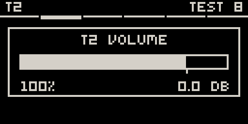

**One detent is one dB**, the whole way down. The readout shows both the
percentage Schwung stores and the gain in dB, so quiet settings are as easy to
place as loud ones — from −9 dB there are another 39 steps before the fader
reaches silence at the bottom of its travel.

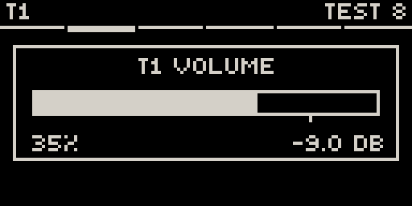

Whether you see *this* slider depends on Shift. Move's firmware takes over the
screen for as long as you are touching the volume knob, so:

- **Track + volume** — Move draws its own volume overlay. The track volume still
  changes; you just see Move's display of it. **Tracks 1-4 only** — see below.
- **Shift + track + volume** — Movy keeps the screen and shows the slider above.
  Works on all 16 tracks.

⚠️ **On tracks 5-16, use the Shift variant.** The plain gesture leans on telling
Move which track is held, and Move only has four track buttons — beyond them it
has nothing to be told, so the knob stays on Move's *master* volume. Known
limitation, not by design.

The value belongs to the track — Movy's own mixer, for every track — and it is
**saved with the Set**, so it survives leaving Movy, a power cycle, and
switching to another Set and back. A track's level is saved alongside its
chain, so a chain with nothing loaded in it has no level to keep.

### The MIX page

The last slot in every track's chain is **MIX** — Movy's own mixer for that
track.

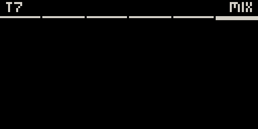

| Knob | What it does |
| --- | --- |
| **VOL** | Track level, drawn as a fader. Silence to +12 dB, on the same dB curve as **track + volume**. |
| **PAN** | Position in the stereo field, shown as `C`, `L50`, `R100`. |
| **SEND1** | How much of this track goes to send FX 1. Full right is 0 dB. |
| **SEND2** | How much of this track goes to send FX 2. |
| **SEND3** | How much of this track goes to send FX 3. |

VOL and PAN sit on the top row; the three sends are together on the bottom row,
under encoders 5–7.

Every knob here turns at the same rate as a module's — a full sweep is a full
sweep, wherever you are on the fader — and lands on the round numbers: `0.0 dB`
and centre pan are always reachable, whatever the value started at. The header
shows the knob under your hand, as on any page.

All five are **automatable** like any module parameter: hold a step and turn, or
turn while recording. See [Step parameters](#step-parameters--per-trig-locks).
Automation follows the same fader curve the knob does, so an automated level
moves where you expect it to rather than crowding into one end of the travel.

The sends are **post-fader and post-pan**: pulling a track's level down takes its
reverb with it, and a hard-panned track arrives in the return where you left it.
Muting a track mutes its sends too.

### The Session mixer

**Latch Session view (tap Note/Session), then hold Note/Session.** After a
moment the screen turns into a mixer for all 16 tracks; let go and you are back
in Session view. A quick tap still switches back to Note view as before, and
holding Note/Session from Note view is still the Session peek — the mixer only
opens from a Session view you have already latched.


Every track is one strip: a **stereo level meter** (left and right side by
side, after the fader, so a muted track reads empty) and a **fader** — the thin
line across the strip, drawn dark where it crosses the meter. The meter and the
fader share one scale: a full-scale signal through a fader at 0 dB reaches the
fader's line.

The eight knobs drive **tracks 1-8** on the first page and **tracks 9-16** on
the second; **turn the jog wheel** to switch, as on any parameter page. The bar
under the header shows which page you are on. Both pages always show all 16
strips.

**Hold a knob** to see its track exactly: its number inverts under the strip and
the header shows the full value.

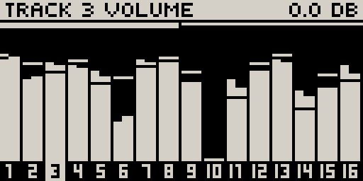

The faders are the same control as **VOL** on each track's
[MIX page](#the-mix-page) — same curve, same rate, same undo, saved with the
Set — so a level set here is the level you find there.

If you press a step (to pick a track) or launch a clip while holding
Note/Session, the hold stays a modifier and the mixer does not open.

### Send FX

The master chain starts with three **send FX** slots, to the left of MFX 1.

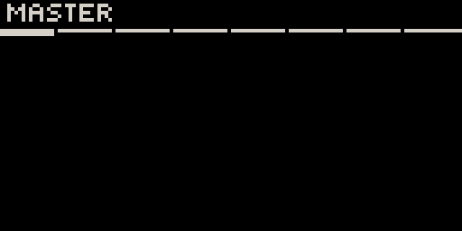

Load one the way you load any module — jog to the slot, jog click, pick from the
browser — and then raise **SEND1**, **SEND2** or **SEND3** on the MIX page of
whichever tracks should feed it. Each send holds **one audio FX**. Its output is
added back at unity; the send amount on each track is the level control.

The buses render **in parallel** when it pays for itself. Three heavy reverbs
cost 847 µs of a 2902 µs audio block one after another and 423 µs spread across
Movy's render lanes — a saving of about 15% of the frame. Movy checks the
arithmetic per block and stays serial when overlapping would cost more than it
saves, which is what happens when only one bus is working.

They sit left of the master FX on screen because they sit left of them in the
signal path: a send's output joins Movy's own output, which the master FX then
process.

**Why bother.** One reverb shared by eight tracks costs a fraction of eight
reverbs — and a send is never more expensive than putting the same effect on the
track itself, however few tracks feed it. That used not to be true: a bus had to
wait for every track to finish and then ran on its own, so below about four
tracks a send cost more than an FX slot did. Movy now renders a bus on the same
render lane as the tracks feeding it whenever that shortens the block, which on
a twelve-track set with one heavy delay is worth about 250 µs — 9% of the audio
frame. Nothing is delayed to do it, so short effects behave normally on a send.

Sends are still for *wet* effects — reverb, delay, chorus. An effect that
replaces the dry signal (distortion, compression, EQ) belongs in the track's own
FX slot, where it will sound like you intended: that is a question of what it
does to the sound, not of what it costs.

Sends are **saved with the Set**, module and preset alike.

#### Per-pad sends from drum modules

A drum module with its own per-pad **Send A** / **Send B** knobs feeds the same
buses, one pad at a time: **Send A goes to SEND 1, Send B to SEND 2**. Turn up
the snare's Send A on the module's own pad page and only the snare reaches
the reverb on SEND 1, even with the track's SND1 at zero. SEND 3 has no per-pad
source; it is fed from the MIX page only.

- A pad's send is added to whatever the track's own SND1/SND2 already sends.
- It follows the **track's** volume, pan and mute, like the track's own send.
  It is taken from the pad's dry sound, before the track's FX.
- The levels belong to the module and are saved in its preset, like any other
  module parameter.

Two modules support this today: **Simian** (Send A/B on each of its ten drums)
and **DR32** (on each of its 32 pads). Other modules' "send" knobs (Surge,
Weird Dreams, Forge, MiniJV, Mono Voice, Osirus) drive effects built into the
module itself and never reach Movy's sends.

### The LFO page

The last page in the chain is **LFO** — two low-frequency oscillators that can
modulate any automatable parameter in the track's chain. Jog-click it to drill
in; the jog then scrolls between **LFO 1** and **LFO 2**.

These are Schwung's own LFO pages — the same LFO 1 / LFO 2 pages its Slot
Settings and Master FX Settings show, so a patch reads the same in both places:

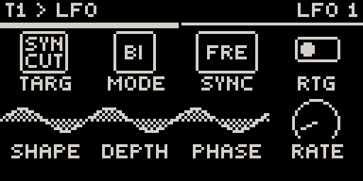

- **Top row:** **TARG** (what it modulates), **MODE** (uni/bipolar),
  **SYNC** (free/synced), **RTG** (retrigger on each new note).
- **Bottom row:** **SHAPE**, **DEPTH** and **PHASE**, drawn as one live
  waveform, then **RATE** in a cell of its own — in Hz when free-running, a
  musical division (`1/4`, `8T`, `2b`) when synced. The waveform still follows
  it, and a synced rate draws at the speed it plays (1/4 looks like 2 Hz).
- **Target:** **turn its knob** like any other list — every parameter the LFO
  can reach pops up while you turn, and the routing is made when you let go
  (scrolling past other parameters does not modulate them). Click the jog on it
  for the same list as a menu. **None** is the first entry.
- **There is no On switch:** choosing a target turns the LFO on, and **None**
  turns it off. A newly routed LFO starts at **100%** depth.

**Synced LFOs phase-lock to the transport.** With **Sync** on, a running
transport drives the LFO's phase directly from song position — the cycle is
bar-aligned and stays drift-free no matter how long it plays. It follows
Movy's own sequencer. **Phase** then
becomes a musical offset against the bar. When the transport **stops**, the LFO
keeps breathing — it free-runs from where it was, at Movy's tempo, and a tempo
change while stopped changes its rate straight away.

You can pick an LFO's Target here, but the easy way is to assign it from the
parameter itself:

### Modulating a parameter with an LFO

On any module's parameter page, **hold an (automatable) knob** for about a second
without turning it. A prompt appears at the bottom. On a page Schwung draws,
this works on ordinary number knobs only: an option, a switch, an action or a
file knob already uses the click, so holding one never takes it over (point an
LFO at those from the LFO page's **Target** instead).

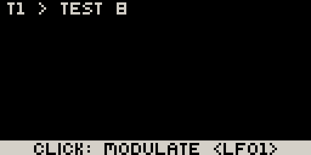

- **Turn the jog** to choose `LFO1` or `LFO2`.
- **Click the jog** to assign — that LFO now modulates the parameter, and you
  jump to its LFO page to set rate, shape, and depth.

Hold the same knob again to **remove** the modulation (or, from the other LFO,
add a second one to the same parameter). A modulated parameter wears a
modulation mark on its cell:

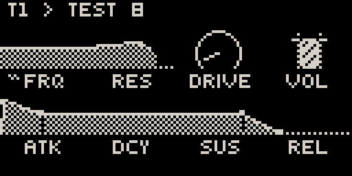

Both work on **every track** alike.

The prompt only appears on knobs an LFO can actually reach — a module's own
parameters. It is not offered on the **MIX** page or on a **send FX** slot: those
live in Movy's own audio engine, while the LFOs belong to Schwung's chain host,
so it has no way to drive them. Automate those with a parameter lane instead.

### The master chain's LFOs

The master FX chain has an LFO page of its own, in the same place: the **fifth
slot**, after MFX 4. Jog to it in Session view and click to drill in.


It works exactly like a track's, with two differences:

- **Targets are the four master FX slots** (and the other master LFO) rather
  than a track's chain — so an LFO here sweeps the whole mix's reverb or filter.
- **There is no Retrigger.** Nothing plays notes on the master bus.

Hold-to-assign works here too: hold any automatable knob on an MFX slot's page
and click to modulate it.

These settings are saved with the Set's chains, so they survive a power cycle.

---

## 4. Keyboard & drums

### Melodic keyboard

On a melodic track the 32 pads form a playable keyboard whose shape you choose:

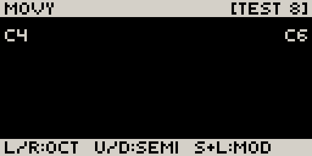

- **+ / −** (Up/Down buttons) shift **the active track's** octave (in Session
  view they move between track groups instead). Each track
  keeps its own octave, saved with the set — so a bass part stays low when you
  come back to it, even after a device restart.
- The root note is shown in the header.
- Pads are coloured by the current key: the tonic takes the track colour, other
  in-scale notes light grey, out-of-scale notes stay dark.

### Pad layouts

Two knobs on the [Set parameters](#set-parameters--shift--step-5--7--9) page
(**Shift + Step 5 / 7 / 9**) decide the grid's shape:

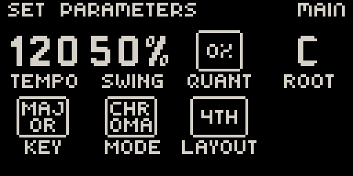

**MODE** picks the note set:

- **Chromatic** — every semitone is reachable; the KEY setting only colours the
  pads.
- **In Key** — the grid folds to the scale, so every pad is in key and a wrong
  note is impossible.

**LAYOUT** picks the geometry, and its options follow MODE:

| MODE | LAYOUT | Grid |
| --- | --- | --- |
| Chromatic | **4th** | +1 semitone per pad to the right, +5 (a fourth) per row up. The root sits on the **4th pad of the bottom row**, leaving three pads below it. |
| Chromatic | **Piano** | Rows 1 and 3 are the white keys (C–C), the row above each holds the black keys, offset right so a black key sits above the white note it leads into. Three pads per black row have no key and stay dark and silent. Two octaves on the grid. |
| In Key | **4th** | Three scale degrees per row up (Push's *In Key*), root bottom-left — the same fingering transfers between rows. |
| In Key | **Inline** | One scale octave per row, root bottom-left: `1 2 3 4 5 6 7 1`, with the next row starting an octave higher. |

Two details worth knowing:

- **Piano still honours KEY**, with three brightness levels so you can tell the
  cases apart: a **gap** pad (no key above it) plays nothing and stays dark, an
  **out-of-key** pad does play so it is lit dimly, and an **in-key** pad is
  bright. Pick the **Chromatic** scale to bring the whole keyboard up.
- **In Key + Inline steps by the scale's own degree count.** A seven-note scale
  gives exactly one octave per row; a five-note pentatonic gives five per row, so
  rows overlap slightly.

MODE, LAYOUT, ROOT and KEY are set-wide. Only the octave is per-track.

### Held notes stop when the context changes

A note played on a pad is released when you switch tracks, enter Session mode,
load a different module into the slot, change the octave/root, or mute that
track — it never keeps ringing on a track you have left. Closing Movy releases
everything, including whatever the sequencer was playing.

Playing pads over a muted track still works: muting only stops notes that were
already sounding, so you can keep jamming on a silenced track.

### Drums

When a **drum module** is loaded, Movy switches the pads to a **4×4 drum rack**
and the screen to drum-oriented parameter pages, including **per-pad pages** (a
page that controls just the selected drum voice — marked with a pad icon).
A kit with **more than 16 voices** (dr32 has 32) uses **all 32 pads**: voices
1–16 fill the left 4×4 exactly as on any other kit, and voices 17–32 fill the
right 4×4 the same way, each half numbered from its bottom-left pad upwards:

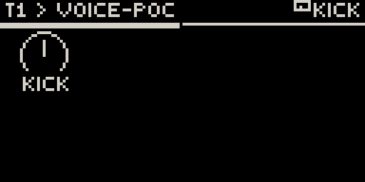

**Press a pad to pick which voice you're editing.** A kit that declares its
voices — or one Movy ships a curated layout for — has a page per voice, and a
pad press shows that voice's page, the header naming the voice and the pad icon
lighting the pad. **Shift + pad** picks a voice without sounding it. Pages that
belong to the whole kit — Reverb, Delay, Master — carry no pad icon, and a pad
press does not drag you off them:

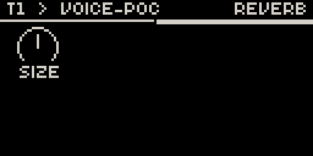

On a drum track the page follows the pad **you** press and
nothing else. A playing pattern never turns the page, even on a drum machine
that moves its own selection with every hit (6W6, 8W8, 9W9, CW-78, mrdrums,
Forge). The per-pad knobs always edit the pad you last pressed.

The **pad's own pages come first**. On a drum machine with one page per voice
(6W6, 8W8, 9W9, CW-78) those pages fold into a single **pad page**, which shows the
pad you last pressed. The jog then reaches the module's other pages (Main,
Reverb, Delay…). On a rack whose pages edit the selected pad (simian, dr32,
sophie, Forge's voice pages) the pad pages are all of those. A drum module opens
on its pad page.

A module needs no Movy config file to be played as a drum rack here. One that
says it is a drum kit, or whose pages switch between instances by their own
"selected pad" parameter, gets a rack of its own: its pads start at C1 (note 36)
unless it names the notes itself. When a module does ship a Movy config, or
Movy ships one for it (6W6, 8W8, 9W9, CW-78), the config decides the pads and
their notes.

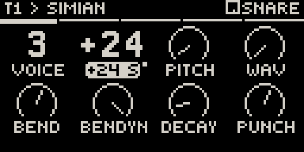

How a pad press moves the page:

- **On a pad page**, a press switches to that pad and stays on the same pad
  page: the second page of one voice becomes the second page of the next. A
  voice with fewer pages lands on its last one.
- **On any other page** (Main, Reverb…), a press leaves the page where it is.
  It still selects the pad, so jogging back to the pad page shows the pad you
  hit last.

Switching pads does not wait on the module. Every pad's values are read in the
background, so the knobs show the new pad on the press itself.

*Sample Slicer* is a slice player rather than a kit: its **32 pads are the 32
slices** the module can trigger (pad 1 = slice 1). Its Main page carries the
**Sample** browser — hold that knob and click the jog to browse
`UserLibrary/Samples` — and a **Scan Slices** action next to it, which is what
turns a freshly loaded sample into slices. The **Slice** page then edits
whichever slice you last hit: start, end, attack, decay, pitch, gain, mode and
loop. Those per-slice knobs are not automatable — the module points them at the
slice it is playing, so a lane would land on whatever the sequencer triggered
last.

*Forge* takes it further: its **16 pads are a Kit A↔B performance grid** (lower
two rows = Kit A, upper two = Kit B; the *Morph* knob crossfades them), and
tapping any pad selects that voice for deep editing across six pages —
**Osc, Filter, Env, Mod, Setup, Send**:


The **Send** page holds the selected voice's mixer strip — **Reverb Send**,
**Delay Send** and **Pan**. On Kit A pads these are automatable like any other
per-voice parameter (classic per-step delay throws); Kit B pads can still be
edited, just not automated:

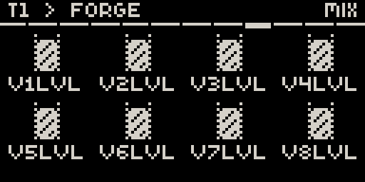

*Libpo32* (a PO-32 / Microtonic-style engine) gives all **16 voices** the same
treatment across **Osc, Mod, Noise and Voice** pages: pitch, decay, noise mix,
distortion and level are per-voice automatable, and the Noise page draws the
noise filter's response curve. Each voice is addressed by a fixed index, so
per-voice automation is playback-safe regardless of which pad last played.

Per-pad pages are not only for sample players and voice-cloned engines:
an **analog-style drum machine**, where every voice is its own circuit with its
own knobs (a kick that has Sub and Tube, a sampled cymbal that has neither), can
have one too — its layout lists each pad's parameters by name.

Because there's no other way to choose a drum type on the device, drum modules
rely on Movy's **layout templates**. Mr Drums, Weird Dreams, KrautDrums and
Signal ship Movy templates; Forge and Libpo32 are **self-describing** — they
carry their own layout in the module. Other drum modules may need one
contributed (see [CONTRIBUTING.md](CONTRIBUTING.md)).

An older drum module follows its Movy template: **Forge, Mr Drums, Weird
Dreams, Signal and Libpo32** show the template's pages, in the template's
order. The knobs on them edit the pad you last pressed. A page that edits the
selected pad shows the **pad icon** next to its name (Forge's Osc to Send pages,
Mr Drums' Main and Rand, Weird Dreams' Voice). Global pages such as Mix or
Master don't show it. The template's graphics carry over too, wherever Schwung can draw them: Forge's
Filter page shows a filter curve, its Mix page eight faders, and its Mod page an
LFO wave. When another knob sits inside a graphic's group (Forge's LFO Sync
between Rate and Depth), the picture covers the knobs before it. The ones after
it keep their own knob and still shape the picture: Depth sets the wave's
height. A drum module that
describes its pads itself (Simian, DR32, Sophie, and the 6W6/9W9 kits) shows its
own pages. On Forge, a pad press does not jump to a voice page; it picks the
voice the page edits.

#### Muting one voice

A drum track's voices can be silenced one at a time, with the same gesture that
mutes a whole track: **hold Mute and press a pad** to silence that voice,
**Shift + Mute + pad** to solo it. It is the track gesture one voice down, and it
follows the track rules throughout: every form is a **latch** (press again to
unmute, or to clear the solo), solo is **exclusive** (soloing another voice moves
the solo rather than adding to it), and **solo overrides mute** — the voices you
muted are remembered underneath and come back exactly as they were when the solo
drops.

Like a track mute, it silences the **sequencer**: it applies to the whole track,
in every clip, and a pad you play by hand still sounds. **The press that works the
gesture does not, though** — for as long as Mute is down the pads belong to the
gesture, so a press neither sounds nor moves the pad the lane is editing. Let Mute
go and they play as usual. It lasts as long as the
Set does — the mutes and the solo are saved with the tracks' own — and both are
**undoable**, with the Undo record naming the voice. A voice outside the rack
(no pad in the drum layout maps to it) is not a voice: the gesture does nothing.

Each press shows a **toast naming the voice** — the rack's own name where the
module declares one (`KICK MUTED`), otherwise its pad number (`PAD 2 SOLO`).

**Seeing what is silenced.** A silenced voice rests **grey** on the pads
themselves instead of its track colour. Two states outrank the grey, because both
would otherwise become invisible: a voice **whose gate is open stays green**
while it sounds, and the pad the drum lane is **editing stays white**. So a grey
pad is exactly a voice the sequencer is not going to play — the difference
between a mute you can read off the grid and one you have to remember.

---

### External MIDI keyboard

Plug a class-compliant USB MIDI keyboard or groovebox (an OP-XY, for example)
into Move's **USB-A** port and it plays the **selected track**, just like the pads.

- **Every channel plays the selected track.** Pick the destination by selecting
  a track on Move, not on the controller. A key held while you switch tracks
  still releases on the track it started on.
- **Velocity is the keyboard's own.** Full Velocity applies only to Move's pads.
- **Recording works like the pads.** With Rec armed the notes land in the clip,
  and step recording and the hold-step + note gesture take keyboard notes too.
- **Drum tracks: one key per pad.** C1 (MIDI note 36) plays pad 1, C#1 pad 2,
  and so on up the rack. Keys outside the rack play nothing.
- **Mod wheel and pitch bend** reach the selected track's synth live. They are
  **not recorded**. Switching tracks recentres the bend and zeroes the mod wheel on
  the track you left, so it isn't left bent.
- Nothing else is used yet. Other CCs, aftertouch and clock are ignored, and
  there is no custom CC mapping.

## 5. The sequencer (aligned with Move)

Movy's sequencer is built to **feel like Move's**, across **16 tracks**. The
following all work essentially as they do on Move — refer to the
[Move manual](https://cdn-resources.ableton.com/resources/pdfs/move-manual/1/2024-10-04/move1-manual-en.pdf)
for the concepts:

- **Clips** — one clip per track slot; steps entered on the 16 step buttons.
- **Session view & clip launching** — press **Note/Session** to see the clip
  grid; pads launch clips. Launching a clip also **selects its track**, so the
  knobs, screen and step row all move to the clip you just started. Hold
  Note/Session for a momentary peek; tap to latch.
- **16 tracks in four groups** — see [Tracks and groups](#tracks-and-groups)
  below.
- **Live recording** — **Rec** arms recording with a one-bar **count-in**; play
  the pads to record. Clips start only after the count-in. Pressing **Rec**
  while the transport is *already running* punches in instead: onto a clip that
  already has notes it records from where you are, and into an **empty slot** it
  waits for the next bar — the Rec button flashes until then — so the new clip
  starts on the beat, in sync with everything already playing. Tapping Rec again
  while it flashes cancels. A note played slightly *ahead* of the final beat
  still lands on the downbeat rather than being dropped, so leaning into the
  first hit does not cost you the note.
  A pad still **held when you press Rec to stop** (or when you stop the
  transport) is kept, not discarded: recording stops there, but the note you
  are sounding is written with the length you actually play it for, so ending a
  take on a sustained chord keeps that chord. It ends at your release or at the
  **end of the clip**, whichever comes first — so however long you lean on the
  pad, it never wraps round the loop into a drone.
- **Metronome** — toggle with **Shift + Step 6**. If you can't hear it, raise
  **CLICK VOLUME** in [Settings](#settings--shift--step-2).
- **Full velocity** — **Shift + Step 10** makes every pad note leave at
  127, whatever you actually hit the pad with. It is a way of playing
  rather than part of a piece of music, so it stays where you left it: in
  every set, and after closing and reopening Movy.
- **Step recording** — hold **Rec** while stopped and play the pads to enter
  notes one step at a time; see [Step recording](#step-recording) below.
- **Capture** — play first, keep it after: see
  [Capture](#capture--keep-what-you-just-played) below.
- **Step entry & editing** — tap a step to toggle a note; **hold a step** to edit
  it (and to open its [step parameters](#6-beyond-move-step-clip--set-parameters)).
  Adding a pad to a step that already has notes **joins what is there**: the new
  note takes the earliest start and the latest end of the notes on that step, so
  a voice added to a chord you played behind the beat sounds with the chord
  instead of snapping to the grid. It stops at the next note of the same pitch,
  or at the clip end. Drum lanes are exempt — hits sharing a step are separate
  voices, not a chord, so they keep the grid.
- **Held-step piano** — while one step of a melodic track is held (Note mode),
  the bar strip at the bottom of the screen turns into a small keyboard with
  that step's notes filled in, so you can see the chord you are building with
  the pads without covering the knobs. The keyboard starts on a C and shows at
  least two octaves; a chord too wide for that narrows the keys (down to about
  five octaves) instead of scrolling. While you hold the step it only ever
  grows, so the keys you are looking at never jump; every new hold fits that
  step's notes afresh (keeping the last range when it already fits them at the
  same key width). An empty step centres on the last note you played. Drum lanes
  and Loop mode keep the bar strip.

  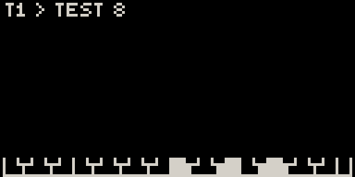
  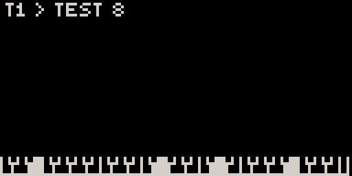
- **Note length** — **hold step A, then press step B** to set A's length up to B.
- **Loop / bars** — the **Loop** button turns the step row into a bar selector;
  **Left/Right** navigate bars. See [The Loop view](#the-loop-view) below.
- **Duplicate / delete** — **Copy** and **Delete** (a.k.a. Clear) act on steps,
  clips, or bars depending on context. **Hold Clear + a drum pad** wipes that
  pad from the whole clip — one lane emptied without touching the others,
  wherever its notes fall. A pad that plays nothing (outside the drum grid, or
  a gap in a piano layout) clears nothing.

  A step or bar copy carries **everything on the step**: the notes with their
  velocity and length, the step page's probability, condition and invert, and
  the step's automation. A paste replaces all of it at the destination — a
  plain source step resets the destination's probability and condition too.

  On a **drum track**, copying a step or a bar copies **only the selected pad**:
  its notes, its probability/condition/invert, and the automation on that
  pad's own parameters, the way Move does
  it. A paste replaces only that pad at the destination, and every other pad's
  notes and locks there stay as they were. This needs a drum module that
  declares its pads to Schwung (6W6, 8W8, 9W9, CW-78, simian, dr32, sophie) and Schwung
  1.6.0 or newer. On any other module, or an older Schwung, a step copy takes
  the whole step as before.
- **Quantize** — **Shift + Step 16**. See [Quantization](#quantization).
- **Mute** — press **Mute** on its own to mute the current track; or hold
  **Mute** and press a track button to mute that one instead. Using the
  track-button form suppresses the current-track toggle, so one press never
  mutes two things. In Session view there is no current track, so Mute stays a
  pure modifier there.

  Both forms reach **any of the 16 tracks**. The track buttons address the
  focused group, so **+ / −** scrolls that quartet to the one you want. To skip
  the scrolling, use the step row: **hold Mute and the 16 steps become a mute
  map** — step 1 is track 1, step 16 is track 16, each lit in its track colour
  and **dim while it is silenced**. Press a step to mute or unmute that track.

  The map appears **wherever you are**: on the melodic or drum pads, in Loop
  mode, while step recording, and in Session view. Whatever the row was showing
  comes back the moment you let Mute go, and a step press that belonged to the
  map never enters a note. In Session view it works whether you latched the view
  with a tap or are just holding **Note/Session** for a peek; muting inside a
  peek does not latch it, so the view still reverts when you let the button go.
  Every form is a **latch**: press again to unmute, and how long you hold the
  button makes no difference.
- **Solo** — the same gestures with **Shift**: **Shift + Mute** solos the
  current track, **Shift + Mute + track button** solos that one, and
  **Shift + Mute + step** solos it from the mute map. Press again to
  un-solo. Solo is **exclusive** — soloing another track moves the solo rather
  than adding to it. **Solo overrides mute**,
  so soloing a track you had muted makes it audible; your own mutes are
  remembered underneath and put back exactly as they were when the last solo
  drops. Solo works by muting everything else, so it silences their *sequenced
  notes* — pads you play by hand on a silenced track still sound. Silenced
  tracks dim their track button like muted ones, and every mute or solo shows a
  toast naming the track (and the whole solo set, e.g. `SOLO T1 T3`). Shift can
  go down before or after Mute — either order works.

  **Seeing what is silenced.** A muted track wears its **dim** colour wherever
  it is drawn: its track button, its step in the track selector and the mute
  map, and its cells in the clip grid. Solo needs no colour of its own — it
  silences the others by muting them, so the map already shows it: one track in
  full colour, the rest dim. In the selector, mute and focus stack rather than
  compete — a muted track in the focused group still pulses, just to its dim
  colour, so the motion reads as focus and the brightness as mute. Clips keep
  their white playing/queued pulse when muted: the track is still running, and
  the grid is where you watch it run. Because only four track buttons are
  visible at once, the **Mute button itself lights bright** whenever anything is
  muted or soloed — the one always-visible cue that something is silent two
  groups away.
- **Per-voice mute and solo** (drum tracks) — **hold Mute and press a pad** to
  silence that one voice; **Shift + Mute + pad** solos it. The track gesture,
  one voice down, and it follows the track rules: latch, exclusive solo,
  solo-overrides-mute, a toast naming the voice, saved with the Set, undoable.
  See [Muting one voice](#muting-one-voice).
- **Automation** — turn a module knob while recording (or while holding a step)
  to record parameter automation; the cell follows the automation.

  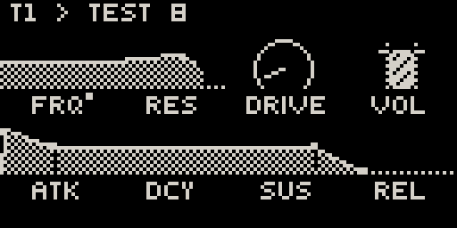

Because Movy keeps the module's parameters on screen during sequencing, some of
Move's full-screen sequencer displays are replaced by **LED feedback on the pads
and step buttons** plus a bar/position indicator and brief on-screen
announcements. The lighting follows Move's conventions (play = green, record =
red, only actionable buttons lit, the playhead sweeps the step row, etc.).

> **Note:** Movy's sequencer intentionally does **not** copy Davebox's timing
> where Davebox deviates from Move — the goal is to match native Move.

### Scenes & Song mode

A **scene** is a column of the clip grid — the same clip slot on all 16 tracks,
not just the four you can see. **Hold Loop in Session view** and the step row
becomes the scene launcher: the eight buttons printed **1, 3, 5 … 15** are
scenes 1-8, and the ones between them are dark because they do nothing.

Loop, not Shift: Shift keeps the [shifted step
shortcuts](#shift--step-shortcuts) here, exactly as in Track view. Loop has
nothing else to do in Session view — there are no bars on the row to select —
so holding it there is a pure modifier and never latches the Loop view.

Pressing a scene launches that whole column. Tracks with a clip there start it
(on the next bar, like any clip launch); **tracks with an empty slot stop** — a
scene is a snapshot of what plays, so what is not in the column goes quiet.

**Building a song.** Keep holding Loop and press more scenes. The first press
of a hold starts a new song; every press after it adds to the end. Press the
same scene twice and it plays twice as long. Let Loop go and the song is what
you pressed — it plays through in order and then **loops**.

Each scene lasts as long as its longest clip, rounded up to whole bars.

**Ending a song deliberately.** A scene with no clips on any track is the **end
of the song**: there is no clip to take a length from, so the arrangement stops
there. Everything goes quiet and the screen adds `END` after the scene numbers —
but the **transport keeps running**, so you are still in time and can launch
straight back in. Put an empty scene at the end of a song and it plays once
through instead of looping. One bar
before a switch the next scene's clips start flashing in the grid, the same way
a clip you have just launched flashes while it waits for the bar. Every scene
the song uses pulses on the step row, so you can see the whole arrangement at a
glance.

The bottom of the screen shows `SONG` and the scene numbers, with the one
playing boxed. It appears as soon as you press Loop in Session view and stays
up while a song is running. A song too long for the row scrolls, keeping the
scene you are on and what comes next in view.

**Ending a song.** Launch any clip by hand and the song is gone — what is
playing keeps playing, it just stops moving on by itself. Pressing Loop and a
scene again starts a fresh song.

Stop and Play restarts the song from the beginning. The song is saved with your
Set.

You can record while a song plays, and the take follows the song into whichever
clip ends up playing on the track you are recording. The one exception is a
take started on an **empty** clip: that is itself a clip launch, so it holds
its own track for that scene while the rest of the song carries on.

### Tracks and groups

Movy sequences **16 tracks**, arranged as **four groups of four**. The four
track buttons and the Session clip grid always address one group at a time —
the **focused** group.

**Picking a track.** In Session view the 16 step buttons become a **track
selector**: each step is one track, lit in that track's own colour. Two markers
sit on top of that, and they can point at different tracks — the **+ / −**
buttons move the group without changing which track is open.

- The **focused group's** four **pulse** between black and their colour, so you
  can see at a glance which quarter of the song you are in. It is the *position*
  of the pulsing block that tells you the group, not just its colour.
- **While you hold Note/Session**, the track you are currently on lights **solid
  white** — still, where everything near it is moving. It is a read-out you ask
  for by holding the button rather than a permanent marker competing with the
  pulse, and it stays visible even after **+ / −** has scrolled its group away.
  Let go, or latch Session view with a tap, and the white goes away.
- **Muted tracks** show their **dim** colour, which is what makes this row the
  place to read mutes: it is the only surface showing all sixteen at once. It
  composes with the pulse rather than replacing it, so a muted track in the
  focused group pulses to its dim colour. Hold **Mute** and the whole row
  becomes a **mute map** — here and in any track view, so you never have to come
  to Session view to silence something. See **Mute** in
  [The sequencer](#5-the-sequencer-aligned-with-move) above.

Press any step to **open that track**: the pads, the screen and the knobs all
switch to it immediately, exactly as if you had pressed its track button. It
behaves like a track button too — a quick **tap** stays there, while **holding**
the step is a peek that returns to Session view when you let go.

**Switching without leaving what you were doing.** **Hold Note/Session** and tap
a step. Movy drops straight onto that track — pads, screen, knobs — but the step
row *stays* a track selector for as long as you hold the button, so you can keep
tapping through tracks and auditioning them. Let go and you stay on the last one
you picked.

**Moving between groups.** In Session view the **+ / −** buttons step the
focused group through the track list: **+** moves towards tracks 1-4, **−**
towards 13-16 — the direction the grid reads on screen, not the direction the
group numbers count. They are dim while there is a group to move to and
dark at either end, the same way the arrows behave elsewhere. Moving the group
does not change which track is open — it re-aims the four track buttons and the
clip grid so you can reach the next four.

**Track colours.** Colours are chosen so the four tracks within a group are easy
to tell apart *and* so the same position in different groups never looks alike.
That takes eight colours, not sixteen: a colour reappears in another group, but
never in the same row or the same column, so two tracks you can see at the same
time never share one. Eight well-separated colours is also all this hardware
offers — the pale and cool ones wash out to white next to the lit in-scale pads.

**Every track hosts its own instrument.** Load a module onto one exactly as you
would on a track button track, and movy hosts the whole chain itself.

Two things worth knowing:

- **Move's mixer sees every track as one channel.** Movy sums them into a
  single stereo output, so their levels are movy's own — the Move fader does
  not reach them individually, and Movy saves them in the set itself. Set them
  with **Shift + hold track + volume encoder** — ⚠️ on tracks 5-16 the plain
  gesture *without* Shift does not work yet and moves Move's master volume
  instead, so use Shift there; tracks 1-4 take either.
- **They sound only while movy is open** — movy is what renders them.

Their modules and settings are saved with the set, so a track comes back the
way you left it.

### The Loop view

A clip's **loop window** is the range of bars that actually plays. It does not
have to start at bar 1 — you can loop bars 3–4 of an eight-bar part and leave the
rest in place, untouched, ready to come back to.

**Loop** shows the window on the step buttons: tap it to latch the view, or hold
it for a momentary peek. While it is up, the step row is a bar selector:

| Gesture | Result |
|---|---|
| Press a bar | View that bar (the step row follows) |
| **Double-tap** a bar | Loop just that bar |
| Press **two bars** | Loop the range between them, inclusive |
| Hold **Loop** + jog | Grow or shrink the loop by whole bars |
| **Shift + Step 15** | Double the loop — notes and length (hold it for [Smart Double](#smart-double-shift--hold-step-15)) |

Setting a window brings the view with it, so you are never left editing a bar
that has just stopped playing.

**What the bar LEDs mean.** Every bar that matters fades in and out against black,
all of them in step with each other, and the colour tells you which is which:

| Bar | Appearance |
|---|---|
| Playing now | Green, pulsing |
| Selected (the bar on the step row) | White, pulsing |
| In the loop | Track colour, pulsing |
| Outside the loop | Near-black, steady |

The pulse comes from the hardware, so it keeps breathing while the transport is
stopped — which is exactly when you are looking at these.

Whether a bar contains notes is deliberately *not* shown — in this view a bar's
job is to tell you whether it plays. Press it to see its notes on the step row.

**On screen**, the clip's notes fill everything above the bar strip, like a
folded piano roll: only the pitches the clip actually uses get a row (lowest at
the bottom), so a four-note bassline gets four fat rows and a chord part as many
rows as it has notes. Time runs left to right over exactly the bars of the strip
below, so each bar of notes sits over its own segment, and a line sweeps across
both at the play position. The knobs do nothing while the notes are up.


When there are more notes than pixels, the view folds them rather than dropping
any: with more than 30 pitches, neighbouring pitches share a row; every note
keeps at least one pixel; and where several notes land on the same pixel the row
is drawn **hatched** instead of solid, so a run of fast hi-hats never looks like
one long note:

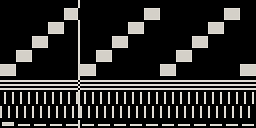

Recording shows up live: a note you are still holding grows across the screen
with the playhead, and when a first take auto-extends the clip, the view
re-spreads itself over the new bars.

The strip along the bottom draws one segment per bar of the loop — thick for
the selected bar.

Navigating past the end of the loop shows a **`+`** for the empty bar you have
stepped into. Add a note there and it becomes part of the loop, so a part grows
by simply playing into the next bar:


### Quantization

Quantization in Movy is a **value, not an action**. Every clip carries a
strength from 0 to 100 %, applied as notes are played rather than by rewriting
them, so the timing you recorded is never destroyed and you can dial it back at
any time.

- **0 %** — the take plays exactly as you played it.
- **100 %** — every note lands dead on the step grid.
- In between, notes are pulled toward the grid by that fraction. 60–80 % tightens
  a take without flattening the feel out of it.

**Shift + Step 16** cycles the current clip through **0 % → the set default →
100 %**, and shows the choices for a moment. In Track view it cycles when you
**let go** of Step 16: **holding** it instead starts
[Smart Quantize](#6b-generators-smart-quantize--variation). `DEF` marks the default:

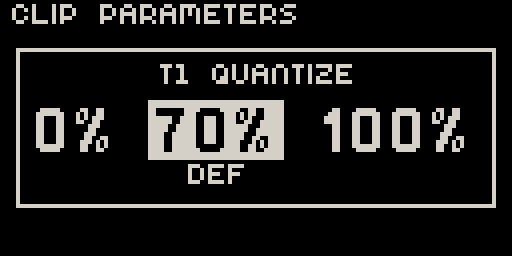

While the panel is up the **jog** picks between the same values, and **Back**
closes it. Playing pads or entering steps does not disturb it. When the default
is already 0 or 100 there are only two values to cycle.

For anything other than those three, **QUANT** on the
[Clip page](#clip-parameters--shift--step-3) sets the clip directly:


**QUANT** on the [Set page](#set-parameters--shift--step-5--7--9) sets the
**default** — the strength new clips are created with, so a take you record gets
your preferred tightness immediately. Changing it never re-times clips that
already exist; each clip owns its own value from the moment it is created.


The default follows you into **new sets**, so it is a preference you set once
rather than per project. Clips from sets made before this existed load at 0 %,
so an older set sounds exactly as it always did.

Notes entered on the step buttons are already on the grid, so quantization has
no effect on programmed patterns — only on what you play in. **Swing is
independent**: it applies at full strength whatever the quantization is.

### Step recording

Hold **Rec** while the transport is stopped and play the pads: each note lands
on the record head and the head moves on. Nothing is timed, so a phrase you
could never play in real time goes in as fast as you can find the notes. It
works the same on melodic and drum tracks.

Notes that overlap land on the **same step** — hold a chord and it is entered as
a chord; the head only advances when the last finger lifts. Tap notes one at a
time and each gets its own step.

While Rec is held:

| Control | Action |
| --- | --- |
| **Pads** | Enter notes at the head. |
| **Right** | Leave a rest — or, with pads held, **tie** the chord into the next step. |
| **Left** | Step back: the note there plays and its pads light, ready to be replaced. With pads held, **untie**. |
| **Step button** | Jump the head there; if that step had notes, it is cleared. |
| **Release Rec** | Done. |

The head blinks red on the step row and the screen shows the position and the
notes under it, with the module's parameters still visible underneath — so you
can keep tweaking the sound while you enter the part. The **Left/Right arrows
blink** while they are worth pressing: Right always, Left once there is a step
to go back to or a tie to undo.

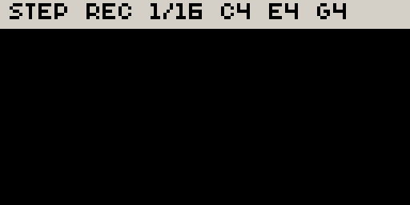

On an **empty clip** the clip grows to exactly what you play, one step at a
time, rests included — play seven notes and you get a seven-step clip. On a clip
that already has notes the head **wraps** at the end and overwrites, leaving the
length alone.

Entering notes **replaces** what is on the step on a melodic track, so stepping
back and replaying overwrites cleanly. On a drum track pads only **add** their
own lane, so you can lay the kick down in one pass and the snare in the next.

A quick **tap** of Rec still arms live recording as before — only holding it
starts step recording.

### Capture — keep what you just played

Movy is always listening. Everything you play on the pads while that track
isn't recording goes into a buffer, so when something comes out right you can
keep it after the fact: press **Capture**. The Capture button is lit whenever
there is something buffered worth keeping.

Capture writes into the **current track's current clip**. What happens depends
on the transport:

| Transport | Clip | What you get |
| --- | --- | --- |
| Playing | empty | The phrase you just played, keeping the tempo and the beat you played it on, with the clip grown to whole bars around it. It falls in **on the bar**, like any other clip launch, so it lines up with your other tracks. |
| Playing | has notes | An overdub: each note lands where you heard it, and the clip keeps its length. |
| Stopped | empty | A new take — Movy reads a tempo off your playing, sizes the clip, and starts the transport so you hear it at once. With no transport running there is no beat to hold on to, so here the first note you played *is* the start of the clip. |
| Stopped | has notes | The take is fitted to the tempo you already have (see below). |

After a **stopped** capture the screen shows what happened and stays until you
press something:

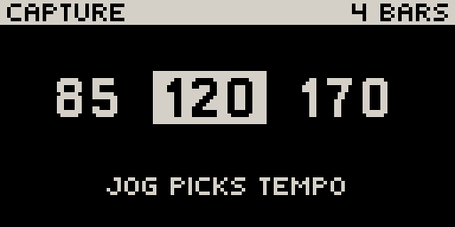

Three tempos, the applied one boxed. **Turn the jog** to take another — it is
applied as you pass it, and the transport keeps rolling, so you can hear which
one fits. The bar count in the corner follows: the same performance is more bars
at a faster tempo, and it always plays back at the speed you played it. **Any
button, pad or knob closes the overlay.**

When the tempo isn't Movy's to set — because Move is clocking us, or because
you captured into a clip that already has notes — there is nothing to choose,
and the overlay explains the fit instead:

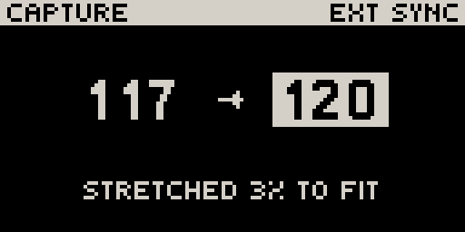

Movy still reads a tempo off your playing, then stretches the take onto the
tempo you have. It picks whichever reading is closest, including half and double
time, so the stretch is always the smallest one available — a phrase played at
58 BPM against a 120 BPM set is fitted through 116, not doubled.

**What clears the buffer.** Capture keeps what you played while you were *just
playing*, so anything that means you have moved on empties it — the Capture
button goes dark when it does:

- **Play or Stop**, and **pressing a track button**.
- **Playing over a spot you already covered**, once the loop has come round —
  that means you are redoing that part, so the earlier pass goes and Capture
  takes the one you just played. Notes that land somewhere new keep
  accumulating, so a phrase that runs across the loop end stays whole.
- **Any deliberate edit** — arming Rec, entering or editing steps, changing the
  clip length or loop, launching or deleting a clip, editing automation.
- **Switching to Session.**
- **Time**: a couple of bars of silence, and in any case only the last
  **8 bars** of playing are ever kept. Without that ceiling, playing without
  pausing for a minute would capture the whole minute.

To throw it away by hand, hold **Clear** and press **Capture**.

> **Not Shift + Capture.** Move clears the input that way, but on Schwung that
> combo belongs to the skip-back recorder and never reaches Movy — you would see
> "skipback saved" and the buffer would still be full. Hold **Clear** instead.

> **Not captured:** knob moves. Move captures automation too; Movy captures
> notes only. Record automation live instead (see the sequencer list above).

### Saving — there is no Save button

Movy saves by itself, and there is deliberately nothing to press. Your
sequence, tempo, swing, automation and the Set-page settings (tonic, scale,
mode, layout, per-track octave, mutes) are stored **per Set**, so every Set
recalls its own Movy project.

Saving happens a few seconds after you stop changing things, when you switch to
another set, and when you close Movy — so leaving immediately after an edit
keeps it. Nothing is written when nothing has changed.

Each set keeps a couple of rotating backup copies of its sequence alongside the
main file. If the Move loses power or a crash interrupts a save, Movy detects
the damaged file on the next load and falls back to the newest intact copy
rather than opening a blank template. Sets saved by older Movy versions load
normally.

The instruments on each track, their settings and the master chain are saved
with the Set too.

---

## 6. Beyond Move: Step, Clip & Set parameters

These three pages add control Move doesn't expose on-device. Each opens with a
**Shift + Step** combination (or, for step parameters, by holding a step).

### Step parameters — per-trig locks

**Hold a step** that has a note. While held, **page 0** becomes the **Step**
page, showing that trig's intrinsic properties on the knobs:


| Knob | Parameter | Notes |
| --- | --- | --- |
| 1 | **VEL** | Velocity for this trig. |
| 2 | **LEN** | Note length. |
| 3 | **PROB** | Probability the trig fires (0–100%). |
| 4 | **COND** | Trig condition (e.g. `2:3` = fire on the 2nd of every 3 cycles). |
| 5 | **INV** | Invert — flips the condition. |

This is Movy's take on Elektron-style **parameter locks**: a per-step,
per-parameter override. (While a step is held, jog/Left/Right can still roam the
module pages so a single held step can automate across the chain.)

Turning a module knob while a step is held **writes a lock for that step only**:
the sound you hear now does not change. The locked value plays when the
sequencer reaches that step, with the transport running. The cell shows the
step's locked value, including any graphic (envelope, filter) that covers it.
Recording automation live (Rec + Play) is different: there you hear the turn as
you make it.

**Choices and switches can be locked too** — a filter type, a waveform, an
on/off. On a held step each knob detent moves **one option**, and the cell shows
the option the step will play:

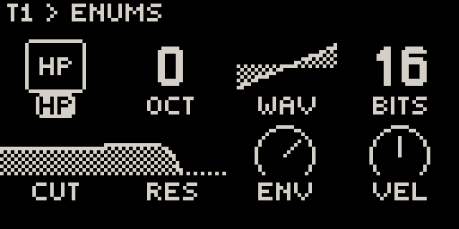

Each track has **32 automation lanes**, one per parameter you lock or record.
When all 32 are taken, a held step only offers the parameters that already have
a lane, and says `32 AUTOMATION LANES — FULL`. A step's locks are applied before
its note — also for a note nudged early and for the first step after Play — so a
drum voice that takes its sound at the hit plays the locked value on that hit.

**On a drum track a lock belongs to the pad you locked it on.** A knob on a
pad's page is that pad's parameter, even on a rack whose page edits "the
selected pad": the lock plays on that pad only, and its value and lane mark show
on that pad's page, whichever pad you press next.

**Hold Clear and touch a knob** to delete that parameter's whole automation
lane. A `<param> lane cleared` prompt confirms it, and the lane's mark next to
the label goes away.

### Clip parameters — Shift + Step 3

In Track view, **Shift + Step 3** opens the **Clip** page for the active clip:


| Knob | Parameter |
| --- | --- |
| 1 | **SCALE** — the clip's musical scale. |
| 2 | **LEN** — clip length in steps. |
| 3 | **TRANS** — transpose. Reads `n/a` on a drum track (see below). |
| 4 | **QUANT** — [quantization strength](#quantization) for this clip, 0–100 %. |

(Clip parameters apply to a single clip, so this page is Track-view only.)

On a **drum track**, transpose is unavailable — the cell reads `n/a` and the knob
does nothing.

A drum module's pitches are pad addresses, not notes, so shifting them fires a
different pad — or, if the shift lands outside the module's pad range, nothing at
all. The sequencer ignores clip transpose on those tracks, including for a clip
that already carried one from before a drum module was loaded onto the track.

### Set parameters — Shift + Step 5 / 7 / 9

**Shift + Step 5, 7, or 9** opens the global **Set** page:


| Knob | Parameter |
| --- | --- |
| 1 | **TEMPO** |
| 2 | **SWING** |
| 3 | — (LINK to Move's transport, in Movy 0.35 and earlier) |
| 4 | **QUANT** — the [quantization](#quantization) new clips are created with |
| 5 | **ROOT** — the tonic's pitch class |
| 6 | **KEY** — scale |
| 7 | **MODE** — Chromatic or In Key |
| 8 | **LAYOUT** — the pad grid's shape |

KEY, MODE and LAYOUT are lists: turning shows the options as you go, and a jog
click opens the whole list as a menu.

MODE and LAYOUT are covered in [Pad layouts](#pad-layouts).

These are set-wide (they affect all tracks).

Press **Back** to close any of these pages and return to where you were.

The Clip and Set pages sit **side by side, not stacked**: opening one while the
other is up *replaces* it, so a single **Back** always leaves for the view you
started from — never for the other page. Switching tracks or going to Session
view closes them as well, so neither page follows you around.

### CPU meter — Shift + Step 12

**Shift + Step 12** opens the **CPU meter**: one column per track over a bar for
Movy's share of the audio block. **Back** closes it. Pressing **Shift + Step 12** again
while it is open clears the held peaks and starts a fresh observation. Like the
other page shortcuts, step 12 lights dim while Shift is held and full bright
while the page is up.


The bar under the header is Movy's **budget** for one audio block. The fill is
how much of it Movy used; the notch above the bar is the worst single block
since the page opened, held for as long as the page stays open. The percentage
in the header is the same number, and it is *not* capped.

**100 % is the edge, not the ceiling.** It is calibrated against what actually
happens on the device: dropouts set in at around 70 % of the raw 2.9 ms block,
so that is what the bar calls full. Two things account for the rest. Move's own
engine takes about 240 µs of the same block. And this bar is an *average* over
blocks, while a dropout is one block missing its deadline — so an average
sitting at the raw block length would have been glitching for a long time
already. The notch is the block that gets there first; if it is near the end of
the bar, listen for it.

Practically: **under 80 % is comfortable, near 100 % you are at the edge, over
it you are hearing it.**

Each column is one track. The scale starts at **1 ms per block** and stays
there for any normal set, so a column means the same thing from one session to
the next — but if a track goes past it the whole plot re-scales to fit, and the
number at the bottom right tells you what a full-height column is now worth. It
only ever grows while the page is open; re-press **Shift + Step 12** to start
over. The row of dots across the plot marks **1 ms**: it sits at the very top
while the scale is at its floor, and drops as the scale grows, so the gap above
it shows at a glance how far the plot has been squashed. Tracks 1, 5, 9 and 13
are labelled; the rest count across from them.

The scale follows the **bars**, not the peak lines. Loading an instrument costs
several milliseconds in one block, and letting that single spike set the scale
would flatten every real column for the rest of the viewing. A peak taller than
the plot therefore clips, and its column is capped with a detached line to say
so — the same bargain any level meter makes.

| What you see | What it means |
| --- | --- |
| A solid bar | The instrument |
| Checkered on top of it | The effects after it |
| A solid bar with no checkering, even with FX loaded | A module that can't be split into a synth stage and an effects stage — it draws as one undivided bar |
| A dotted line above the bar | The worst block that track has had since you opened the page |
| A solid line across the top with a gap under it | Something on that column is off the top of the plot — usually a one-off spike in its peak, which the scale deliberately ignores (see below) |
| A short dash just above the baseline | Loaded, but silent right now, so Movy is skipping it entirely. Its peak line is still drawn — a track that spiked and then went quiet is exactly what you came here to find |
| Just the baseline | Nothing loaded |

#### Send buses

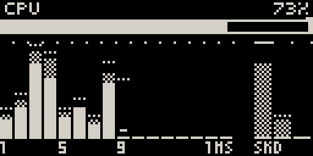

As soon as any **send bus** holds an effect, three more columns appear at the
right of the plot under **SND**, one per send. The track columns narrow to make
room, and the tracks lose their `13` label — the scale, which moves to the right
of the track columns, is the more useful number of the two. A set that uses no
sends draws exactly the plot it always did.

The send columns are always all three, in bus order, whether or not each one has
an effect in it — so a bus keeps its place as you load and clear its neighbours.
They read on the same scale as the tracks, so you can compare a reverb against
the instrument feeding it directly, and a heavy send lifts the whole plot the
same way a heavy track does.

A send is an effect pass over a buffer every track has already contributed to,
so its column is checkered all the way up: there is no instrument stage to
draw. And because a bus only runs when something is feeding it or its tail is
still ringing, a send you have stopped playing into drops to a **dash** —
loaded, costing nothing this block — with its peak line still showing what it
cost when it was working.

The send phase has always counted towards the bar and the percentage at the top;
these columns just show you which bus the time went to.

#### A module that reads as free

A few modules do their synthesis in a **separate process** and hand Movy
finished audio through a shared buffer — **Virus** is the one instrument that
works this way, and the streaming modules (Radio Garden, AirPlay, Web Stream,
StreamRTSP) do too. Their column shows almost nothing, because copying that
audio out really does cost Movy almost nothing.

They are not free. The work is happening on another core, in another process,
where Movy cannot see it — so a set of six Virus tracks can run the device out
of CPU while every column on this page still looks empty. Treat a
suspiciously-empty column on a module you know is heavy as "measured elsewhere",
not as "costs nothing".

#### Chains rendering side by side

Expect an individual track to read **higher** than it would rendering alone —
around a quarter higher — while the bar at the top reads much *lower*. That is
not a bug: several chains rendering at once cost each other a little, and the
whole point is that they are running side by side instead of one after another.
The bar is the number that decides whether you get dropouts; the columns are for
finding which track is expensive.

---

### Sets — Shift + Step 1

Movy keeps **its own Sets**, separate from Move's Set pads.

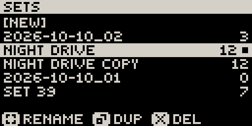

**Shift + Step 1** opens the list. **[NEW]** comes first, then your Sets,
newest first. A duplicate sits directly under the Set it was copied from. The
number on the right is the Set's clip count (it is left out when the name needs
the room), and the **dot** marks the Set that is open.

| Control | Action |
| --- | --- |
| **Jog** | Move the cursor. **Shift + jog** jumps eight rows. |
| **Jog click on [NEW]** | Make a new, empty Set named for today (`2026-10-10_01`, `_02`, …) and open it. |
| **Jog click on a Set** | Open it. The page closes and the Set loads. |
| **Capture** | Rename the Set under the cursor, with Schwung's on-screen keyboard. A Set still named for its date opens the keyboard on a suggested name instead (*Velvet Echo*, *Paper Moon*, …), never one another Set already has: **OK** keeps it, or edit it first. **Back** leaves the name as it was. |
| **Copy** | Duplicate the Set under the cursor as "*name* Copy". The copy carries the Set as it is right now, not its backups. |
| **Delete** | Delete the Set under the cursor. It asks first: **jog click** deletes, **Back** cancels. |
| **Back** | Close the page. |

Capture, Copy and Delete are lit dim while the cursor is on a Set, and dark on
**[NEW]** or while a delete is waiting to be confirmed. While the keyboard is
up only **Back** stays lit: the keyboard takes every other control.

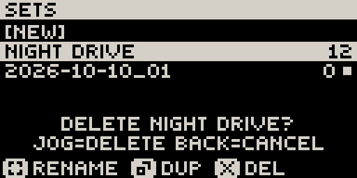

Deleting the open Set opens the one below it first (or a new one, if it was
your only Set). A deleted Set is moved to
`/data/UserData/UserLibrary/Movy/Trash/`, not erased, so it can still be
recovered by hand.

**Your existing Sets come with you.** The first time Movy opens as a
standalone app it migrates every Set from Move into its library, once:

- **Every set page.** Sets parked on any of Schwung's eight set pages come
  across, not just the page Move was showing. Each keeps its Move name
  ("Set 1", "Set 2", …). When two pages each have a "Set 1", the one on the
  lowest page keeps the plain name and the others say their page: `Set 1 P3`.
- **Schwung tracks become Movy tracks.** Instruments and effects that tracks
  1–4 held in Schwung's slots, with their level and LFOs, land on Movy's
  tracks 1–4. A Set whose tracks a Schwung-era Movy had already moved, or a
  track Movy already holds, keeps what Movy has. Schwung's master chain becomes
  Movy's master. A Schwung effect that was **bypassed** is left out, so the Set
  sounds the same. The same goes for a third audio effect, which has no place on
  a Movy track. An effect with no saved preset comes up at its defaults.
- **Older Movy storage** — Sets from every earlier Movy, including those that
  kept their tracks in their UI file — is converted to the current format.
- Sets that only ever existed on an unsaved Move pad come across as
  **Recovered** *date*. A Set you deleted in Move is not brought back, and
  neither is one with nothing in it (no clip and no module).

Nothing is taken away: the originals stay where they were, so Move and
Schwung still open them exactly as you left them (edits made since then live
only in Movy's library). The migration runs **once**; Sets added to Move later
are not picked up on their own, and one you delete in Movy does not come back.
To run it again, see **MIGRATE FROM MOVE** under [Settings](#settings--shift--step-2).

**Empty Sets are not kept.** A Set with no clip and no module is never saved,
and when you switch to another Set it disappears from the list (into
`Movy/Trash/`). Tempo, scale and other settings on their own don't make a Set
worth keeping. While an empty Set is open it stays listed, so if you turn Move
off on it, Movy opens it again next time.

The library lives in `/data/UserData/UserLibrary/Movy/`, outside Movy's
module folder, so reinstalling Movy keeps it. The Set that was open when you
left reopens next time.

### Settings — Shift + Step 2

**Shift + Step 2** opens **Settings**, a scrolling list rather than a knob page:
the **jog** moves the selection, a **jog click** opens or runs the selected
row, **Back** closes it. The line at the bottom explains whichever row is selected.
Step 2 lights dim under Shift and full bright while the page is open.

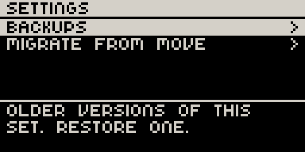

**CLICK VOLUME**, the first row, is how loud the metronome (and the count-in)
clicks. **Turn knob 1** to change it: each detent is 1 dB, from **0 dB** (the
level it has always had, and what a new install uses) up to **+11 dB**, the
loudest the click can be without clipping. Every turn plays a click so you hear
the new level. It is a property of this device, not of a Set, so it stays put
across Sets and restarts. (On top of other loud audio the mix can still limit;
the click itself never clips.)

**GENERATORS**, the second row, sets how bold the
[generators](#6b-generators-smart-quantize--variation) are: **SAFE**,
**BALANCED** or **WILD**, with **knob 1**:

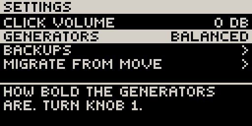

**MIGRATE FROM MOVE**, the last row, runs the migration from Move again. The
first jog click arms it (the row reads **CONFIRM?**, and moving off disarms
it), the second runs it. The hint below shows when the migration last ran. It
**replaces every Set that came from Move** with a fresh copy, under its Move
name, and brings back one you had deleted. Each replaced Set's previous state
is kept in its **BACKUPS** first, so a mistaken run can be undone Set by Set.
Sets you made in Movy, including copies of migrated Sets, are never touched.
If the open Set is replaced, it reloads. A Set from Move that now has nothing
in it is moved to Trash instead, unless it is the one open.

Movy always renders its chains on several threads and always skips chains that
are silent. Together those are worth roughly 2× on a heavy set — the difference
between a big set staying inside the audio frame and crackling. There is
nothing to turn on or tune; the **CPU meter** (Shift + Step 12) is where you
see what it buys you.

---

## 6a. Undo & redo

Press **Undo** to take back the last edit; **Shift + Undo** redoes it. An
overlay names what changed, where, and which way — the value on the right of
the arrow is what it is *now*, so the same reading works for both:

    UNDO                    REDO
    CUTOFF                  CUTOFF
    T1: 0.31 -> 0.42        T1: 0.42 -> 0.31

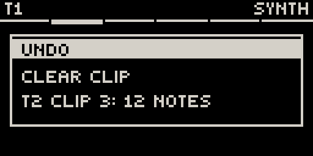

**What's undoable.** Everything that changes the music: notes and steps, clip
clear / delete / copy / paste / duplicate, clip scale, length and transpose
(each its own undo, committed when you let the knob go), loop length and start, per-step trig
properties, automation (locks, lane values, clearing a lane or a step),
tempo, swing, root and key, track mute, solo and volume, synth and LFO
parameters (master FX included),
LFO assignments, and module or preset loads.

**What isn't.** Anything that only changes what you're looking at — selecting a
track or clip, moving between bars or pages, Session mode, the browser — plus
Play, Rec, the metronome, and the keyboard layout. Undo is for edits,
not for navigation or performance.

**How edits are grouped.** One gesture is one undo, not one undo per detent:

- Turning a knob is a single entry however far you turn it, from where the knob
  started to where you let go.
- Each pass of live recording is its own entry — record over two loops and it
  takes two presses to remove both.
- Everything else — a step press, a clear, a paste — is one entry each.

An edit that changes nothing costs no press: turn a knob up and back down
before releasing it and there is nothing to undo.

Undoing a module load brings the old module back **with its settings**, taken
from the module's own saved state — the same snapshot Schwung uses for its
module presets. Adding and removing a module are undoable the same way.

Changing a **preset** is undone the same way, so tweaks you made after loading
it are not lost: undoing returns the module exactly as it was, rather than
re-applying the old preset from scratch. Redoing picks the preset again, which
is what you did the first time.

**What Undo can't reach.** Worth knowing before you rely on it:

- **Octave** (the +/- buttons) isn't undoable — it's treated as a live
  performance control. Root, scale, mute and solo all are.
- **Parameters something else is driving** — one with an automation lane, or one
  a track LFO is modulating — are left out of a module restore. Their on-screen
  value belongs to Movy and the sounding value belongs to the engine, so there
  is no single number to put back. Undo restores everything around them.
- **A module's hidden state.** Undoing a module load restores what the module
  itself reports; anything it doesn't publish — a sample's contents, a parameter
  absent from its list — can't come back.
- **Parameters the module derives** rather than stores will not hold a restored
  value. Movy rewrites them a few times and then leaves them.
- **The oldest edits fall off.** History holds 64 entries (and a memory budget);
  past that the oldest are discarded, and undoing that far back does nothing.
- **A no-op costs nothing.** Quantising an already-quantised clip, or a knob
  turned back to where it started, records no entry — so Undo will name the edit
  before it. That's deliberate.

**Limits.** History lives in memory and is cleared when you switch sets or
close Movy. It holds the last 64 edits. Undoing a module load restores the old
module and its parameters, but anything Movy never sees — a loaded sample's
contents, a parameter the module doesn't publish — can't come back.

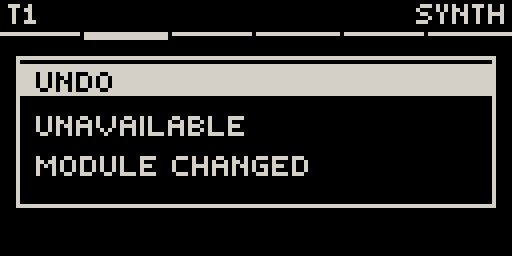

---

## 6b. Generators: Smart Quantize & Variation

Movy's **generators** give you **several takes on one clip** (three from Smart
Quantize, six from Variation and from Smart Double), each grown from what you played. You always see
them before anything changes, alongside your **ORIG**inal. Smart Quantize
starts from the clip you recorded, Variation from another clip already on the
track, and Smart Double from the clip itself, played twice. Only
[New Clip](#new-clip-shift--hold-step-14-on-an-empty-track) writes from
nothing, and even it listens to the rest of the scene.

The takes come from Movy's own generators, on the Move: no key, no network, an
answer in under a second, and every option has **knobs** you can turn to
reshape it (see [The knobs](#the-knobs)).

### Smart Quantize: Shift + hold Step 16

Record something rough, then **hold Shift and hold Step 16**. A tap still
cycles the clip's quantization as before. After a moment a bar fills along the
bottom of the screen, and when it is full the generators run. Let go before the
bar is full and nothing happens, not even the plain quantize. While recording,
in Session view or while a Set loads, no bar appears and a press of any length
just cycles quantization:

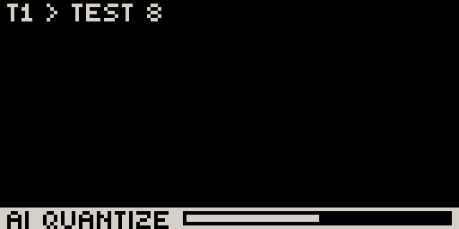

The six options go from careful to bold. Option 1 is always the tightest:
your notes on the scene's groove, with only the wrong notes moved. The others
**develop** or **mutate** the clip, because Smart Quantize is not only a fixer.
Every one of them starts from your clip as you played it, on the grid with its
wrong notes put right, and changes one thing about it; nothing is written from
scratch. They come from these generators, picked for your clip:

| Generator | Melodic tracks | Drum tracks |
| --- | --- | --- |
| **TIGHT** | Timing onto the grid and the scene's pocket; clashing notes moved to ones that fit. | Timing onto the grid; doubled hits and flams cleaned. Every hit on its pad. |
| **TIDY** | Tight, plus accidental doubles and grazes removed, velocities and lengths evened. | The same for drums. |
| **GROOVE** | The scene's swing and pocket, or a groove FEEL (laid back, pushed, shuffle, drunk 16ths), with accents. | The same for drums. |
| **SHAPED** | Chords filled out and voice-led; a line's stray octave leaps folded back. | |
| **EMBELLISH** | Grace, passing or neighbour notes, the way a player adds them. | |
| **ANSWER** | The second half answers the first, moved through the scale. | |
| **GHOSTS** | | Ghost notes where the groove leaves room. |
| **FILL** | | A small fill into the loop point. |
| **MUTATE** | Some notes moved a scale step or more (STEPS), weak beats first; past half AMOUNT the strong beats too, onto a chord tone. A chord moves only its top note. SEED picks which. | Some hits moved a 16th or an 8th along (MOVE); the downbeat kick and the backbeat snare stay. |
| **MODE** | The clip in another mode of its key: the parallel one (major↔minor), Dorian, Phrygian, Lydian, Mixolydian, harmonic or melodic minor, Locrian; WHERE puts it on the whole clip, the second half, every other bar or the last bar. Only on a clip playing alone, where no other track's chords would clash. | |
| **INVERT** | The line mirrored in the key around a PIVOT (its first, lowest, middle or highest note): a step up becomes a step down. WHERE as above (lines only). | |
| **OCTAVES** | Off-beat notes thrown an octave up, down or either (lines only). | |
| **RATCHET** | Some notes re-struck as 1/32s, 1/16 triplets or 1/16s over their length, each repeat softer by DECAY; four strikes at most. | Rolls on the hats, the snare or any pad. |
| **SHIFT** | The whole clip moved -4 to +4 sixteenths in the bar, wrapping; KEEP holds the downbeats where they were. | |
| **HUMANIZE** | The opposite of quantizing: timing, velocity and length loosened by LOOSE, VELOCITY and LENGTH, the way a person would play it again. | The same for drums. |

A mutation that moves pitches (MUTATE, INVERT, OCTAVES) moves a note off any
semitone rub it makes against the other tracks.
| **FULL** | All of the above at once, on eight knobs. | All of the above at once, on eight knobs. |

### Variation: Shift + hold Step 14

You have an A part and want a B. Select a clip slot on the track, **empty or
not**, then **hold Shift and hold Step 14** until the bar along the bottom of
the screen is full, just like Smart Quantize. A tap only shows `HOLD TO
GENERATE`, so a stray press never runs anything. Step 14's light is dim white
under Shift. On a track with no other clip to vary from, the same hold makes a
[New Clip](#new-clip-shift--hold-step-14-on-an-empty-track) instead.

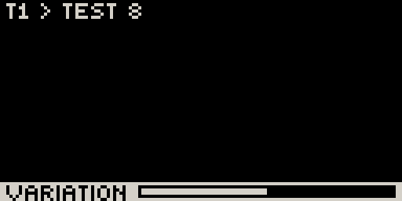

The variation grows from the nearest clip **above** the slot (or below, if
there is none above), keeps that clip's playback speed, and takes its length
too, unless the slot already has a clip. In that case it replaces that clip at
the same length, and ORIG gets it back.

Variation offers **six options**, chosen from some thirty
generators for the part you are varying: the ones that suit it (a chord part
gets chord generators, a bass line bass ones) and that differ enough from each
other. They are shown closest first, and **switching options shows the
generator's name** at the top of the screen. The generators come in three
groups:

| Group | Melodic generators | Drum generators |
| --- | --- | --- |
| **Close** | NEXT CHORDS (the rhythm kept, new notes from the new chords), FOLLOW (the whole part slid along the new roots, the way dub and house chords move), PULSE (the rhythm on each chord's root), HARMONIZE (a line in parallel thirds or sixths), RE-VOICE, NEW LINE, ANSWER, SPREAD, ARP, DRONE MOVE | KICK, HATS, GHOSTS, FILL |
| **Rhythm** | BASSLINE (a new bass figure over the chords: offbeat, rolling, octaves, 3-3-2, gallop…), DISPLACE, ANTICIPATE, CONNECT (passing notes and suspensions), RECOMBINE, EUCLID, COMP (chord rhythms, on the same map of comps as New Clip's CHORDS), OCTAVE BASS, WALK, THIN | SHIFT, TURNAROUND |
| **Experimental** | STYLE (a new part in the source's own language, learned from it), LOOPER (a locked loop that mutates, after the Turing Machine), FORM (the part as a phrase: AABA, call and response…), MOTIF (a cell as a sequence), RETROGRADE, HALF/DOUBLE, ORNAMENT, REGISTER, PEDAL, DEVELOP (eight knobs) | STYLE (a new pattern learned from yours), FORM (your bar with a fill, a breakdown or a new bar as its answer), FEEL (half time, double hats), GRIDS (a map from your pattern to the genres' patterns, after Mutable Instruments' Grids), EUCLID, DEVELOP |

GENERATORS (below) sets how many come from each group. Each generator is
also tried with its feel moved two ways (another rhythm, more or fewer voices,
longer or shorter notes, more chord changes), and after the closest option
every next one is the take that fits well **and** differs most from those
already chosen, in rhythm, notes, density, register, lengths and loudness.

**Every option keeps the track's role.** Movy measures what the source clip is:
a drone, a pad, chord stabs, a bass line, an arpeggio, a melody or a drum
pattern, with how many notes it plays at once, how long they are, how many
onsets and in what register. Any option that breaks it is left out, so chords
never come back as an arpeggio and a held drone never as a melody. Drums never
change pads; only where and how hard they play.

**No option is the same loop again.** An option that is one of the track's
clips with its bars swapped or rotated, or transposed as a whole, is left out,
and so is an option that is a near copy of another. A melody moved through the
scale (a sequence) is a new line and stays.

### Smart Double: Shift + hold Step 15

A tap on Shift + Step 15 doubles the loop, a copy of its notes after
themselves. **Hold Shift and hold Step 15** instead, and the clip doubles with
an **ending**: the second time round it leads back into the top of the loop
the way a player would, with a turnaround, a fill or a pickup. Everything before
the ending is your clip exactly as you played it, so the first part stays yours.
The tap now doubles on **release**, so a hold can grow into Smart Double; in
Session view a tap still doubles straight away.

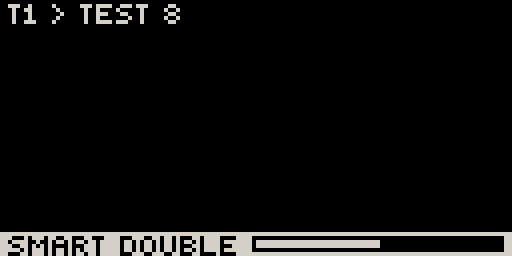

Smart Double needs room: a loop already longer than 8 bars cannot double, and the hold does
nothing there. It doubles the loop window, so the new clip starts at bar 1. The
six options are never the plain double (a tap is that), and ORIG puts back the
clip at its old length.

| Group | Melodic endings | Drum endings |
| --- | --- | --- |
| **Close** | TURNAROUND (the ending's notes step into the clip's first note: from BELOW, ABOVE, an ENCLOSURE or CHROMATIC), CADENCE (the ending lands on the ROOT, FIFTH, TONIC or DOMINANT and holds it) | FILL (snare, toms or both, rising), PICKUP (your pattern kept, one to three hits leading into the downbeat) |
| **Rhythm** | PUSH (the ending a 16th to a beat early, the first note anticipated), RUN (a run UP, DOWN or ARCHed into the first note, in 8ths, 16ths or triplets, on the scale, the chord or chromatic), ECHO (the figure before the ending, or the clip's opening, again moved through the scale) | ROLL (a snare roll in 8ths, 16ths, 32nds or accelerating, with a crescendo), REPEAT (the slice before the ending repeated through it, fading: a beat repeat) |
| **Experimental** | STYLE (the ending written new in the part's own language), STOP (the part drops out, holds or stabs, then picks up into the top), TURN (the ending over a chord that leads back: V7, IV, the tritone substitute, or a Tonnetz R, L or P; only when no other track sets the scene's chords), EVOLVE (the whole second half answers the first over new chords: the first half's progression moved by a sequence, a Riemann turn, a substitute or a borrowed chord, picked with MOVE, so two chords in bar 1 become two new ones in bar 2; PHRASES on EACH gives every phrase of the answer its own development, and opens there when the first half already repeats itself, so a long clip moves through more than four chords; only when no other track sets the scene's chords, and in a scene with a bass or lead alone only the moves that fit it) | BREAK (the ending drops to the kick, the snare, the hats or nothing, with one hit back in), STYLE (the ending walked new from your pattern) |

Every Smart Double generator has an **ENDING** knob (half a beat to two bars,
never more than half the clip; it opens at about a quarter of it) and most have
**SEAMS**: `END` rewrites only the end of the loop, `BOTH` also gives the first
half a shorter ending of its own, a question the second half answers (CADENCE
then ends the first half open, on the dominant). The endings sit on the scene's
chords: TENSION lets their notes reach further, and only TURN changes a chord.

**The double stays in step with the scene.** When another track already plays
a loop the new length fits into (a 2-bar pad under a 1-bar bass you double, or
a 4-bar one), the doubled clip joins it in phase: its first bar plays under the
other track's first bar, even if you doubled while that track was in its second
bar. The endings are written against what the other tracks play at that point,
and **hit with them**: STOP's and TURNAROUND's pickups, the drum PICKUP and
BREAK's hit back in move onto the band's accents near their beat (the
drummer's fill, the chords' push), and RUN plays the notes it shares with the
band a little harder. A quiet hi-hat alone is not an accent.
A tap on Shift + Step 15 does the same. With no such loop playing, the playhead
stays where it was.

### New Clip: Shift + hold Step 14 on an empty track

On a track with nothing to vary yet, **hold Shift and hold Step 14** and the bar
says `NEW CLIP`. When it fills, Movy writes a part for the selected slot from
nothing.

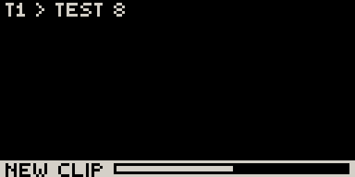

It fits whatever else plays in that scene. The parts take the other tracks'
chords when they spell them out, chords that fit around a bass or a lead when
that is all there is, or one of a set of progressions in the Set's key when
the scene is silent. They pick up the scene's swing, and some of them play on
the band's accents: the bass's WITH KICK pattern, CHORDS and STABS on WITH
BAND, and COUNTER, which answers where the band is quiet. If the slot is
already playing, the new clip lines up with the longest loop in the scene.

**Every run is new.** Each hold rolls fresh defaults, and Movy remembers the
options it offered in the last few runs and passes over anything too close to
them, so holding again on the same Set gives you new parts. Every default is
checked before it is shown: busy enough for its kind of part (a bass at least
two notes a bar, a melody three to twelve), on the chords where it counts, with
some shape. A groove needs a kick on the one and a backbeat or a steady pulse.
Turning a knob back to where it was gives you the same notes again.

**Melodic tracks get eight options**, one per part, always in this order:

| Option | What it writes | Its knobs |
| --- | --- | --- |
| **CHORDS** | Comped chords on a rhythm, voice-led | PATTERN, VOICING, REGISTER, HARMONY |
| **PAD** | Held chords, a new one where the harmony moves or each bar | VOICING, MOTION, REGISTER, HARMONY |
| **STABS** | Short chords off the beat | PATTERN, VOICING, REGISTER, HARMONY |
| **BASS** | A bass figure (offbeat, rolling, octaves, 3-3-2…) or the kick's accents, on a map of every figure | PATTERN, NOTES, OCTAVE, HARMONY |
| **ARP** | Each chord broken up, down, in order… | STYLE, RATE, OCTAVES, HARMONY |
| **MELODY** | A phrase on a contour that answers itself and lands home, on each chord's guide tones | CONTOUR, DENSITY, RANGE, SEED |
| **RIFF** | A short cell repeated through the chords | CELL, NOTES, REGISTER, SEED |
| **COUNTER** | A line that moves where the band leaves room, on each chord's guide tones | RATE, MOTION, REGISTER, SEED |

The knobs that set where a part sits reach past where the takes are drawn,
for a darker or brighter, more experimental colour; a take always starts
inside the usual range:

| Knob | Positions (the takes in **bold**) |
| --- | --- |
| **REGISTER** (CHORDS, PAD, STABS) | DEEP, LOW-, **LOW**, **LOW+**, **MID**, **MID+**, **HIGH**, HIGH+, TOP. Each click opens the chord one inversion higher; it never goes under the band's bass, so with a bass playing the lowest positions meet. Every chord after the first is voiced for the whole loop at once, so the voices move as little as the VOICING allows and the last chord leads smoothly back into the first. |
| **PATTERN** (CHORDS, STABS) | Over 100 positions, a map of every comp the part can play, numbered. Each named figure (quarters, offbeats, dub, house, tresillo, charleston, push, syncopated 16ths on CHORDS; offbeat, house, dotted, 3-3-2, push, sync, skank on STABS), the band's own accents when it has them, and Euclidean figures sit on it whole; each click from one adds or drops a single hit, from one hit a bar up to ten (eight on STABS) and back down through the next figure. So a slow turn morphs the comp hit by hit, and a full sweep passes through every figure. A take always lands on a named figure. |
| **PATTERN** (BASS) | The same kind of map through the bass figures (offbeat, rolling, octaves, root-fifth, 3-3-2, gallop, half notes, walk, pump 8ths), the kick's accents and Euclidean figures, 1 to 12 hits a bar. A named figure plays its own notes (octaves, a fifth, an approach); between them a hit on a strong beat plays the root, the eighths between a fifth or the octave, and the hit just before a chord change steps into the next chord's root. |
| **REGISTER** (RIFF, COUNTER) | BASS, **LOW**, **MID**, **HIGH**, TOP, an octave apart. |
| **VOICING** (CHORDS, PAD, STABS) | How each chord is stacked, from thin to rich: DUO (two notes), **TRIAD**, **OPEN** (a triad spread past the octave), **SHELL** (root, 3rd, 7th), **ADD9**, **SEVENTH**, **DROP 2** and DROP 3 (a seventh chord with one voice dropped an octave), **SPREAD** (root, 5th, 10th, 7th: wide and cinematic), JAZZ (rootless, 3-5-7-9 or 7-9-3-5), QUARTAL (stacked fourths that still hold the chord's 3rd) and NEO SOUL (root, 7th, 10th, 5th, 9th). A 9th, 6th or 11th is added only where the key and the chord allow it; a seventh chord in the progression keeps its seventh in every style. |
| **MOTION** (PAD) | How the voicings move from chord to chord. **SMOOTH** moves the fewest semitones; **TOP LINE** keeps the top note as still as it can; **CLIMB**, **ARCH** and FALL lift, arch or lower the top over the clip; PARALLEL slides one chord shape along the progression, as house and dub chords do. |
| **OCTAVE** (BASS) | DEEP, **LOW**, **MID**, HIGH. |
| **OCTAVES** (ARP) | **1**, **1.5**, **2**, 2.5, 3, 4. A taller arp starts lower so its top stays in reach. |
| **RATE** (ARP) | 1/4, **1/8**, **1/8T**, **1/16**, 1/16T, slowest to fastest. |
| **RANGE** (MELODY) | 4TH, **5TH**, **7TH**, **OCTAVE**, **10TH**, **12TH**, 2 OCT. |

HARMONY picks the progression in a free scene; every option of one run starts
on the same one, so the parts go together, and turning it changes only the
option on screen. A progression changes chord once a bar on clips of four bars
or more. In a scene whose chords are already set, HARMONY has nothing to
change and its knob stays dark.

HARMONY is a map of up to 128 progressions, laid out so that **each click
changes one chord** (now and then two) rather than the whole song. It is grown
from named loops:

- POP, DOO-WOP, CADENCE, II-V-I, VAMP, LIFT, SOUL and TONIC in major; MINOR
  LOOP, DESCENT, CADENCE, DRIFT, VAMP, EPIC, DEEP and TONIC in minor;
- SENSITIVE (vi IV I V), ROYAL ROAD (IV V iii vi), TURNAROUND (I vi ii V) and
  SWAY (I ii, with sevenths) in major; HOOK (i III VII VI), RISE (VI VII i),
  SHUTTLE (i VII) and FALL (i v VI III, with sevenths) in minor;
- three **WALK**s, new each run: four chords (eight on a long clip) drawn in
  the key from how pop and rock songs move from chord to chord (I to IV or V,
  IV back to I, V to vi, ii to V), always leading back to where they started;
- from eight bars up, each loop **+DEV**, where every repeat of its four chords
  answers with a different development (a sequence, a Riemann turn, a
  substitute, a borrowed chord), and the eight-chord CIRCLE, CANON and ROAD
  (CIRCLE, LAMENT and SAGA in minor).

Between them sit loops derived the way tonal harmony is (labelled after the
loop they came from, `POP+3`): one chord swapped for a substitute a third away
(I for vi, IV for ii), or for the dominant or subdominant of the chord after
it. The likeliest, by how songs actually move, are kept. A run opens only on a
named loop.

At the end of the knob is colour from outside the key, for a more
experimental take, again a chord at a time: a secondary dominant (I E7 Am F in
C), its tritone substitute sliding in by a semitone (Dm7 Db7 Cmaj7), a chord
borrowed from the parallel mode (iv, bVI, bVII), and the borrowed loops
MIXOLYDIAN (I bVII IV I), MINOR IV (I IV iv I), BVI BVII, BACKDOOR
(ii7 bVII7 Imaj7) and LYDIAN (I II) in major; DORIAN (i IV), PHRYGIAN (i bII),
HARMONIC (i iv V i), ANDALUSIAN (i VII VI V) and PICARDY (i iv VII I) in
minor. A run never opens on these; you turn to them. Lines written over a
borrowed chord borrow with it: under a bVII in C they walk Bb, not B.

**The parts hear the changes.** A CHORDS, STABS or BASS hit in the last eighth
before a chord change, with nothing struck on the change itself, plays the
*next* chord: the push of pop, funk and house comping, and a bass's
anticipation. MELODY and COUNTER start each chord on its 3rd or 7th (its
guide tones, the notes that tell one chord from the next), moving between them
by the smallest step, and the note just before a change steps into the next
chord's guide tone; between those they keep their own contour.

Knobs 5 to 7 are the same on every New Clip option and knob 8 is DYNAMICS or SPARSE; every run starts them
somewhere new, so the rhythm and the note lengths change from run to run too:

| Knob | What it does |
| --- | --- |
| **GATE** | How much of the space to the next note each note holds: short and clipped at 0, held right up to the next one at `HELD`. Chords, pads included, need not ring for their whole length. |
| **VARY** | Bar to bar, a note may drop out, move a 16th, repeat half way to the next one, or ring longer or shorter. 0 plays the same bar every time; each click varies one note more, the same ones the same way, so turning back gives the take back. Notes that land on the band's accents stay put. |
| **SWING** | Swing on the off-16ths (on the off-8ths for a part that plays no 16ths). It opens at the scene's own swing. PAD has **STRUM** here instead: OFF, then 2 to 12 TICKS (low to high, wider each click), UP 6 and UP 12 (high to low), ROLL (slowing as it goes, like a hand), SLOP (each note loosened in time and level), HARP and HARP 2X (the chord run up through one or two octaves over the first half of the chord). |
| **DYNAMICS** | How much the velocities follow the beat: louder on the downbeats, softer off them. MELODY only; the others have SPARSE here. |
| **SPARSE** | Keeps the pattern you like but plays it only in some places. `ALL` plays everything, and each click plays less, always the same way (nothing is random). The notes that stay are exactly as before. A note just before a beat counts as part of that beat, so a pickup goes with its beat. CHORDS and STABS: `1+3`, `2+4`, `BEAT 1` to `BEAT 4` (if a bar has no chord on that beat, it plays the nearest one within an 8th), `3 IN 8` and `5 IN 16` (beats spread evenly), then bars: `BAR 1 OF 2`, `BAR 1 OF 4`, `LAST BAR`. BASS, ARP, RIFF and COUNTER always keep beat 1 and the first note of every new chord, so you still hear the harmony move: `1+3`, `1+4`, `BEAT 1`, then the bar positions. PAD thins by bars only. Positions that need more bars than the clip has are left out. |

Drum options have **VARY, SWING, DYNAMICS** and **HUMAN** (a few ticks of timing
and some velocity, the way a player is never exact) in knobs 5 to 8. VARY never
drops the kick on the one.

**Drum tracks get seven options.** The first two are **per pad**: PAD EUCLID and
PAD PATTERN write only the selected pad. Press another pad and it gets its own
notes at the same settings, while the pads you already have keep theirs. That
way you build the kit one pad at a time. Knob 1 is **DENSITY**: turn it to 0 to
take the selected pad's notes out again. Each pad keeps its DENSITY when you
move between options 1 and 2. The other five write the whole kit: GROOVE (a
genre's pattern: four on the floor, disco, backbeat, 2-step, breakbeat, half
time, trap, broken beat), **DRUM MAP**, EUCLID KIT, BROKEN (the kick leaning on the band's
accents, the snare pushed late, ghost notes) and PERC (the kit's other voices).
On those, a pad press only plays the pad.

DRUM MAP steers a groove on two axes, as on Mutable Instruments Grids.
**GROOVE** walks through the same genres, from four on the floor to broken
beat, trading one genre's hits for the next one's a hit at a time (the
velocities blend with it). **KICK**, **SNARE** and **HATS** are each voice's
number of hits a bar on that groove: each click adds or drops one hit, the
strongest steps first, so a voice thins or fills without changing its
character. At a genre and its own counts (four on the floor: 4 kicks, 2
snares, 4 offbeat hats) you hear that genre.

**Length.** A new clip is as long as the slot's own loop if you set one
before the hold (Loop Mode works on an empty slot). Otherwise it takes the
longest loop playing in the scene, or one bar. You can change the length
during the preview: press **Loop**, set the bars as usual, and every option is
remade at the new length from its own knobs. The preview stays open, so you
never leave the generator to resize the clip.

### Harmony belongs to the scene

Everything has to sound right together, across tracks and scenes, so the
harmony a Variation uses depends on what the **other** tracks already play in
the target scene:

- **They play chords there**: the option follows those chords exactly. HARMONY
  then changes how the part sits on them: as played, roots only, inversions,
  added 7ths or 9ths.
- **Only a bass or a drone plays there**: the option takes chords that hold
  that note. The closest fit comes first, and a lone bass note is read as the
  root.
- **Nothing plays there yet** (or only drums): the option may **move the
  harmony**, from the A's chords: the progression a 4th or 6th up the scale,
  substitute chords, borrowed chords, a pedal, the parallel mode (and, on WILD,
  a chromatic mediant). Moves that would not lead well into and out of the A
  are never offered.

So each track's B is built on its own, in the order you make them, and the
first track you vary in an empty scene sets that scene's chords for the rest.
The bass or the chords are the best tracks to vary first.

In an empty scene, three moves keep two notes of each chord and move the third
(the Tonnetz): **R TURN** (C to Am), **L TURN** (C to Em) and **P TURN** (C to
Cm). Each changes only the second half of a chord that is held for a bar, so a
slow progression moves without leaving its sound.

### Harmony, not scales

The generators follow the chords your other tracks actually play, not a scale.
A chord tone or a 9th, 11th or 13th always fits. A note outside the key is fine
as a passing or approach note on a weak beat, or as part of a borrowed chord
the scene allows. Smart Quantize's PITCH FIX only moves a note that clashes
with the chord sounding at that moment, not because it is out of key.

New Clip, Variation and a Smart Double's new ending never put a note a semitone
against a note another track is holding: a chord voice moves an octave, a line's
note to the nearest chord tone that sits. A clip shorter than its scene is
checked against every bar it loops under, so a one-bar motif over a four-bar
progression fits all four. New Clip's chords keep above the bass line, at least
a fifth over it, in every REGISTER.

### The knobs

In a preview, **the knobs belong to the option on screen**. Each generator has
its own: four, or eight when all eight are useful. Each option opens with its
knobs already set to the best positions, so you never have to touch them.

- **Turn a knob** and the option is made again from its generator at the new
  position, written over the clip as it plays. One click is one step. A turn
  throws away hand edits on that option.
- **Touch a knob** to see its name and value in the strip at the top of the
  screen, the way a Schwung page shows a held knob:


- **The knob lights show each knob's position**, as on a module's parameter
  page: brighter further right, the dimmest step at a knob's minimum, and off
  where the option has no knob there.
- Each option keeps its own knob positions. ORIG has no knobs, and its lights
  are off.
- A knob that cannot change this particular option shows nothing and does
  nothing. An example is SWING on a pad that only plays on the beat.

A name means the same thing on every generator:

| Knob | Turning right |
| --- | --- |
| **HARMONY** | Further from the source's harmony (see above). In a free scene, the moves that are WILD's own (MEDIANT) or that connect less smoothly with the source come last, past the usual ones, for a more experimental turn; an option never opens on them. |
| **TENSION** | At 5 the take as it comes. Each click up turns a few more of its chord tones into colour tones (9th, 11th, 13th), weak beats first; each click down takes its outside notes back onto chord tones, until only chord tones are left at 0. A position keeps everything the one below it did. |
| **AMOUNT** | More of the clip rewritten. |
| **DENSITY** | More notes (`AS IS` in the middle, fewer to the left). |
| **LENGTH** | Longer notes, toward legato (`AS IS` in the middle). |
| **RANGE** | Wider intervals and spread voicings, up to twice the played intervals at X2.0 and an octave past the played register (`AS IS` in the middle); two more clicks, X2.5 and X3.0, make the line leap. Every click away from `AS IS` is heard: the stretched interval wins over the chord tone the note would have mapped to. |
| **CHANGES** | More chord changes than the source: an approach chord before each change, then on the last beat, then a substitute inside long chords. Only where the scene's harmony is free. |
| **RHYTHM** | A new rhythm for the same notes: KEEP, PUSH, SYNCOPATE, DOUBLE, HALF, COMP, EUCLID, SHUFFLE, and CYCLE 3, 5, 6 and 7: the first 3, 5, 6 or 7 steps repeated against the bar, drifting out of phase and back. |
| **LIKENESS** | Closer to the source: on the left the learned walk recombines freely, on the right it keeps the source's own phrases. |
| **PHRASE** | How long the learned phrase is before it repeats: 1, 2 or 4 bars. |
| **VOICES** | More harmony notes (chord tones added on top, or a note under a line's strongest notes), or one fewer. |
| **TIMING** | From your feel to exactly on the grid. |
| **SWING** | More swing, from 50 % (straight) to 75 %; it opens on the swing you played. |
| **GRID** | 1/8, 1/8T, 1/16, 1/16T, 1/32; it opens on the grid you played. |
| **PITCH FIX** | How many of the take's off-chord notes go onto the nearest chord tone, worst first: `OFF`, `1 NOTE`, `2 NOTES` … `ALL`. Each click fixes one more; the knob has a position for each note there is to fix (up to 10), and opens on the clear mistakes. |
| **DYNAMICS** | From the velocities you played to the groove's accents. |
| **DRIFT** | The take walks away from itself, one small move per click: a note a scale step up or down (onto a chord tone on the strong beats), a chord voice to the next chord tone, a drum hit a 16th along or a ghost beside it. Each position is the one before plus one more move, so turning it slowly morphs the part (live, or to find the take you want among close ones) and turning back walks it home. `OFF` is the take as generated. On every Variation and Smart Double generator with a knob free (Smart Double drifts only its second half); not on Smart Quantize, and New Clip's eight knobs are full. |
| **SEED** | Another roll of the same idea. Generators that roll dice and had knobs to spare carry it as knob 5: CONNECT, RECOMBINE, THIN, ORNAMENT, PEDAL, OCTAVE, WALK, RETRO and drum FILL in Variation, EMBELLISH in Smart Quantize, FILL in Smart Double. There it opens on `#1`, the take you always got; turn it for which notes AMOUNT touches, which pads a fill hits, and so on. |

Other knobs belong to one generator. FORM cuts the clip into UNITs (half a
bar, a bar or two) and lays them out by a FORM: AABA, ABAB, AAAB, ABAC, or
GROWTH and MIRROR, two patterns that grow by rules (A→AB) and repeat without
settling into a loop. A is your first unit; ANSWER says what B is: your own
unit there, A moved up or down the scale by STEP, A upside down, A's rhythm
pushed, or a new phrase in your style (for drums: a fill, a new bar, a
breakdown or your own bar). GRIDS moves across a map with X and Y: your
pattern is the corner at 0 %, and the rest is four on the floor, disco,
backbeat, 2-step, breakbeat, half time, trap and broken beat, blended between
them; it opens on the nearest one that is not yours. KICK, SNARE and HATS set
how much of each plays, CHAOS shakes it. LOOPER has LOCK (on the right the loop
repeats as it is; turning left, more of its steps are rewritten each time
round), LOOP (3 to 16 steps; a loop that does not divide 16 runs against the
bar), CLOCK (1/16, 1/8 or 1/4 per step) and SPREAD (how far a rewritten step may
leap); BASSLINE has PATTERN, NOTES, OCTAVE (-1 OCT, AS IS, +1 OCT) and SHIFT; ARP has PATTERN, RATE and OCTAVES (1, 1.5, 2, 2.5, 3, 4); REGISTER's INTERVAL reaches two octaves either way; MOTIF
has CELL and STEP; FILL has SIZE and PADS; EUCLID has PULSES and ROTATE; and GRIDS has X, Y, KICK, SNARE, HATS and CHAOS.

### How bold: Settings → GENERATORS

**GENERATORS** on the Settings page (Shift + Step 2) sets how bold the
options are: **SAFE**, **BALANCED** (the default) or **WILD**. Turn **knob 1**
on the row. It belongs to the Move, not to a Set, and a change applies from the
next request.

The level picks how many options come from each group, and
how far every generator goes by default:

| Level | Variation's six options | Smart Quantize's six | Defaults |
| --- | --- | --- | --- |
| **SAFE** | 4 close, 2 rhythm | 2 close (tight first), 3 rhythm, 1 experimental | AMOUNT and TENSION lower |
| **BALANCED** | 3 close, 2 rhythm, 1 experimental | 2 close (tight first), 2 rhythm, 2 experimental | as each generator sets them |
| **WILD** | 2 close, 2 rhythm, 2 experimental | 1 close (tight), 2 rhythm, 3 experimental | AMOUNT and TENSION higher; a free scene's HARMONY one move further |

Smart Double's six options are mixed from its groups the same way as
Variation's. SAFE opens every ENDING one size shorter, WILD one size longer and
with SEAMS on BOTH.

### While it works

The header at the top of the screen shows `QUANTIZING...`, `VARIATION...`,
`DOUBLING...` or `NEW CLIP...`; the rest of the screen and the lights stay as they were, and the sequencer
keeps playing. Only **Back** does anything: it cancels and leaves the clip
untouched. The power button's dialog still comes up and answers. It lasts a
moment.

If it fails, a message says why (`NOTHING TO QUANTIZE`, `NOTHING TO DOUBLE` or
`GENERATOR ERROR`), and the clip is unchanged. An option that comes back identical to your clip is left out
(and in Variation one that breaks the role or repeats a loop), so the strip
can show fewer options than usual. A request that leaves none says
`GENERATOR ERROR`.

### Choosing

The clip's notes fill the screen, with `GEN  ORIG  1  2  3` along the bottom
(`1` to `6` for Variation). It opens on the first option:


Here a Variation's sixth option is playing:


- **Turn the jog** to hear ORIG and each option. The clip swaps in place and
  keeps playing in time.
- **Touch the jog** to see which generator made the option showing:
  `GENERATOR: NAME` appears in the top strip at once, like a held
  knob's name. Turn while still touching and it follows the option; let go
  and it goes a second later.

  
- **Turn the knobs** to reshape the option showing ([The knobs](#the-knobs)).
- **Edit freely** with the pads, steps and held-step edits. Each option keeps its
  own edits: change option 2, look at 3, come back, and 2 is as you left it.
- **Click the jog** (or press **Back**) to keep what is showing. Only these
  two end the preview.
- **Start another generator on top.** Shift + hold Step 16, 14 or 15 during a
  preview keeps what is showing and runs that generator on it: go from New
  Clip straight to Smart Double or Smart Quantize.
- **Leave and come back.** The preview belongs to its clip. Switch to another
  track or clip, go to Session or another page, and the clip plays the
  option showing. Come back to the clip and the preview is there again, on
  the same option with the same knobs, and you carry on. Several clips can
  each have a preview open. Selecting a clip with one takes you into it.
  If you changed other clips while away (another track's part, or the clip a
  Variation grew from), coming back reads the Set again. The options stay as
  they are, but the next knob turn makes its option against the Set as it is
  now. While the
  clip on screen has a preview open, the light under the step that started it
  (Step 16, 14 or 15) is fully lit, as for an open page. Open previews are
  not saved: loading another Set or reopening Movy keeps what each clip
  shows.
- **Hold a track button** to see the track's parameter pages instead. The
  knobs and jog work the page while you hold it. Let go and the preview
  comes back.
- **Undo** takes back each visit to the clip in one step. Undo on the first
  visit returns the clip to how it was before the generator ran. An undo or
  redo also ends every preview left open on other clips. So does deleting
  or pasting over such a clip.

How they do on Movy's test set of real parts is in
`plans/gen-bench-results-2026-10-27-algo.md`.

---

## 7. Limitations vs Move

Movy aims to match Move, but it's an early prototype and several things are
missing or simplified. **All of these are candidates for future work — and
[contributions are welcome](CONTRIBUTING.md).**

- **No automation capture.** [Capture](#capture--keep-what-you-just-played)
  keeps notes; knob moves made before you press it are not captured. Record
  automation live instead.
- **Schwung modules only.** Movy sequences its own 16 chains — not Move's native
  instruments, drum racks, or sampler.
- **The CPU runs out long before 16 tracks do.** Move will typically give up
  somewhere around 6-7 tracks of ordinary synth modules playing notes. Pick
  cheap modules and it goes much further — 16 tracks of Dexed playing 2-4 notes
  each, with mverb on half of them, does run. Treat 16 as a ceiling to explore,
  not a promise.
- **Track + volume needs Shift on tracks 5-16** (see
  [Track volume](#track-volume)).
- **Tracks are silent while Movy is closed.** Every track needs Movy open to
  sound — Movy is what renders them.
- **Simplified clip model.** Sequencer resolution and some clip-level features
  are reduced compared to Move.
- **Rough edges.** Expect occasional display glitches or, rarely, a crash that
  needs a [recovery](#9-troubleshooting--recovery).

If a missing feature matters to you, please open an issue describing the Move
behaviour you'd like — or, better, a PR.

---

## 8. Controls reference

### Parameter / chain views

| Control | Action |
| --- | --- |
| **Knobs 1–8** | Edit the current page's parameters. Touch (no turn) shows the full name and value in the header. |
| **Knob 1** (preset page) | Browse the module's presets. The jog keeps paging. **Shift + knob 1** steps the bank (OB-Xd, Dexed) and loads its first preset. |
| **Hold a module-screen knob, then jog-click** | Open the screen a module draws for that knob (DR32 ENGN, Breakbeat Edit A/B and Status; the bottom row reads `CLK OPEN`). Back climbs out, Shift + jog leaves. |
| **Hold a file knob, then jog-click** | Open the file browser for a sample / wavetable / preset parameter (the header names the file, the bottom row reads `CLK BROWSE`). Turn to move, click to load, Back to cancel. |
| **Hold a module-screen knob, then jog-click** | Open the module's own screen (DR32's ENGN engine picker). Back climbs out a level at a time; Shift + jog leaves at once. |
| **Hold a knob (~1 s)** | Assign that parameter as an **LFO target**: jog picks LFO 1/2, jog-click assigns (hold again to remove). Automatable parameters only — and on a Schwung-drawn page, number knobs only. |
| **Jog wheel — turn** | Scroll chain slots (Chain view) or module pages (Knobs view) / browser list. On either LFO page — a track's or the master chain's — scroll between LFO 1 and LFO 2. |
| **Jog wheel — click** | Drill Chain → module pages; on Knobs (or an empty slot) open the module browser; in a browser, load the selection. |
| **Shift + jog wheel — turn** | Knobs view: one page, like a plain turn. |
| **Hold the jog (~1 s)** | Touch without turning: a bottom prompt spells out what a click does on this page. A turn or release clears it. |
| **Shift + jog click** | Chain view: open the module browser to swap the slot's module. Knobs view: Schwung's section list, to jump to a section. |
| **Back** | Module pages → Chain; browser → cancel; **at the root (Chain) → open the Leave Movy menu** (Close Movy). |
| **Shift + touch volume + jog click** | Close Movy from anywhere, even when it has stopped responding (hard close after 2 s). |
| **Volume knob** | Master volume (MASTER VOLUME slider, 1 dB per detent). |
| **Power button** | Asks **Power off?**; jog click confirms, Back cancels. |
| **Anything** (Leave menu up) | Dismisses the menu *and* does its normal job — pads, steps, Track, Clear, Capture, octave, Copy/Delete/Mute/Loop, arrows. |
| **Shift / Play / Rec** (Leave menu up) | Run normally *without* closing the menu. |
| **Parameter knobs** (Leave menu up) | Inert — the menu covers the screen, so the edit would be invisible. |
| **Hold track + volume encoder** | Set that track's volume (0–400%, 100% = unity, 1 dB per detent). Add **Shift** to see Movy's slider instead of Move's native overlay. |
| **MIX page knobs 1–2, 5–7** | VOL / PAN on the top row, SEND1 / SEND2 / SEND3 on the bottom, for the current track. All five automate like any parameter (see [The MIX page](#the-mix-page)). |
| **Jog to the master chain's first three slots** | The three **send FX**. Load one like any module; feed it with SEND1 / SEND2 / SEND3 on each track's MIX page (see [Send FX](#send-fx)). |
| **USB-A keyboard — keys** | Play the **selected track** on any channel, recorded like pads. On a drum track, C1 (36) upward is one key per pad (see [External MIDI keyboard](#external-midi-keyboard)). |
| **USB-A keyboard — mod wheel / pitch bend** | Played live on the selected track, never recorded. |
| **+ / −** (Up/Down) | Shift the **active track's** octave (melodic tracks only). Each track remembers its own, saved with the set. In **Session** view they step the focused **track group** instead (**+** towards tracks 1-4, **−** towards 13-16). |

### Sequencer

| Control | Action |
| --- | --- |
| **Step buttons 1–16** | Toggle a note on/off at that step. In **Session** view they select one of the 16 tracks and open it — tap to stay, hold to peek. |
| **Hold a step** | Edit that step; opens its **Step parameters** (page 0). |
| **Hold step A + press step B** | Set step A's note length up to B. |
| **Hold a step + pad** | Edit that step's notes from the keyboard. An added note takes the step's existing start and length (melodic only). The bottom band shows the step's notes on a keyboard while the step is held. |
| **Play** | Start / stop the transport. |
| **Rec** (tap) | Arm recording — one-bar count-in from stopped; while playing, punch in now (overdub) or at the next bar (new clip, Rec flashes). Tapping again stops or cancels; a pad still held is kept and gets its full played length. |
| **Hold Rec** (stopped) | **Step recording** — play the pads to enter notes step by step. |
| **Hold Rec + pads** | Enter a note or chord at the head; the head advances when the last pad lifts. |
| **Hold Rec + Right / Left** | Rest / step back — or tie / untie the chord being held. |
| **Hold Rec + step button** | Jump the head to that step, clearing it if it had notes. |
| **Capture** | Keep the notes you just played as clip data. Stopped → also reads a tempo and starts the transport. |
| **Clear + Capture** | Throw the buffered input away. (Not Shift + Capture — that belongs to schwung's skip-back and never reaches Movy.) |
| **Jog** (capture overlay) | Take another tempo — applied as you pass it. Any other press closes the overlay. |
| **Note / Session** | Show the Session clip grid (momentary hold = peek, tap = latch). Pads launch clips; step buttons select a track. Dim when idle, bright while Session view is up. |
| **Hold Note/Session** *(Session latched)* | Open the **Session mixer**: 16 track faders with stereo meters. Knobs drive tracks 1-8 / 9-16, jog switches the page, release returns to Session. See [The Session mixer](#the-session-mixer). |
| **Hold Note/Session + step** | Jump to that track (pads, screen, knobs) while the step row stays a track selector — keep tapping to keep switching. Releasing keeps the last track you picked. |
| **Loop** | Toggle the bar selector and the note view (knobs idle); hold + jog resizes the loop. See [The Loop view](#the-loop-view). |
| **Loop + bar** | Press one bar to view it, two to loop that range, double-tap for a 1-bar loop. |
| **Loop + Step 1 / 3 / 5 / 7 / 9 / 11 / 13 / 15** | *(Session view)* **Scenes 1-8** — launch a whole clip column, or build a song. Loop is a modifier only there: it does not latch the bar selector. |
| **Left / Right** | Navigate bars — the loop's own bars plus one empty bar past its end (or nudge held steps). |
| **Copy** | Duplicate a step / clip / bar (context-dependent). |
| **Delete (Clear)** | Delete a step / clip / bar; in Session, delete a clip (a playing or queued clip stops at once and its pad goes dark). Hold + knob-touch clears that knob's automation lane — and touching a knob is always a knob gesture, so a knob with nothing under it clears nothing and the clip is left alone. |
| **Hold Clear + pad** | Clear every note of that pad's pitch from the clip — a whole drum lane at once. |
| **Undo** | Undo the last edit. |
| **Shift + Undo** | Redo it. |
| **Mute** | Mute / unmute the current track (Track view only — Session view has no current track). Bright while anything is muted or soloed. |
| **Mute + track** | Mute that track instead; suppresses the current-track toggle on release. Addresses the focused group of four. |
| **Mute + step** | The step row becomes a 16-track mute map, in any view — mute that track directly, all 16, no group scrolling. Does not switch tracks or enter a note. |
| **Shift + Mute** | Solo / un-solo the current track (Track view only). Exclusive — soloing another moves it. |
| **Shift + Mute + track** | Solo that track instead. |
| **Shift + Mute + step** | Solo that track from the mute map. |
| **Mute + pad** (drum track) | Mute / unmute that drum voice in the sequencer — the whole track, every clip. Live pad playing is unaffected, but the press itself is silent (no note, no pad select). Latch. |
| **Shift + Mute + pad** (drum track) | Solo that drum voice instead — exclusive, press again to clear. |
| **Track buttons 1–4** | Select a track within the focused group of four (hold = momentary peek). |
| **Volume encoder** | Adjust held steps' velocity. With a track button held instead, sets that track's volume (**add Shift on tracks 5-16** — see [Track volume](#track-volume)); otherwise it is the master volume. |
| **TEMPO knob** (Set page) | Set the tempo. |

### Shift + Step shortcuts

These work **in Session view too** — the step row's own meanings there (the
track selector, and the scene launcher under Loop) leave Shift free. The one
exception is Clip Params, which needs a single clip and so stays Track-view
only.

| Combo | Action |
| --- | --- |
| **Shift + Step 1** | Open **Sets** — Movy's own Sets. |
| **Shift + Step 2** | Open **Settings** (older versions of this set, migrate Sets from Move again). |
| **Shift + Step 3** | Open **Clip parameters** (scale, length, transpose, quantize; Track view). |
| **Shift + Step 5 / 7 / 9** | Open **Set parameters** (tempo/swing/quantize, root/key/mode/layout). |
| **Shift + Step 6** | Toggle the **metronome**. |
| **Shift + Step 10** | Toggle **full velocity** — every pad note at 127. Kept across sets and restarts. |
| **Shift + Step 12** | Open the **CPU meter** (per-track and per-send cost, block usage). Press again to clear the held peaks. |
| **Shift + hold Step 14** | **Variation** generator from the track's previous clip into the selected slot, or a **New Clip** from nothing when the track has no other clip (Track view; lit dim white under Shift). See [Generators](#6b-generators-smart-quantize--variation). |
| **Shift + Step 15** | **Double** the loop, on release in Track view. |
| **Shift + hold Step 15** | **Smart Double**: the loop doubled with a new ending (Track view). See [Smart Double](#smart-double-shift--hold-step-15). |
| **Shift + Step 16** | Cycle the current clip's **quantization** (0 / default / 100 %), on release in Track view. |
| **Shift + hold Step 16** | **Smart Quantize** generator (Track view). See [Generators](#6b-generators-smart-quantize--variation). |
| **Knobs 1-8** (in a generator preview) | The option's own knobs: turn to reshape it, touch to see the name and value. See [The knobs](#the-knobs). |
| **Hold the jog** (in a generator preview) | Shows `GENERATOR: NAME` for the option showing, in the top strip. |
| **Hold a track button** (in a generator preview) | Shows the track's parameter pages while held; the knobs and jog work the page. Let go to return to the preview. |
| **Jog click / Back** (in a generator preview) | Keep the option showing and end the preview. Leaving the clip parks the preview; coming back resumes it. |

---

## 9. Troubleshooting & recovery

- **Movy looks frozen or the screen is stale.** Hold **Shift**, touch the
  **volume knob** and click the **jog wheel**: Movy closes (saving if it can),
  then open it again.
- **Movy opens at power-on and you want Schwung.** Press **Back** in the
  two-second `Loading Movy` window at power-on and pick **Schwung**.
- **A set opens as a blank template.** Movy keeps rotating backup copies and
  falls back to the newest intact one, so this should no longer follow a freeze
  or a power-cut. If it still happens, the set's files are under
  `/data/UserData/UserLibrary/Movy/Sets/<set-id>/` (Movy 0.35 and earlier:
  `schwung/modules/tools/movy/sets/<set-uuid>/`) — `seq-state.json` plus
  `seq-state.1.json` / `seq-state.2.json`. Attach all of them to a bug report;
  each carries a generation number, which says which was written last.
- **A set went blank, or you want an earlier version of it.** Open
  **Settings → BACKUPS** (Shift + Step 2; it is the first row) and pick
  one — see [Backups](#backups) below. Every Set keeps up to 32 older versions,
  and a Set that predates this feature has its existing backup copies adopted
  into the list the first time you open it.
- **A set went blank on an OLDER build, before backups existed.** Those builds
  offered `JOG CLICK = START EMPTY` on every failure, including ones where the
  Set was fine — and taking that offer blanked the Set. The previous save is
  usually still in one of the rotating copies, so it can be put back:

  ```bash
  node scripts/recover-sets.mjs move.local            # report what is recoverable
  node scripts/recover-sets.mjs move.local --apply    # put it back
  ```

  **Do it with Movy closed, and before reopening the Set** — the rescue copy
  lives in the shadow slot the next autosave writes to.

  Without a checkout of this repo, the same thing over plain SSH. First find
  which Set is affected and which copy still has the music:

  ```bash
  ssh ableton@move.local 'S=/data/UserData/schwung/modules/tools/movy/sets
  for d in "$S"/*/; do
    c=$(grep -c "^cl " "$d/seq-state.json" 2>/dev/null); c=${c:-0}
    [ "$c" != "0" ] && continue
    for n in 1 2; do
      s=$(grep -c "^cl " "$d/seq-state.$n.json" 2>/dev/null); s=${s:-0}
      [ "$s" != "0" ] && echo "$(basename $d) -> seq-state.$n.json holds $s clip(s)"
    done
  done'
  ```

  Then copy that file over **both** the canonical file and the other shadow,
  using the folder and number it printed:

  ```bash
  ssh ableton@move.local 'D=/data/UserData/schwung/modules/tools/movy/sets/<uuid>
  cp $D/seq-state.2.json $D/seq-state.json
  cp $D/seq-state.2.json $D/seq-state.1.json'
  ```

  Overwriting the other shadow is not optional. Each copy carries a generation
  number and Movy loads the highest one it can read, so a blank left in the
  other slot is newer than the rescue and still wins — restoring only
  `seq-state.json` looks right and loads empty.
- **The audio engine (MoveOriginal) crashed.** A sequencer engine bug should be
  caught before it can take down Move, but if audio dies, a full restart of the
  Schwung stack recovers it (see the build/test notes in
  [CONTRIBUTING.md](CONTRIBUTING.md) / the project's developer docs).
- **A module's parameters look wrong or empty.** It may need a layout template.
  Note the module and open an issue (or contribute a template).

### Reporting bugs

Movy is a prototype, so good bug reports really help. Please include:

1. **What you did** — a numbered list of steps.
2. **What you expected** to happen.
3. **What actually happened.**
4. **Which modules** were loaded in the chain (and on which track).
5. Anything from the device log if you can grab it.

A reproducible report (steps that reliably trigger the problem) is worth far
more than a screenshot of a broken screen. Thank you! 🙏

### Recording the screen, LEDs and sound

Schwung's web mirror works under Movy as well. Open `http://move.local:7700/mirror`
in a browser. It shows the screen with the whole device below it: every pad,
step and button LED, plus the controls as you hold them. Use **Save PNG** for a
still or **Record** for a video. A recording of the bug as it happens is often
the best report you can send.

The **sound** is included only while Schwung's **Mirror Display** setting is
on (web manager → Settings). With the setting off, Movy doesn't copy any audio
for the mirror. The page still shows the screen and LEDs, and recordings have
no sound. **Mute** on the page only controls whether your browser plays the
sound. A recording always includes it.
