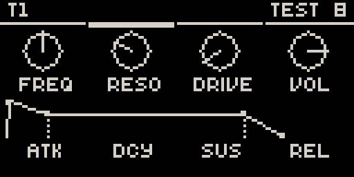
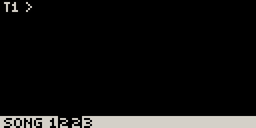

# Movy

**A friendly, Elektron-style knob UI and 16-track step sequencer for [Ableton Move](https://www.ableton.com/move/), built on the [Schwung](https://github.com/charlesvestal/schwung) framework.**

Movy turns Move into a hands-on instrument for Schwung modules: every module's
parameters land on the 8 knobs as clean, readable pages, and a 16-track
sequencer — modelled closely on Move's own — sits underneath, driven by a small
Rust engine. All sixteen tracks are chains Movy hosts itself.

**Movy runs on its own and boots straight into Movy.** It is a standalone
Schwung tool: while it is open it owns the whole device — pads, screen, audio,
master volume and the power button — with Move's software out of the way. Open
it from the Tools menu, or pick **Movy** once in Schwung's boot picker and the
Move powers on into it.



<sub>A tour of Movy's screens — a montage of UI states, not a live capture.</sub>

> ### ⚠️ Early prototype
>
> Movy is an **early, experimental prototype** — a proof of concept that has
> grown a lot of features but is not a finished product. It works on real
> hardware and is tested end-to-end, but expect rough edges, missing pieces, and
> the occasional crash.
>
> **I can't promise this will ever be "finished."** That said:
>
> - **Contributions are very welcome** — see [CONTRIBUTING.md](CONTRIBUTING.md).
> - **Bug reports are welcome too** — please make them **reproducible** (what you
>   did, what you expected, what happened, which modules were loaded). A vague
>   "it crashed" is hard to act on; a numbered list of steps is gold.
>
> 📖 **Full guide: [MANUAL.md](MANUAL.md)** · 📜 **[Changelog](CHANGELOG.md)**

---

## What is Movy?

Move is a wonderful piece of hardware, and [Schwung](https://github.com/charlesvestal/schwung)
opens it up to run custom DSP modules (synths, drums, effects). But controlling
those modules and sequencing them on the device itself is bare-bones. Movy fills
that gap with two things:

1. **A parameter UI** — pick up any Schwung module and its parameters are laid
   out on the 8 knobs as Schwung's own pages, the same ones its slot editor
   draws. Walk the whole chain (MIDI FX → Synth → FX 1 → FX 2 → LFO) with the
   jog wheel.
2. **A sequencer** — a **16-track** step sequencer whose behaviour is aligned as
   closely as possible with Move's native sequencer (clips, session view, live +
   step recording, automation), but driving Schwung modules instead of Move's
   instruments. Every track hosts its own module chain inside Movy, summed to
   one stereo output — one host for all sixteen, which is also what lets every
   track share Movy's CPU optimization. The 16 are arranged as **four groups of four**: in Session
   view the +/− buttons move between groups, and the step buttons pick a
   track.

## Inspiration & lineage

Movy stands on the shoulders of several projects:

| Aspect | Inspired by |
| --- | --- |
| **Screen UI** | [Elektron](https://www.elektron.se/) boxes (knob pages, parameter locks), with a nod to [Dronage](https://github.com/charlesvestal/schwung) |
| **Sequencer behaviour** | Ableton **Move**'s native sequencer — Movy tries to feel the same, just for 16 tracks of Schwung modules |
| **Sequencer architecture** | [Davebox](https://github.com/legsmechanical/schwung-davebox) — the proven engine/transport approach (without copying its code, and without inheriting its deviations from native Move) |
| **Concept** | Native Move + Davebox + Dronage, distilled into one tool |

## Features

- **Parameter pages for any module** — every page a module publishes, drawn by
  Schwung's own page planner: arcs, switches, lists, envelopes, filter curves,
  a sampler's waveform with its play position. Movy adds the header, the page
  bar and the file browser, and records every edit for undo and automation.

  
  

- **Full chain navigation** — MIDI FX, Synth, FX 1, FX 2 per track, plus a
  master chain in Session view: three send FX and four master FX.

  

- **A mixer per track, and three send FX** — the MIX page ends every track's
  chain with level, pan and three send amounts, all automatable. Three shared
  send FX sit at the head of the master chain, so eight tracks can share one
  reverb instead of paying for eight — and the buses render in parallel, which
  takes three heavy reverbs from 847 µs of the audio block down to 423 µs.

  

- **Session mixer** — latch Session view and hold Note/Session: all 16 tracks'
  faders and stereo meters on one screen, eight knobs per page.

  

- **Track volume** — hold a track button and turn the volume encoder to set that
  track's level (0–400%, unity marked). Add Shift for Movy's own slider.

  

- **Per-track LFOs** — two LFOs per track with a live waveform display
  (shape, rate/sync, depth, phase, retrigger). **Hold any knob** to modulate
  that parameter with an LFO; modulated params wear a mark.

  

- **External MIDI keyboard** — plug a USB keyboard (an OP-XY, say) into the
  USB-A port: it plays and records into the selected track, one key per pad on
  drum tracks, with mod wheel and pitch bend.

- **16-track sequencer**, aligned with Move: clips, Session view & clip
  launching, live recording (with count-in/metronome), step entry, loop/bar
  editing, duplicate/delete, and **parameter automation**.

  

- **Loop-mode note view** — press **Loop** and the screen shows the clip's
  notes as a Push-style folded piano roll lined up with the bar strip, live
  while you record.

  

- **Scenes & Song mode** — hold **Loop** in Session view and the step row
  becomes eight **scenes**: each one launches a whole clip column across all 16
  tracks. Keep holding and press more scenes to build a looping **song**. A
  scene plays for as long as its longest clip; press one twice to hold it twice
  as long. The next scene flashes a bar before it lands, the song is saved with
  the set, and launching any clip by hand ends it.

  

- **Sixteen tracks in four groups.** Every track loads a module the way any
  track button does, and Movy hosts the whole chain itself, saved with the
  set. In Session view, **octave +/−** moves between the
  four groups and **a step button selects a track** — or hold **Session** and
  press a step from anywhere. Hold **Mute** anywhere — the pads, Loop mode,
  Session view — and the step row becomes a **16-track mute map**; add **Shift**
  to solo. How many you can actually run is
  a CPU question, not a Movy one: see
  [Limitations](MANUAL.md#7-limitations-vs-move).

- **Step recording** — hold **Rec** while stopped and play notes or chords in
  one step at a time, with ties, rests and back-stepping. An empty clip grows to
  exactly what you play.

  

- **Capture** — play freely, then press **Capture** to keep what you just
  played. With the transport stopped it reads a tempo off your playing and
  offers three; the jog picks one and you hear the take at it straight away.

  

- **Non-destructive quantization** — every clip carries a strength from 0 to
  100 % applied as it plays, so the timing you recorded is never rewritten and
  you can dial it back at any time. **Shift + Step 16** cycles 0 / your default
  / 100 %; new clips are born with the default, which follows you into new sets.

  

- **Generators: Smart Quantize & Variation** — hold **Shift + Step 16** and a
  generator (a free Gemini key) hands back three takes on the clip you recorded,
  from tightened to reimagined, each fitted to the chords and groove of the rest
  of the scene; Settings → GENERATORS sets how bold. **Shift + hold
  Step 14** turns a track's A part into a B. You preview every option on the
  jog, against your original, before anything is kept.

  

- **Undo & redo** — **Undo** takes back the last edit, **Shift + Undo** redoes
  it, and an overlay names what changed. One gesture is one undo: a whole knob
  turn, or one pass of live recording. Covers notes, clips, automation, synth
  parameters and module loads alike.

  

- **Scales & pad layouts** — the 32 pads become a chromatic fretboard or piano,
  or fold **in key** (4ths or inline) so a wrong note is impossible. Each
  track remembers its own octave, saved with the set.

  

  

- **Drum support** — drum modules switch the pads to a 4×4 rack with per-pad
  parameter pages, and **Mute + pad** silences one voice of the sequence
  (**Shift** solos it) — a silenced voice sits grey on the pads.

  

- **Beyond Move** — three pages of features Move doesn't have on-device:
  - **Step parameters** — per-trig velocity, length, probability, condition, invert.
  - **Clip parameters** — scale, length, transpose.
  - **Set parameters** — tempo, swing, root, key.

  

- **Settings — Shift + Step 2** — a scrolling list and older versions of the
  set (**BACKUPS**). Each row explains itself on screen.

  

- **Backups** — every Set keeps up to 32 older versions, kept when you open it,
  as you work, and always before anything that would wipe it. Browse them by
  age and clip count in **Settings → BACKUPS** and put one back on the device,
  no computer needed. Restoring is itself undoable, and a Set from an older
  build has its existing copies adopted into the list the first time you open
  it.

  

- **Boots straight into Movy** — pick Movy once in Schwung's boot picker
  (press Back in the two-second window at power-on) and the Move comes up in
  Movy, with no Move in between. Leaving goes to Schwung; Tools-menu opening
  works as before.
- **Its own Sets** — **Shift + Step 1** lists Movy's Sets: new, open, rename,
  duplicate, delete. The first open copies every Set the Move-side Movy kept,
  and leaves the originals untouched.

See the [manual](MANUAL.md) for how each of these works.

## Module support

Movy works with **most Schwung modules with no setup at all** — it reads each
module's parameter hierarchy and lays it out automatically.

Some modules use a **curated layout template** for a nicer arrangement. These
are especially important for **drums**, where there is otherwise no way to
switch the drum type from the device. A template can ship inside Movy or as a
`movy_config.json` beside the module itself.

**Tested drum modules:**

- [Mr Drums](https://github.com/handcraftedcc/schwung-mrdrums) — basic drums
- [Weird Dreams](https://github.com/filliformes/weird-dreams-move) — synth drums

Other modules will work via the generic layout; if a module deserves a custom
template (or you want to improve drum support), **contributions are welcome** —
see [CONTRIBUTING.md](CONTRIBUTING.md).

## Requirements

- An **Ableton Move** with the **[Schwung](https://github.com/charlesvestal/schwung)**
  framework installed.
- At least one Schwung sound-generator module to play.
- On your build machine: **Node.js** and **Rust**, plus a cross-compiler —
  `deploy.sh` builds three things, a JS UI bundle, a Rust sequencer engine
  (`dsp.so`) and `movy-host`, the small C host that runs them, all
  cross-compiled for the Move's aarch64 Linux.

## Install

Movy is a **standalone** Schwung tool module (Schwung 1.6.0 or newer). Build
and deploy it to a Move reachable at `move.local`:

```bash
# Rust toolchain (skip if you already have cargo)
curl --proto '=https' --tlsv1.2 -sSf https://sh.rustup.rs | sh
source "$HOME/.cargo/env"
rustup target add aarch64-unknown-linux-gnu

# aarch64 cross-compiler (macOS, via Homebrew)
brew tap messense/macos-cross-toolchains
brew install aarch64-unknown-linux-gnu

cd movy
npm install
./scripts/deploy.sh            # builds ui.js, the Rust engine (dsp.so) and movy-host, deploys them
```

Building on Linux? Install a `aarch64-linux-gnu-gcc` cross-compiler from your
package manager instead (e.g. `apt install gcc-aarch64-linux-gnu`) and point
`engine/.cargo/config.toml`'s linker at it.

Then open **Movy** from Schwung's Tools menu on the device. See
[CONTRIBUTING.md](CONTRIBUTING.md) for the full build/test workflow.

## Limitations

Movy intentionally tracks Move's behaviour, but it is **not** a full
reimplementation. Notable gaps (all candidates for future work — contributions
welcome):

- **No automation capture** — Capture keeps notes; knob moves are not captured.
- **Schwung modules only** — not Move's native instruments, drum racks or
  sampler.
- Sequencer **resolution and some clip-level features** are simplified.

A fuller list, with context, is in the [manual](MANUAL.md#limitations-vs-move).

## Contributing & bug reports

Movy is open to contributions and bug reports. Please read
[CONTRIBUTING.md](CONTRIBUTING.md) first — it covers the build/test loop, how to
add a module layout template, and what makes a bug report actionable.

## License

[MIT](LICENSE) © megadake
