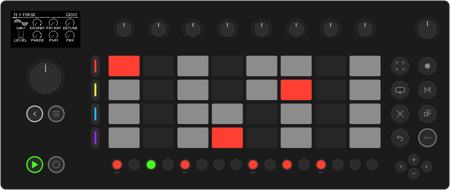
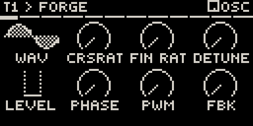
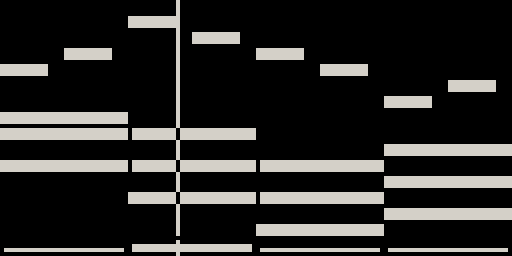
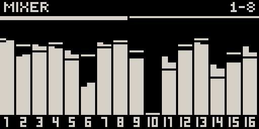

# Movy

**A 16-track sequencer and Elektron-style knob interface for Ableton Move.**

Movy turns Move into a groovebox for [Schwung](https://github.com/charlesvestal/schwung)
modules. Every module's parameters land on the eight knobs as clear, readable
pages. Underneath runs a 16-track sequencer that plays like Move's own, with
per-step parameter locks, automation, LFOs, scenes and a song mode.

[Install Movy](install.md){ .md-button .md-button--primary }
[Read the manual](manual/index.md){ .md-button }

## What you get

-   **Sixteen tracks, four groups**

    ---

    Each track hosts its own chain: MIDI FX, synth, two effects and a mixer
    strip. The four track buttons address one group of four at a time.

    [Tracks & sounds](manual/sounds.md)

-   **Every module on eight knobs**

    ---

    Parameter pages drawn as arcs, switches, envelopes, filter curves and
    sample waveforms. Presets, sample browsing and drum racks included.

    [Tracks & sounds](manual/sounds.md)

-   **A sequencer that feels like Move**

    ---

    Clips, live recording with count-in, step recording, Capture, a
    non-destructive quantize, copy and delete. If you know Move, you know this.

    [The sequencer](manual/sequencer.md)

-   **Locks, conditions and LFOs**

    ---

    Lock any parameter on any step, also on steps without notes and per drum
    voice. Add trig probability and conditions, and two LFOs per track.

    [Locks, automation & LFOs](manual/modulation.md)

-   **Scenes, songs and a mixer**

    ---

    Launch whole columns of clips as scenes and chain them into a looping song.
    Mix all 16 tracks on one screen, with three shared send effects.

    [Session view & songs](manual/session.md)

-   **Generators**

    ---

    Hold a step button and Movy offers new takes on your clip: tightened,
    varied, doubled with an ending, or a brand-new part that fits the scene.

    [Generators](manual/generators.md)

{ .small }
{ .small }
{ .small }

## See it in action

<iframe src="https://www.youtube-nocookie.com/embed/wj6Nm_tMez8" title="Movy Turns The Ableton Move Into a 16-Track Groovebox (Takton)" allow="accelerometer; clipboard-write; encrypted-media; gyroscope; picture-in-picture" allowfullscreen></iframe>

*Movy Turns The Ableton Move Into a 16-Track Groovebox*, by
[Takton](https://www.youtube.com/@taktonmusic).

!!! note "Filmed with Movy 0.29 (August 2026)"
    The sequencer, locks and LFOs work as shown. Since then the parameter pages
    look different, Movy runs in place of Move's software, and scenes, songs,
    send effects, the mixer and the generators were added.

## What you need

- An **Ableton Move** with **Schwung 1.6.0 or newer** installed.
- At least one Schwung **sound module** (a synth or a drum machine) to play.

Movy is free and open source. It is an independent project and is not made or
supported by Ableton.

!!! warning "Early software"
    Movy works on real hardware and is tested end to end, but it is still young.
    Expect rough edges. [Bug reports](reference/troubleshooting.md#reporting-a-bug)
    with clear steps help the most.
