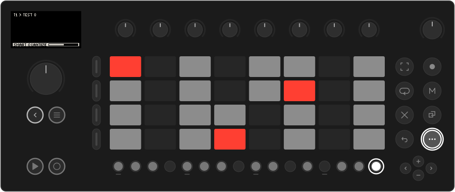
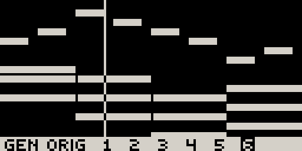
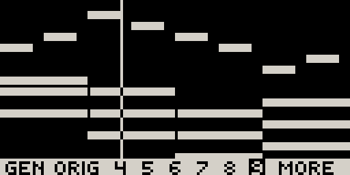
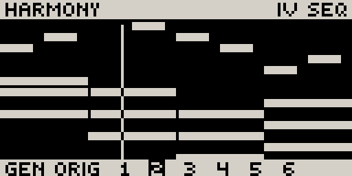
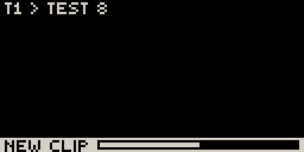

# Generators

Movy's generators offer **new takes on a clip**. Each one starts from what you
played and listens to the rest of the scene: its chords, its groove, its
accents. You always hear the options before anything is kept, next to your
original.

| Gesture | Generator | Starts from |
| --- | --- | --- |
| **Shift** + hold **Step 16** | **Smart Quantize** | The clip you recorded. Six takes, from tightened to developed. |
| **Shift** + hold **Step 14** | **Variation** | Another clip on the track: your A part becomes a B. |
| **Shift** + hold **Step 14** on an empty track | **New Clip** | Nothing: a new part that fits the scene. |
| **Shift** + hold **Step 15** | **Smart Double** | The clip, doubled, with a new ending. |

All of them work in **Track view**. Hold until the bar along the bottom of the
screen fills. Let go early and nothing happens. A short tap keeps the button's
normal job (quantize, double), and on Step 14 a tap only shows `HOLD TO GENERATE`.

## Choosing a take

When the generator is done, the clip's notes fill the screen with the options along the bottom:

{ .small }

| Control | Action |
| --- | --- |
| **Jog** | Hear **ORIG** and each option. The clip swaps in place and keeps playing in time. Keep turning past the last one for every other generator that suits the clip (`MORE` on the strip while there are more). |
| **Touch the jog** | Show which generator made the option (`GENERATOR: TURNAROUND`). |
| **Knobs** | Reshape the option showing (below). |
| **Pads, steps, held steps** | Edit the option. Each option keeps its own edits. |
| **Jog click** or **Back** | Keep what is showing and close the preview. |
| Hold a **track button** | See the track's parameter pages while held. |
| **Undo** | Step back through what you did in the preview (knob turns, edits, option changes), then ORIG, then close it with the clip as before. **Shift** + **Undo** steps forward. Undo right after keeping an option reopens the preview. |

{ .small }

You can stack generators: during a preview, **Shift** + hold **Step 16**, **14**
or **15** keeps what is showing and runs the next generator on it. For example,
go from New Clip straight to Smart Double.

You can also **leave and come back**. Switch to another track or clip and the
clip plays the option you were on. Come back and the preview is still open on
that option, with the same knob settings.

## The knobs

In a preview, **the knobs belong to the option on screen**. Every option opens
with its knobs already at good positions, so you never have to touch them. Turn
one and the option is remade at the new setting while it plays. Touch a knob to
see its name and value:

{ .small }

The knob lights show each position. A knob that does nothing for this option
stays dark. Turning a knob back to where it was gives you the same notes again.

A knob name means the same thing on every generator:

| Knob | Turning right |
| --- | --- |
| **AMOUNT** | Rewrites more of the clip. |
| **DENSITY** | More notes; left thins to the strongest (`AS IS` in the middle). |
| **LENGTH** | Longer notes, towards legato. |
| **RANGE** | Wider intervals and voicings. |
| **COLOUR** | More colour notes (9ths, 11ths, 13ths); left goes back to plain chord tones. |
| **CHORD RATE** | Chords change more often under the part. |
| **FIX NOTES** | Puts more of the notes that clash with the chords right, worst first. |
| **HARMONY** | Further from the original chords; its value shows them (`AM F C G`). Turned all the way left, a New Clip part stays on one chord. On a New Clip, turning right goes through progressions of 2 chords (two bars each), then 4, then 8 (half a bar each), and each group ends with its boldest moves. On a Variation, the middle of the knob changes your own chords; left of where it opens are 2-chord loops made from them, and on a clip of four bars or more the far right has 8-chord ones (your chords with a chord leading into each). A Double's chord option has the same groups on its MOVE knob, for the new half. Where other tracks already set the chords, HARMONY adds passing chords between them instead. |
| **RHYTHM** | A new rhythm for the same notes: push, syncopate, double, half, Euclid… |
| **DRIFT** | Walks the take away from itself one small change per click. Turn back to walk home. |
| **SEED** | Other takes of the same idea, closest first: each click right sounds a little further from the one you started on. |
| **TIMING**, **GRID** | From your feel to exactly on the grid; the grid. |
| **GATE**, **SPACE** | How long notes ring; how much room the part leaves between phrases. |

No generator has a swing knob: what they write is straight, and the Set's
swing (Main page) swings it as it plays, like every clip.

## Smart Quantize

Record something rough, then **Shift** + hold **Step 16**. Option 1 is always
the tightest: your notes on the scene's groove, with only clashing notes moved.
The others develop the clip, each changing one thing:

| Generator | What it does |
| --- | --- |
| **TIGHT** | Onto the grid. Its knobs also remove accidental doubles and grazes (**CLEAN**; on drums it also puts a hit that slipped onto the next pad back where the loop plays it, and leaves fills alone), even out or accent the velocities (**VELOCITY**), lengthen or shorten notes (**LENGTH**) and pick a timing feel: the scene's, laid back, pushed, shuffle (**FEEL**). |
| **SHAPED**, **DECORATE** | Chords filled out and moved smoothly; grace and passing notes added. |
| **ANSWER** | The second half answers the first. |
| **GHOSTS**, **FILL** (drums) | Ghost notes where there is room; a small fill into the loop. |
| **MUTATE**, **MODE**, **OCTAVES** | Notes moved through the scale; into another mode, or mirrored (**MIRROR**); thrown an octave. |
| **RATCHET**, **SHIFT**, **HUMANIZE** | Rolls and repeats; the clip moved in the bar; loosened like a player. |

On **TIGHT**, **DENSITY** turns left to keep
only the strongest notes, right to fill the gaps with more of what the part
already plays. On drums every pad keeps at least one hit.

## Variation

You have an A part and want a B. Select a clip slot on the track (empty or not)
and **Shift** + hold **Step 14**. The variation grows from the nearest clip
above the slot and takes its length.

Variation offers **six options**, picked from some thirty generators to suit the
part, closest first. Option 1 is **NUDGE**: the same part with a few notes
moved, in the same harmony. Keep it and press again to change a part a little at
a time; **AMOUNT** moves more notes, **BARS** puts the change in every bar, the
even bars or the last one, and **DIRECTION** lets the part climb or sink.
Option 3 is a brand-new part of the track's kind (a New
Clip **BASS** on a bass track, say), and option 6 a new part of a neighbouring
kind, for when the B section wants something other than a variation. Every option **keeps the track's role**: chords stay
chords, a bassline stays a bassline, drums never change pads. No option is
simply the same loop rearranged.

The options come from three groups: **close** (new notes on the same rhythm,
harmonies, re-voicings), **rhythm** (new basslines, riffs or locked to the kick, displaced or Euclidean
rhythms, comping) and **experimental** (a new part in the same style, phrase
forms, motifs, grids). Touch the jog to see which generator made an option.

**Which track to vary first.** The first track you vary in an empty scene sets
that scene's chords for the tracks after it. The bass or the chords are the best
place to start. Each track you vary after that hears the ones already there: a
line that would land in the chords' octave, playing with them, moves an octave
away.

## New Clip

On a track with no other clip, **Shift** + hold **Step 14** shows `NEW CLIP`.
When the bar fills, Movy writes a part from nothing, fitted to the scene: it
takes the other tracks' chords and swing, or picks a progression in the Set's
key when the scene is silent. Every run is new.

{ .small }

In a silent scene the part is written in the Set's **ROOT** and **KEY** (main
page). Dorian, Phrygian, Lydian and Mixolydian get chords and lines in that mode.
The other scales use their major or minor parent (Blues and Min Penta play
minor, Maj Penta plays major).

Change ROOT or KEY while New Clip previews are open and they follow at once:
every option, on every track, moves to the new key, your edits included. Parts
made side by side in one scene move together, so they stay in tune. A
preview whose scene holds a clip you made or kept stays in the key of that clip.

| Melodic options | |
| --- | --- |
| **CHORDS** | Comped chords on a rhythm. |
| **PAD** | Held chords, or held chords on a rhythm. |
| **STABS** | Short chords off the beat. |
| **BASS** | A bass figure: offbeat, rolling, octaves, 3-3-2, or the scene's kick. **NOTES** RIFF moves a short cell of root, third and scale steps with the chords; it plays the roots of the chords other tracks play, changes where they change, and every second bar steps into the next chord. |
| **ARP** | Each chord broken up. |
| **MELODY** | A phrase that answers itself and lands home. |
| **RIFF** | A short cell repeated through the chords. |
| **COUNTER** | A line that moves where the band leaves room. |
| **HOLD NOTE** | A drone that moves with the chords. |
| **PULSE** | One note of each chord on a bass rhythm. |
| **WALK** | A bass that walks into each chord change. |
| **LOOPER** | A short line that locks into a loop and slowly changes. |
| **HARMONIZE**, **FOLLOW** | A second line under a melody another track plays (only when one does). |

Turn the jog past the first eight to reach the last options.

On **CHORDS**, **DENSITY** thins the rhythm to its strongest hits or fills it
in, keeping the figure. On **PAD**, **PATTERN**: `HELD` changes chord with the harmony, while
`BAR`, `HALVES`, `3-3-2`, `CHARLESTON`, `PUSH` and `2+4` re-strike the chord on
a rhythm. Every chord change still sounds.

**Drum tracks** get six options. **PAD EUCLID** and **PAD PATTERN** write only
the **selected pad**: press another pad and it gets its own part, so you build
a kit one voice at a time (DENSITY at 0 removes it again). **DRUM MAP**,
**EUCLID KIT**, **BROKEN** and **PERC** write the whole kit. DRUM MAP morphs
between genres (four on the floor, disco, backbeat, 2-step, breakbeat, half
time, trap, broken beat) with separate kick, snare and hat counts, and can end
on a fill.

On every New Clip option, **DRIFT** walks the part away from itself one small
change per click: turn it slowly while it plays to let the part evolve.

The new clip is as long as the slot's loop if you set one first (Loop view works
on an empty slot), otherwise as long as the longest loop in the scene. During the
preview, press **Loop** and set the bars to remake every option at the new length.

## Smart Double

A tap on **Shift** + **Step 15** doubles the loop. **Hold** it instead and the
second half ends differently: it leads back to the top of the loop with a
turnaround, a fill or a pickup. The first half stays exactly as you played it.

Endings include turnarounds, cadences, runs, stops and pickups on melodic
tracks, and fills, rolls, breaks and beat repeats on drums.

**ENDING** sets how long the ending is. **SEAMS** on `BOTH` also gives the first
half a short ending of its own, like a question the second half answers. A loop
longer than 8 bars can't be doubled.

## Good to know

- While a generator works, the header shows `QUANTIZING...`, `VARIATION...`,
  `DOUBLING...` or `NEW CLIP...`, and the sequencer keeps playing. **Back** cancels.
- Holding **Step 14** or **Step 15** again on the same clip gives new options each
  time. Smart Quantize gives the same options each time: it fixes your take as
  you played it.
- If nothing can be made, a message says why (`NOTHING TO QUANTIZE`), and the clip is unchanged.
- Open previews are not saved with the Set. When you load another Set, each clip keeps the option it was showing.
