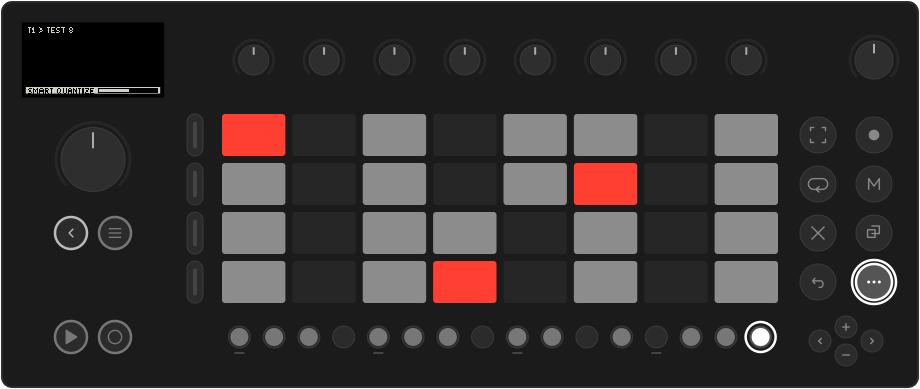
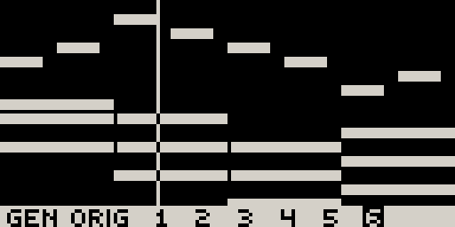
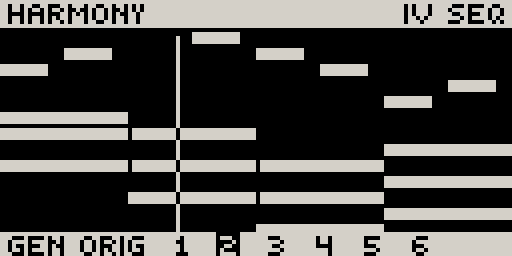

# Generators

Movy's generators offer **new takes on a clip**. Each one starts from what you
played and listens to the rest of the scene: its chords, its groove, its
accents. You always hear the options before anything is kept, next to your
original.

| Gesture | Generator | Starts from |
| --- | --- | --- |
| **Shift** + hold **Step 16** | **Smart Quantize** | The clip you recorded. Six takes, from tightened to developed. |
| **Shift** + hold **Step 14** | **Variation** | Another clip on the track: your A part becomes a B. |
| **Shift** + hold **Step 14** on an empty track | **New Clip** | Nothing: a new part that fits the scene. |
| **Shift** + hold **Step 15** | **Smart Double** | The clip, doubled, with a new ending. |

All of them work in **Track view**. Hold until the bar along the bottom of the
screen fills. Let go early and nothing happens. A short tap keeps the button's
normal job (quantize, double), and on Step 14 a tap only shows `HOLD TO GENERATE`.

## Choosing a take

When the generator is done, the clip's notes fill the screen with the options along the bottom:

{ .small }

| Control | Action |
| --- | --- |
| **Jog** | Hear **ORIG** and each option. The clip swaps in place and keeps playing in time. |
| **Touch the jog** | Show which generator made the option (`GENERATOR: TURNAROUND`). |
| **Knobs** | Reshape the option showing (below). |
| **Pads, steps, held steps** | Edit the option. Each option keeps its own edits. |
| **Jog click** or **Back** | Keep what is showing and close the preview. |
| Hold a **track button** | See the track's parameter pages while held. |
| **Undo** | Return the clip to how it was before the generator ran. |

You can stack generators: during a preview, **Shift** + hold **Step 16**, **14**
or **15** keeps what is showing and runs the next generator on it. For example,
go from New Clip straight to Smart Double.

You can also **leave and come back**. Switch to another track or clip and the
clip plays the option you were on. Come back and the preview is still open on
that option, with the same knob settings.

## The knobs

In a preview, **the knobs belong to the option on screen**. Every option opens
with its knobs already at good positions, so you never have to touch them. Turn
one and the option is remade at the new setting while it plays. Touch a knob to
see its name and value:

{ .small }

The knob lights show each position. A knob that does nothing for this option
stays dark. Turning a knob back to where it was gives you the same notes again.

A knob name means the same thing on every generator:

| Knob | Turning right |
| --- | --- |
| **AMOUNT** | Rewrites more of the clip. |
| **DENSITY** | More notes (`AS IS` in the middle). |
| **LENGTH** | Longer notes, towards legato. |
| **RANGE** | Wider intervals and voicings. |
| **TENSION** | More colour notes (9ths, 11ths, 13ths); left goes back to plain chord tones. |
| **HARMONY** | Further from the original chords. |
| **RHYTHM** | A new rhythm for the same notes: push, syncopate, double, half, Euclid… |
| **DRIFT** | Walks the take away from itself one small change per click. Turn back to walk home. |
| **SEED** | Another roll of the same idea. |
| **TIMING**, **SWING**, **GRID** | From your feel to exactly on the grid; swing amount; the grid. |
| **GATE**, **VARY**, **SPARSE** | How long notes ring; bar-to-bar variation; how much room the part leaves. |

## Smart Quantize

Record something rough, then **Shift** + hold **Step 16**. Option 1 is always
the tightest: your notes on the scene's groove, with only clashing notes moved.
The others develop the clip, each changing one thing:

| Generator | What it does |
| --- | --- |
| **TIGHT**, **TIDY** | Onto the grid; tidy also removes accidental doubles and evens out velocities. |
| **GROOVE** | The scene's swing and timing feel, or a feel: laid back, pushed, shuffle. |
| **SHAPED**, **EMBELLISH** | Chords filled out and moved smoothly; grace and passing notes added. |
| **ANSWER** | The second half answers the first. |
| **GHOSTS**, **FILL** (drums) | Ghost notes where there is room; a small fill into the loop. |
| **MUTATE**, **MODE**, **INVERT**, **OCTAVES** | Notes moved through the scale, into another mode, mirrored, thrown an octave. |
| **RATCHET**, **SHIFT**, **HUMANIZE** | Rolls and repeats; the clip moved in the bar; loosened like a player. |

## Variation

You have an A part and want a B. Select a clip slot on the track (empty or not)
and **Shift** + hold **Step 14**. The variation grows from the nearest clip
above the slot and takes its length.

Variation offers **six options**, picked from some thirty generators to suit the
part, closest first. Every option **keeps the track's role**: chords stay
chords, a bassline stays a bassline, drums never change pads. No option is
simply the same loop rearranged.

The options come from three groups: **close** (new notes on the same rhythm,
harmonies, re-voicings), **rhythm** (new basslines, displaced or Euclidean
rhythms, comping) and **experimental** (a new part in the same style, phrase
forms, motifs, grids). Touch the jog to see which generator made an option.

**Which track to vary first.** The first track you vary in an empty scene sets
that scene's chords for the tracks after it. The bass or the chords are the best
place to start.

## New Clip

On a track with no other clip, **Shift** + hold **Step 14** shows `NEW CLIP`.
When the bar fills, Movy writes a part from nothing, fitted to the scene: it
takes the other tracks' chords and swing, or picks a progression in the Set's
key when the scene is silent. Every run is new.

{ .small }

| Melodic options | |
| --- | --- |
| **CHORDS** | Comped chords on a rhythm. |
| **PAD** | Held chords. |
| **STABS** | Short chords off the beat. |
| **BASS** | A bass figure: offbeat, rolling, octaves, 3-3-2… |
| **ARP** | Each chord broken up. |
| **MELODY** | A phrase that answers itself and lands home. |
| **RIFF** | A short cell repeated through the chords. |
| **COUNTER** | A line that moves where the band leaves room. |

**Drum tracks** get seven options. **PAD EUCLID** and **PAD PATTERN** write only
the **selected pad**: press another pad and it gets its own part, so you build
a kit one voice at a time (DENSITY at 0 removes it again). **GROOVE**, **DRUM
MAP**, **EUCLID KIT**, **BROKEN** and **PERC** write the whole kit. DRUM MAP
morphs between genres (four on the floor, disco, backbeat, 2-step, breakbeat,
half time, trap, broken beat) with separate kick, snare and hat counts.

The new clip is as long as the slot's loop if you set one first (Loop view works
on an empty slot), otherwise as long as the longest loop in the scene. During the
preview, press **Loop** and set the bars to remake every option at the new length.

## Smart Double

A tap on **Shift** + **Step 15** doubles the loop. **Hold** it instead and the
second half ends differently: it leads back to the top of the loop with a
turnaround, a fill or a pickup. The first half stays exactly as you played it.

Endings include turnarounds, cadences, runs, stops and pickups on melodic
tracks, and fills, rolls, breaks and beat repeats on drums.

**ENDING** sets how long the ending is. **SEAMS** on `BOTH` also gives the first
half a short ending of its own, like a question the second half answers. A loop
longer than 8 bars can't be doubled.

## How bold: Settings → GENERATORS

**Shift** + **Step 2** opens Settings. On the **GENERATORS** row, turn knob 1 to
choose **SAFE**, **BALANCED** (default) or **WILD**:

{ .small }

- **SAFE**: more close options; smaller changes; shorter Smart Double endings.
- **BALANCED**: a mix of close, rhythmic and experimental options.
- **WILD**: more experimental options; bigger changes; harmony moves further.

## Good to know

- While a generator works, the header shows `QUANTIZING...`, `VARIATION...`,
  `DOUBLING...` or `NEW CLIP...`, and the sequencer keeps playing. **Back** cancels.
- If nothing can be made, a message says why (`NOTHING TO QUANTIZE`), and the clip is unchanged.
- Open previews are not saved with the Set. When you load another Set, each clip keeps the option it was showing.
