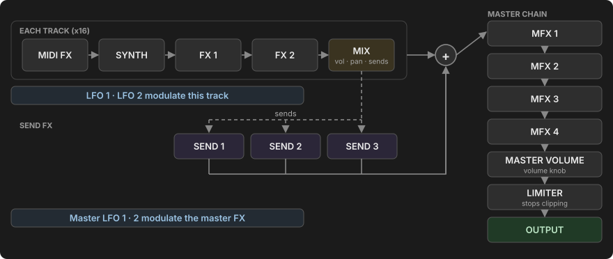

# Manual

This manual explains how to use Movy, chapter by chapter. If you are new, read
[The panel](panel.md) and work through the [Quick start](quick-start.md). After
that, each chapter stands on its own.

## I want to…

| Task | Where |
| --- | --- |
| Load a synth or a preset | [Tracks & sounds → The Chain view](sounds.md#the-chain-view), [Presets](sounds.md#presets) |
| Choose a key or pad layout | [Playing the pads → Pad layouts](playing.md#pad-layouts) |
| Record a part | [The sequencer → Recording live](sequencer.md#recording-live) |
| Program drums on the steps | [The sequencer → Entering steps](sequencer.md#entering-steps) |
| Change a sound on one step only | [Locks, automation & LFOs → Parameter locks](modulation.md#parameter-locks) |
| Make a part vary from bar to bar | [The Step page: probability and conditions](modulation.md#the-step-page) |
| Reach tracks 5–16 | [Session view → Tracks and groups](session.md#tracks-and-groups) |
| Mute or solo a track or drum voice | [Mute and solo](session.md#mute-and-solo), [Muting one drum voice](playing.md#muting-one-drum-voice) |
| Arrange scenes into a song | [Session view → Songs](session.md#songs) |
| Share one reverb between tracks | [Mixing & effects → Send effects](mixing.md#send-effects) |
| Get new ideas for a part | [Generators](generators.md) |
| Get back an earlier version of a Set | [Sets → Backups](sets.md#backups) |
| Get out when Movy stops responding | [Settings & system → Opening and leaving](system.md#opening-and-leaving-movy) |

## Contents

<!-- contents -->

## What Movy is

Movy is a **tool** for Schwung. While it is open, it runs *in place of* Move's
own software and takes over the whole device: pads, knobs, buttons, screen,
sound, master volume and power button. Close Movy and Move comes back.

Inside Movy you work with:

- **16 tracks**, arranged as four groups of four. Each track hosts its own
  chain of Schwung modules: a MIDI effect, a synth (or drum machine), two
  audio effects and a mixer strip.
- **Clips** of notes on each track, played by a sequencer that behaves like
  Move's, extended with per-step locks, probability, conditions and automation.
- A **master chain** with three send effects and four master effects.
- **Sets**: each Set is one whole project, saved automatically.

## If you know Move

Movy's sequencer is deliberately close to Move's: clips, Session view, live
recording with count-in, step entry, Capture, copy and delete all work the way
Move's do. Ableton's [Move manual](https://cdn-resources.ableton.com/resources/pdfs/move-manual/1/2024-10-04/move1-manual-en.pdf)
is a good companion. This manual covers the same ground more briefly and spends
its time on what Movy adds.

Throughout the manual, anything that works **the same as on Move** sits in a
collapsed yellow **Works like Move** box. Move owners can skip those boxes;
newcomers should open them, they hold the basics. Everything outside them is new
in Movy or works differently.

The main differences:

- Instruments are **Schwung modules**, not Move's own instruments, drum racks or sampler.
- There are **16 tracks** instead of 4.
- The screen keeps a **module's parameters** visible while you sequence.
  Sequencer state shows on the pads and step buttons, and in short on-screen messages.
- Extra pages Move does not have: **Step**, **Clip** and **Set** parameters,
  **Settings**, a **CPU meter**, and Movy's own **Sets** list.

## How this manual writes controls

| Written as | Means |
| --- | --- |
| **Shift** + **Step 3** | Hold Shift, then press Step 3. |
| **Hold** a step | Keep it pressed while you do the next thing. |
| **Tap** | A short press and release. |
| **Touch** a knob | Rest a finger on it without turning. The knobs are touch-sensitive. |
| **Jog** / **jog click** | Turn / press the large wheel left of the pads. |
| **+** / **−** | The octave buttons (Up / Down) at the bottom right. |

Button names follow the labels on Move. **Note/Session** is the button to the right of **Back**.

!!! tip "Not sure what the jog does?"
    Rest a finger on the jog wheel for about a second without turning it. A
    prompt at the bottom of the screen says what a click will do on this page.
