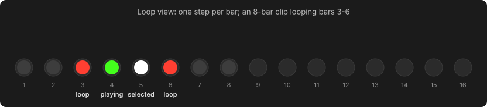
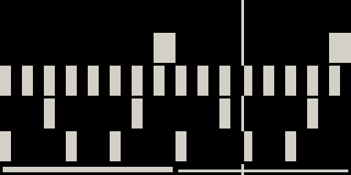
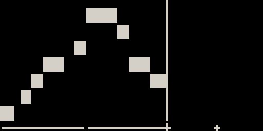

# Loop view

A clip can be many bars long, and its **loop** is the range of bars that
actually plays. The loop does not have to start at bar 1: you can loop bars 3–4
of an eight-bar part and leave the rest in place for later.

Press **Loop** to open the Loop view (tap to stay in it, hold for a quick look).
The step buttons become a **bar selector**, one step per bar, and the screen
shows the clip's notes.

## The bar selector

| Light | Bar |
| --- | --- |
| Green, pulsing | Playing now |
| White, pulsing | Selected: the bar shown on the step row when you leave Loop view |
| Track colour, pulsing | Inside the loop |
| Near-black | Part of the clip, outside the loop |

??? move "Works like Move: selecting and looping bars"

    | Gesture | Result |
    | --- | --- |
    | Press a bar | Select it for viewing and editing. |
    | **Double-tap** a bar | Loop just that bar. |
    | Press **two bars** | Loop everything between them. |
    | Hold **Loop** + turn the **jog** | Grow or shrink the loop a bar at a time. |
    | **◀** / **▶** | Previous / next bar (outside Loop view too). |
    | **Shift** + **Step 15** | Double the loop, notes and all. |

Setting a new loop also moves the view into it, so you never edit a bar that
isn't playing.

**Growing a part.** Press **▶** past the last bar and the strip shows a **`+`**:
an empty bar after the loop. Add a note there and it becomes part of the loop,
so a part grows just by playing into the next bar.

## The piano roll

While Loop view is up, the screen shows the clip as a piano roll. Only the
pitches the clip uses get a row (lowest at the bottom), so a four-note bassline
fills the screen with four thick rows. Time runs left to right over the bars of
the strip below, and a line sweeps across at the play position.

{ .small }
{ .small }
{ .small }

Notes you record appear as you play them. The knobs do nothing while the piano
roll is up.
