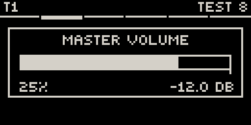
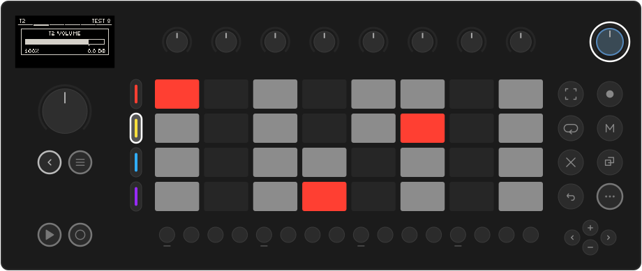

# Mixing & effects

## Master volume

??? move "Works like Move: the volume knob"

    The **volume knob** on its own is the master volume. Touch it to see the
    slider. Each detent is 1 dB, from silence up to 0 dB. Movy remembers the level
    across Sets and restarts.

    { .small }

## Track volume

??? move "Works like Move: hold a track button + volume"

    **Hold a track button and turn the volume knob** to set that track's level.
    100 % (0 dB) is unity, marked by the tick under the bar. Above it you are
    boosting, so watch for clipping.

    

    The level is saved with the Set. The track buttons reach the focused group; for
    other tracks, use the **MIX** page or the **Session mixer**.

## The MIX page

The last slot of every track's chain is **MIX**, the track's mixer strip:

| Knob | Parameter |
| --- | --- |
| 1 · **VOL** | Track level, silence to +12 dB (the same control as track volume). |
| 2 · **PAN** | Stereo position: `C`, `L50`, `R100`… |
| 5 · **SEND1** | Amount sent to send effect 1. Full right is 0 dB. |
| 6 · **SEND2** | Amount sent to send effect 2. |
| 7 · **SEND3** | Amount sent to send effect 3. |

All five can be [locked and automated](modulation.md) like any parameter: a
reverb throw on one snare hit is a SEND lock on that step. The sends are taken
after the fader and pan, so turning a track down takes its reverb with it, and
muting a track mutes its sends.

## The Session mixer

In Session view (tapped, so it stays), **hold Note/Session**. After a moment the
screen becomes a mixer for all 16 tracks. Let go to return.

{ .small }

Each strip shows a stereo level meter and a fader line. The eight knobs drive
**tracks 1–8**; **turn the jog** for **tracks 9–16**. Touch a knob to see that
track's exact level:

{ .small }

These are the same faders as **VOL** on each MIX page.

## Send effects

The master chain starts with three **send** slots, **SEND 1–3**. Each holds one
audio effect, shared by every track that sends to it.

1. Press **Note/Session**. The screen shows the master chain.
2. Turn the jog to **SEND 1**, click, and load an effect, for example a reverb.
3. On each track that should use it, raise **SEND1** on its MIX page.

Sends are for effects you mix in: reverb, delay, chorus. One shared reverb puts
the tracks in the same space and costs far less than one per track. Effects that
replace the sound (distortion, compression, EQ) belong in the track's own **FX** slots.

**Drum voices with their own sends.** On **Simian** and **DR32**, each voice has
**Send A** and **Send B** knobs on its pad page. Send A feeds SEND 1 and Send B
feeds SEND 2, voice by voice, on top of the track's own sends. Put only the snare
in the reverb and keep the kick dry.

## The master chain

After the sends come four master effects, **MFX 1–4**, which process the whole
mix, then the master **LFO** page. Navigate them like a track's chain: jog to a
slot, click to open or load. A limiter at the very end keeps the output from clipping.

The master chain is saved with the Set, so each Set keeps its own master sound.
