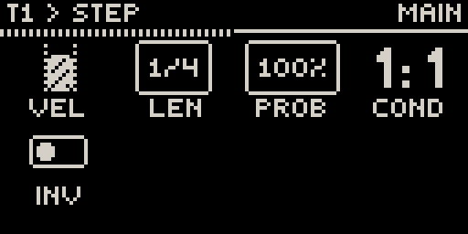
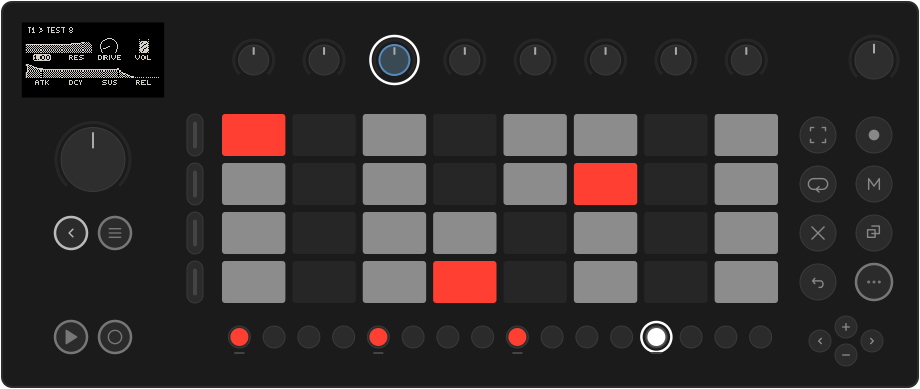
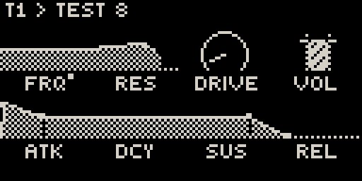
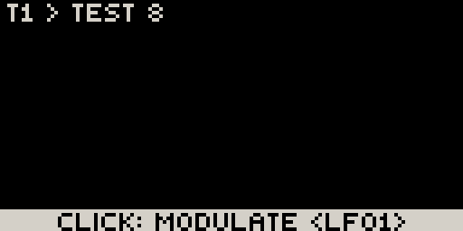
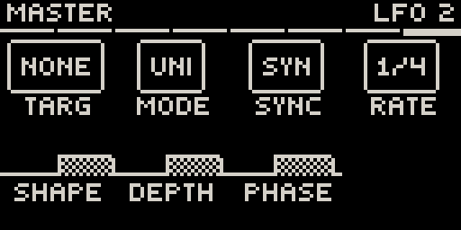

# Locks, automation & LFOs

Three ways to make a part move: lock a value on one step, record a knob
movement, or let an LFO do it. Move has per-step automation too (hold a step,
turn a knob); Movy builds on it with trig probability and conditions, locks on
any page of the chain, locks on steps without notes, and per-voice locks on drums.

## The Step page

**Hold a step** that has a note. While it is held, the first page becomes the
**Step** page, with that step's own settings on the knobs:

{ .small }

| Knob | Parameter | What it does |
| --- | --- | --- |
| 1 | **VEL** | Velocity of this step. |
| 2 | **LEN** | Note length. |
| 3 | **PROB** | Chance that the step plays, 0–100 %. |
| 4 | **COND** | Trig condition: `2:4` plays on the 2nd of every 4 passes through the loop. |
| 5 | **INV** | Inverts the condition: `2:4` inverted plays on every pass *except* the 2nd. |

On a drum track, these settings belong to the **selected voice** on that step.
Hold several steps at once to set them all together.

Musical uses:

- **Probability** on hi-hats or ghost notes makes a loop breathe without changing every bar by hand.
- **Conditions** turn a one-bar loop into a longer phrase: a crash on `1:4`, a
  fill hit on `4:4`, an extra note on `2:2` (every second bar).

## Parameter locks

While holding a step, **turn any knob** on any page of the track's chain. The
new value is stored **for that step only**. You don't hear it change while you
turn; it plays when the sequencer reaches the step.

- The cell shows the step's locked value while the step is held, and a small
  mark shows the parameter has automation:
  { .small }
- Lists and switches lock too: a filter type, a waveform, an on/off. Each knob detent moves one option.
- On a drum track, a lock belongs to the **voice** you locked it on: lock the snare's pitch on step 13 and only the snare changes.
- While a step is held, the jog still moves between pages, so one held step can lock parameters across the whole chain.
- Lock a step that has no note to change a sound between notes.

**To remove** a parameter's locks and automation from the clip: hold **Delete**
and touch that knob. A message confirms the lane is cleared.

## Recording automation

??? move "Works like Move: turn knobs while recording"

    Turn knobs while recording (**Rec**) and the movement is recorded into the clip.
    Unlike a lock, you hear the change as you make it. On playback, the cell
    follows the recorded value.

The **MIX** page's level, pan and sends can be locked and automated the same way.

## LFOs

Each track has two LFOs on its **LFO** page (the slot before MIX in the chain).
Each can modulate one parameter anywhere in the track's chain. **Jog click** the
LFO slot to open it; the jog switches between **LFO 1** and **LFO 2**.

{ .small }

| Knob | Parameter |
| --- | --- |
| **TARG** | The parameter to modulate. Turn to choose; the routing is made when you let go. **None** turns the LFO off. |
| **MODE** | Unipolar or bipolar. |
| **SYNC** | Free-running (rate in Hz) or synced to the tempo (rate in note values). |
| **RTG** | Restart the cycle on every new note. |
| **SHAPE**, **DEPTH**, **PHASE** | Waveform, amount and starting point, drawn as one live waveform. |
| **RATE** | Speed: Hz when free, a note value such as `1/4` or `8T` when synced. |

A synced LFO is locked to the bar while the transport runs, so a 1-bar filter
sweep always starts on the downbeat. When the transport stops, it keeps moving at the tempo.

### Assigning an LFO from the parameter

The quicker way: on any parameter page, **hold a knob** for about a second
without turning it. A prompt appears at the bottom:

{ .small }

Turn the jog to pick **LFO1** or **LFO2** and click. You jump to that LFO's page
to set its rate, shape and depth. A modulated parameter carries a mark on its
cell. Hold the knob again to remove the modulation.

This works on number knobs of a track's modules. The MIX page and send effects
can't take an LFO; automate them with locks or recording instead.

### The master LFOs

The master chain (in Session view) has its own LFO page after MFX 4. It works
the same way, with two differences: its targets are the four master effects, and
it has no retrigger. Use it to sweep a filter or a reverb over the whole mix.

{ .small }
