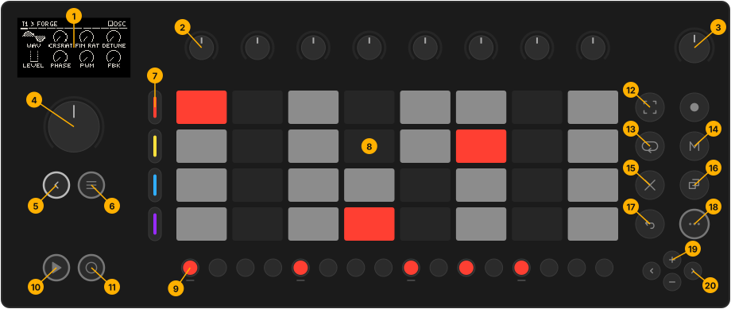
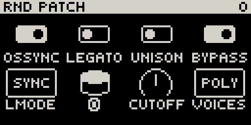

# The panel

| # | Control | In Movy |
| --- | --- | --- |
| 1 | **Display** | Parameter pages, the module browser, Loop view, overlays. |
| 2 | **Knobs 1–8** | Edit the eight parameters on screen. Touch one to see its full name and value. |
| 3 | **Volume knob** | Master volume. With a track button held: that track's volume. |
| 4 | **Jog wheel** | Turn to scroll pages, slots and lists. Click to open or confirm. |
| 5 | **Back** | Step back out of a page, close an overlay, cancel. At the top level it offers to close Movy. |
| 6 | **Note/Session** | Switch between Track view and the Session clip grid. Hold for a peek. |
| 7 | **Track buttons** | Select one of the four tracks in the focused group. |
| 8 | **Pads** | Play notes or drums. In Session view, launch clips. |
| 9 | **Step buttons** | Enter and edit steps. With **Shift**: page shortcuts. In Session view: pick a track. |
| 10 | **Play** | Start and stop the transport. |
| 11 | **Rec** | Tap to record live. Hold while stopped for step recording. |
| 12 | **Capture** | Keep what you just played. |
| 13 | **Loop** | Open the Loop view (bars and the clip's notes). In Session view, hold for scenes. |
| 14 | **Mute** | Mute tracks or drum voices. With **Shift**: solo. |
| 15 | **Delete** | With a step, bar, pad or knob: clear it. Pressed alone: delete the current clip. |
| 16 | **Copy** | Hold, press a step, bar or clip, then where it should go. |
| 17 | **Undo** | Undo. **Shift** + **Undo** redoes. |
| 18 | **Shift** | Second function of the button or step you press with it. |
| 19 | **+** / **−** | Octave up and down. In Session view, move between track groups. |
| 20 | **◀** / **▶** | Move between bars. Step recording: rest, tie, step back. |

The **Sample** button (top right of the function buttons) is not used by Movy.

## The screen

Most of the time the screen shows the current module's **parameter page**:

- **Header** (top line): the track (`T1`) and module on the left, the page name on the right.
- **Page bar** (under the header): one segment per page of this module; the current one is taller.
- **Eight cells**: one per knob, in the same layout as the knobs (top row = knobs 1–4).
- **Bottom row**: the Loop strip (one segment per bar of the clip), or a hint when the page has one.

While your hand is on a knob, the header shows that parameter's full name and
value instead:

## Reading the lights

Movy follows Move's lighting rules:

- **Only controls that do something are lit.** A dark button does nothing where you are.
- **Dim** means available. **Bright** means active, or held down right now.
- **Green** means playing (playhead, sounding drum voice). **Red** means recording.
- Tracks wear their **track colour** on the track buttons, pads and step row. A
  **dim** track colour means muted.
- In Track view the step row shows the current clip: lit steps have notes, the
  green step is the playhead.

When **Shift** is held, every step that has a shortcut lights up dim (see
[Controls](../reference/controls.md#shift-step-shortcuts)).

## The views

| View | What it is | How to get there |
| --- | --- | --- |
| **Track view** | The selected track: its sound on the pads, its clip on the steps, its pages on screen. Chain, parameter pages and Loop view all belong to it. | Movy starts here. **Note/Session** switches to and from Session view. |
| **Chain** | The current track's slots: MIDI FX, Synth, FX 1, FX 2, LFO, MIX. | **Back** from a module's pages. |
| **Parameter pages** | One module's knobs, page by page. | **Jog click** on a loaded slot. |
| **Browser** | The list of modules you can load into a slot. | **Jog click** on an empty slot, or **Shift** + **jog click**. |
| **Loop view** | The clip's bars on the step row and its notes on screen. | **Loop**. |
| **Session** | The clip grid on the pads, the track selector on the steps, the master chain on screen. | **Note/Session**. |

**Jog click** goes one level in, **Back** comes one level out. At the top,
**Back** opens the **Leave Movy?** menu.
