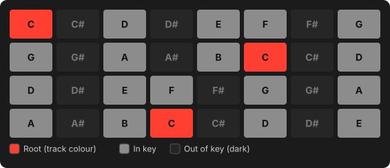
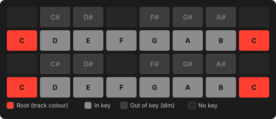
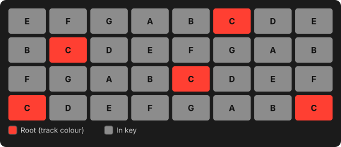
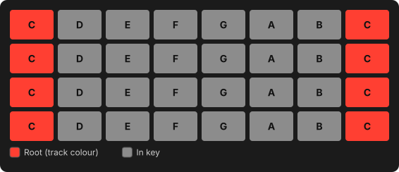

# Playing the pads

## The keyboard

On a melodic track the 32 pads are a keyboard. The pads show the key you chose
on the [Set page](sequencer.md#the-set-page):

- the **root** note lights in the **track colour**,
- the other notes **in the key** light grey,
- notes **outside the key** stay dark (they still play in Chromatic mode).

**+** and **−** move the keyboard an octave up or down. Each track remembers its
own octave, so a bass stays low when you come back to it.

## Pad layouts

Two knobs on the **Set** page (**Shift** + **Step 5**) shape the grid:

- **MODE**: **Chromatic** puts every semitone on the grid and the key only
  colours the pads. **In Key** folds the grid to the scale, so every pad is in key.
- **LAYOUT**: the geometry, below.

=== "Chromatic · 4th"

    

    One semitone per pad to the right, a fourth per row up, like a guitar or
    bass fretboard. Any chord or scale shape works the same in every key and on
    every row. The root sits on the 4th pad of the bottom row.

=== "Chromatic · Piano"

    

    Two octaves of piano keyboard: white keys on rows 1 and 3, black keys
    above them. Pads with no key stay dark. Keys outside the scale light dimly,
    so you can still see the key.

=== "In Key · 4th"

    

    Only the scale's notes, three scale steps per row up. The same finger
    pattern is the same chord in any key, and you can't play a wrong note.

=== "In Key · Inline"

    

    One octave of the scale per row, root at the left: `1 2 3 4 5 6 7 1`.
    Easy for melodies. With a five-note scale the rows overlap slightly.

MODE, LAYOUT, ROOT and KEY belong to the Set and apply to every track.

## Full velocity

**Shift** + **Step 10** toggles **full velocity**: every pad plays at maximum
velocity however hard you hit it. Handy for programming drums at an even level.
The setting stays on across Sets until you turn it off.

## Drums

On a drum track the pads are a drum rack (see
[Tracks & sounds → Drum modules](sounds.md#drum-modules)). Press a pad to play
it and select it for editing and step entry.

### Muting one drum voice

??? move "Works like Move: Mute + pad, Shift + Mute + pad"

    Hold **Mute** and press a pad to mute that voice in the sequencer.
    **Shift** + **Mute** + pad solos it. Press again to undo either.

    - A muted voice rests **grey** on the pads; it still plays when you hit it by hand.
    - Solo is exclusive: soloing another voice moves the solo. When the solo ends,
      your earlier mutes come back.
    - Voice mutes apply to every clip on the track, are saved with the Set and can be undone.

Use it to drop the kick out for a breakdown or to solo the hats while you edit
them, without touching the pattern.

## External MIDI keyboard

Plug a class-compliant USB MIDI keyboard or groovebox into the Move's **USB-A**
port. It plays the **selected track**, just like the pads.

- **Any MIDI channel** plays the selected track. Choose the destination on the Move.
- **Velocity** comes from the keyboard. Full velocity only affects the pads.
- **Recording** works as with the pads: live, step recording, and hold-step + key.
- On a **drum track**, C1 (MIDI note 36) plays pad 1, C#1 pad 2, and so on.
- **Mod wheel** and **pitch bend** reach the synth live but are not recorded.
- Other CCs, aftertouch and MIDI clock are ignored.
