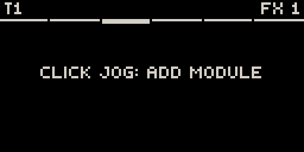
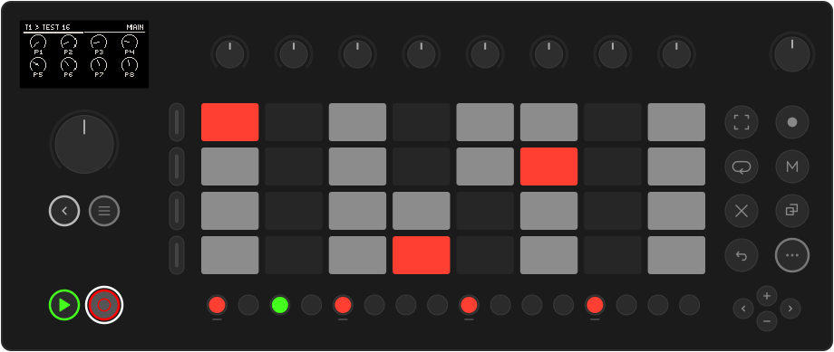

# Quick start

A first loop in ten minutes: a synth part, a drum part, a parameter lock and a
second scene. You need at least one synth and one drum module installed (see
[Install → Add some sounds](../install.md#3-add-some-sounds)).

## 1. Open Movy

Hold **Shift**, touch the **volume knob** and click the **jog wheel** to open
Schwung's Tools menu. Choose **Movy**. After a few loading screens the pads and
knobs wake up, and you are on **Track 1** of a new Set.

## 2. Load a synth

You start in the **Chain** view of Track 1: one slot at a time, its name at the
top right. Turn the jog until the top right reads **SYNTH**. An empty slot says
`CLICK JOG: ADD MODULE` (here on the FX 1 slot):

{ .small }

Click the jog. The module browser lists your installed synths. Turn to one and
click to load it:

{ .small }

Click the jog again to open the synth's **parameter pages**. Turn the knobs and
play the pads. Turning the jog moves through the module's pages.

## 3. Pick a key

Press **Shift** + **Step 5** to open the **Set** page. Turn **ROOT** (knob 4)
and **KEY** (knob 5), for example to A and Minor. The pads now light the key:
the root in the track colour, the other notes of the scale in grey.

{ .small }

Press **Back** to return. Use **+** and **−** to move the keyboard up or down an octave.

## 4. Record a part

Press **Rec**. Movy counts in one bar with the metronome, then records. Play a
bassline or a few chords. A first recording grows a bar at a time while you
play. Press **Rec** again to stop recording; the clip keeps looping. **Play**
stops the transport.

Too loose? Press **Shift** + **Step 16** to quantize the clip. Each press moves
to the next setting: 0 %, your default (set with QUANT on the Set page), 100 %. Your
original timing is kept, so you can always go back.

## 5. Add drums on Track 2

Press **Track button 2** (the second one down, left of the pads). Load a drum
module into its SYNTH slot, the same way as in step 2. The pads become a **drum
rack**: one pad per voice, numbered from the bottom left.

1. Tap pads until the screen's header names the **kick** (often pad 1). The
   pad you pressed is now selected and lights white.
2. Tap steps **1, 5, 9 and 13**. They light up: four on the floor.
3. Select the snare pad and tap **5** and **13**. Select the hi-hat and fill in the off-beats.

Press **Play** to hear both tracks together.

## 6. Lock a value on one step

1. Press the **snare** pad to select it.
2. Hold **step 13**. While a step is held, the **Step** page comes to the front.
3. Still holding, turn the jog to the snare's own page and turn a knob such as
   its pitch or decay. Let go.

That value now plays **only on step 13**, and only on the snare. This is a
**parameter lock**:

The Step page holds the step's own settings: **VEL**ocity, **LEN**gth,
**PROB**ability and **COND**ition. Select the hi-hat pad, hold all its steps at
once, and turn **PROB** (knob 3) to 60 %. The hats now play a little differently
every bar.

## 7. Make a second scene

Press **Note/Session**. The pads show the **clip grid**: each row is a track,
each column a clip slot. Your two clips sit in slot 1.

1. Press the empty pad to the right of Track 1's clip (slot 2). That selects the slot.
2. Press **Note/Session** to go back to the track and record a new part there,
   or let Movy write one: hold **Shift** + **Step 14** until the bar on screen
   fills (see [Generators](generators.md)).
3. In Session view, **hold Loop** and press **Step 1** or **Step 3** to launch
   scene 1 or 2. A scene is a whole column of clips.

## 8. There is no Save button

Movy saves the Set by itself. To leave, press **Back** until **Leave Movy?**
appears, then click **Close Movy**. Next time, Movy opens where you left off.

## Where next

- [The sequencer](sequencer.md): step editing, note length, step recording, Capture.
- [Locks, automation & LFOs](modulation.md): make parts move.
- [Mixing & effects](mixing.md): levels, sends and the master chain.
