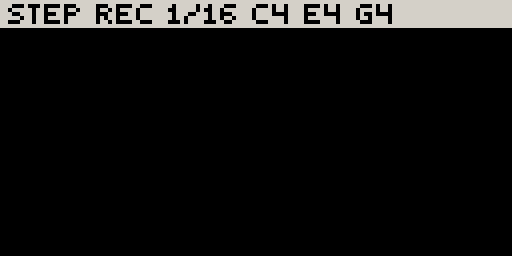
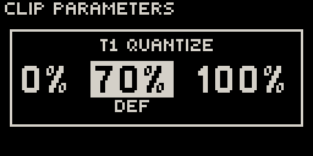
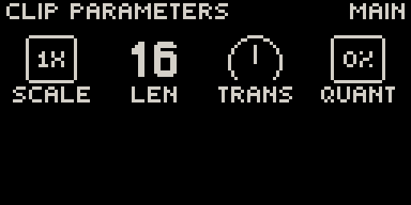
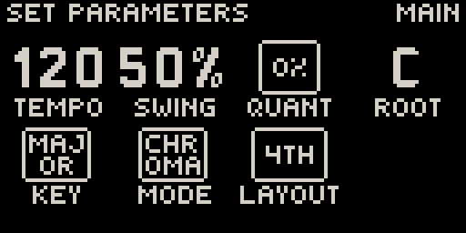

# The sequencer

Each track plays one **clip** at a time. A clip is a loop of notes, one bar or
longer, shown on the 16 step buttons one bar at a time (16 sixteenth notes).
The sequencer works like Move's. This chapter covers entering, recording and
editing notes; [Loop view](loop.md) covers bars and clip length, and
[Session view](session.md) covers launching clips.

## Transport

| Control | Action |
| --- | --- |
| **Play** | Start / stop. |
| **Shift** + **Step 6** | Metronome on / off. If it is too quiet, raise **CLICK VOLUME** in [Settings](system.md#settings). |
| **Shift** + **Step 5** | The [Set page](#the-set-page): tempo, swing, key. |

## Entering steps

??? move "Works like Move: tap steps, hold a step + pads, hold one step + press another"

    - **Tap a step** to add a note there, or remove it. On a melodic track the note
      is the last one you played; on a drum track it is the selected pad.
    - **Hold a step and press pads** to set exactly which notes play on it. Build a chord this way.
    - **Hold step A and press step B** to stretch A's note up to B.
    - **Hold a step and turn the volume knob** to change its velocity.

    The lit steps show the current bar of the clip; the green step is the playhead.

!!! note "Different from Move while a step is held"
    - The **jog** turns parameter pages (so you can lock any knob on the step). Set
      the length with **LEN** on the Step page, or hold the step and press a later step.
    - **+** / **−** transpose the held step's notes; **◀** / **▶** nudge them in time.
    - Hold **several steps** at once and every edit applies to all of them.

While you hold a step on a melodic track, the bottom of the screen turns into a
small keyboard with that step's notes filled in:

{ .small }

Holding a step also opens its **Step page** (velocity, length, probability,
condition) and lets you lock any knob on that step; see
[Locks, automation & LFOs](modulation.md).

## Recording live

??? move "Works like Move: Rec, count-in, punch-in"

    Press **Rec**. From a stop, Movy counts in one bar, then starts the transport
    and records what you play on the pads. A first recording into an empty clip
    grows a bar at a time while you play. Press **Rec** again to stop recording;
    the clip keeps playing.

    - **Rec while playing** punches in. On a clip that has notes, it records from
      where you are. On an empty slot it waits for the next bar (Rec flashes), so
      the new clip starts on the beat with everything else.
    - A note played slightly before the first beat still lands on the downbeat.
    - A pad you are still holding when you stop keeps its full played length.
    - Knob turns while recording are recorded as **automation**.

## Step recording

To enter a part one note at a time, without playing in time: with the transport
stopped, **hold Rec** and play pads. Each note or chord lands on the record head,
and the head moves on when you lift your fingers.

{ .small }

| While holding Rec | Action |
| --- | --- |
| **Pads** | Enter a note or chord at the head. |
| **▶** | Leave a rest. With pads held: tie the chord into the next step. |
| **◀** | Step back (the note there plays, ready to be replaced). With pads held: untie. |
| **Step button** | Move the head there, clearing that step. |
| **Release Rec** | Done. |

On an empty clip, the clip grows to exactly what you enter: seven notes make a
seven-step clip. On a drum track, each pass adds a voice, so you can lay the kick
in one pass and the snare in the next. You can still turn knobs while you enter notes.

## Capture: keep what you just played

??? move "Works like Move: Capture"

    Movy is always listening. When you play something good without recording, press
    **Capture** to keep it. **Capture** is lit whenever there is something to keep.

    | Transport | Clip | Result |
    | --- | --- | --- |
    | Playing | empty | A new clip, in time, sized to whole bars. It starts on the next bar. |
    | Playing | has notes | Your notes are added where you played them. |
    | Stopped | empty | A new clip. Movy reads a tempo from your playing and starts playing it. |
    | Stopped | has notes | Your phrase is fitted to the current tempo. |

    After a stopped capture, turn the jog to try the three tempos Movy offers;
    any other button closes the overlay.

    { .small }

**Different from Move:**

- Capture keeps **notes only**, not knob moves. Record automation live instead.
- To clear the buffer, **hold Delete and press Capture**. (**Shift** + **Capture**
  is Schwung's audio recorder and never reaches Movy.)
- The buffer holds the last 8 bars, and empties when you start or stop the
  transport, change tracks, edit the clip or pause for a couple of bars.

## Quantize

Unlike on Move, quantize in Movy is a **setting of the clip**, not an edit. Each clip has a
strength from 0 % (as played) to 100 % (exactly on the grid). It is applied as
the clip plays, so your recorded timing is never lost and you can change your
mind at any time. 60–80 % tightens a take and keeps its feel.

**Shift** + **Step 16** moves the clip to the next of **0 %**, your **default** and **100 %**, so pressing it again does not quantize harder:

{ .small }

Set any other value with **QUANT** on the Clip page. Set the default for new
clips with **QUANT** on the Set page. Swing is separate and always applies in full.

## Copy and delete

??? move "Works like Move: Copy and Delete on steps, bars and clips"

    **Copy:** hold **Copy**, press the source, then press one or more destinations.
    The source is a step, a bar (in Loop view) or a clip pad (in Session view). A
    paste replaces what was at the destination, including the step's Step-page
    settings and locks. On a **drum track**, a step or bar copy takes **only the
    selected voice**, so you can move a snare hit without touching the kick.

    | Delete gesture | Result |
    | --- | --- |
    | **Delete** alone (press and release) | Delete the current clip. |
    | **Delete** + step | Clear the step: its notes and locks. |
    | **Delete** + bar (in Loop view) | Clear the bar. |
    | **Delete** + clip pad (in Session view) | Delete that clip. |
    | Hold **Delete** + **pad** | Remove that note or drum voice from the whole clip. |
    | Hold **Delete** + touch a **knob** | Clear that parameter's locks and automation on the clip. |

Hold a step and press **Delete** to clear only that step's locks, keeping its notes.

**Shift** + **Step 15** doubles the loop: the clip's notes are copied after
themselves and the clip becomes twice as long. Turn a one-bar idea into two bars
you can vary.

## The Clip page

**Shift** + **Step 3** opens the Clip page for the current clip:

{ .small }

| Knob | Parameter |
| --- | --- |
| 1 · **SCALE** | Playback speed of the clip (for example 2× or ½×). |
| 2 · **LEN** | Clip length in steps. |
| 3 · **TRANS** | Transpose (melodic tracks only). |
| 4 · **QUANT** | This clip's quantize strength. |

## The Set page

**Shift** + **Step 5** opens the Set page, which applies to the whole Set:

{ .small }

| Knob | Parameter |
| --- | --- |
| 1 · **TEMPO** | Tempo. |
| 2 · **SWING** | Swing. |
| 3 · **QUANT** | Default quantize for new clips. |
| 4 · **ROOT** | Root note of the key. |
| 5 · **KEY** | Scale. |
| 6 · **MODE** | Chromatic or In Key (see [Pad layouts](playing.md#pad-layouts)). |
| 7 · **LAYOUT** | The pad grid's shape. |

**Back** closes the Clip or Set page.
