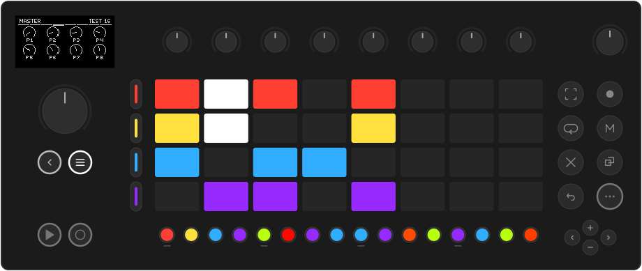
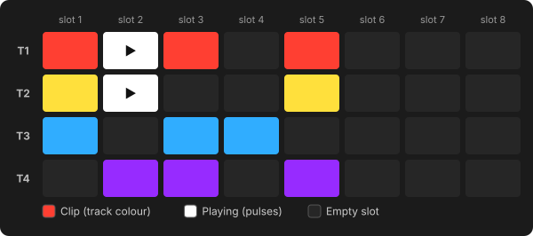
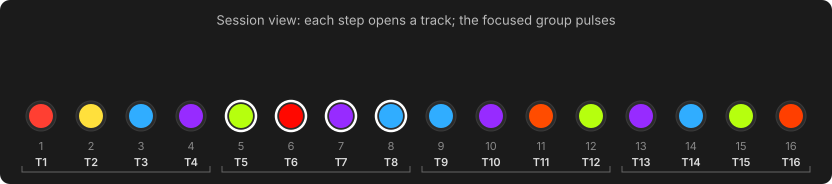
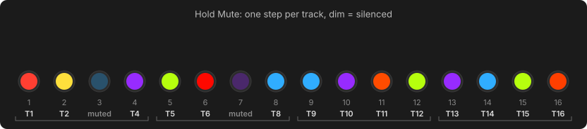
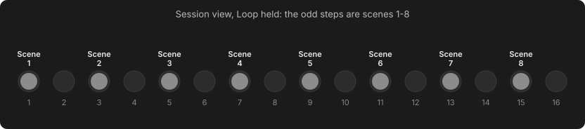

# Session view & songs

Press **Note/Session** to switch between **Track view** (the selected track: its
pages, its pads, its clip on the steps) and **Session view**. Tap it to stay;
hold it to look and come back when you let go. Holding it *in* Session view
opens the [Session mixer](mixing.md#the-session-mixer).

??? move "Works like Move: the clip grid and launching clips"

    - The **pads** are the clip grid of the focused group: one **row per track**,
      one **column per clip slot**. A clip lights in its track's colour; a playing
      clip pulses white.
    - **Press a clip** to launch it: at once when stopped, on the next bar while
      playing. Launching a clip also selects its track.
    - **Press an empty pad** to select that slot (for recording or a generator).
      The track stops.

    

- The **step buttons** pick a track (below).
- The screen shows the **master chain**: three send effects, four master
  effects and the master LFOs. See [Mixing & effects](mixing.md).

## Tracks and groups

The 16 tracks are arranged as **four groups of four**. The track buttons and the
clip grid show one group at a time, the **focused** group.

In Session view, the step row is a **track selector**: one step per track, in its colour.

| Control | Action |
| --- | --- |
| **Step 1–16** | Open that track. Tap to stay; hold to look and come back. |
| **+** / **−** | Move the focused group. **+** goes towards tracks 1–4, **−** towards 13–16. |
| Hold **Note/Session** + step | From any view: jump to that track and keep the selector up, so you can audition track after track. |

The four tracks of the focused group pulse. While you hold **Note/Session**, the
track you are on lights solid white.

## Mute and solo

??? move "Works like Move: Mute and Shift + Mute, on 16 tracks"

    | Gesture | Result |
    | --- | --- |
    | **Mute** | Mute / unmute the current track (Track view). |
    | **Mute** + track button | Mute that track. |
    | **Shift** + **Mute** (+ track button) | Solo instead. |

    Mutes and solos are latches: press again to undo. Solo is exclusive (soloing
    another track moves it), and when it ends your earlier mutes come back. Muting
    silences the sequencer; you can still play a muted track's pads by hand.

**The mute map.** The track buttons only reach the focused group, so hold
**Mute** anywhere (Track view, Loop view, Session view) and the step row becomes
a **mute map** of all 16 tracks. Press a step to mute that track, **Shift** +
step to solo it. A dim colour means silenced:

**Mute** itself lights bright whenever anything is muted or soloed, even in a
group you can't see.

## Scenes

A **scene** is one column of the clip grid across **all 16 tracks**. In Session
view, **hold Loop**: the odd step buttons (1, 3, 5 … 15) become scenes 1–8.

Press a scene to launch it. Every track with a clip in that column starts it on
the next bar, and tracks with an empty slot stop.

## Songs

Keep holding **Loop** and press more scenes: that is a **song**. The first press
starts a new song and each further press adds a scene to the end. Press a scene
twice to play it twice as long. Let go of **Loop** and the song plays through in
order, then loops.

{ .small }

- Each scene lasts as long as its longest clip.
- The bottom of the screen shows `SONG` with the scene numbers and the current one boxed.
- One bar before a change, the next scene's clips flash in the grid.
- An **empty scene** (no clips on any track) ends the song: everything stops, but
  the transport keeps time, so you can launch back in. End a song on an empty
  scene and it plays once instead of looping.
- **Launch any clip by hand** to leave the song; what is playing carries on.
  **Stop** and **Play** start the song from the top. The song is saved with the Set.
- Holding **Loop** and pressing a scene always starts a **new** song. To end a
  song, launch a clip by hand.

Sketch an arrangement while you jam: intro, verse ×2, chorus, verse, chorus ×2, end.
