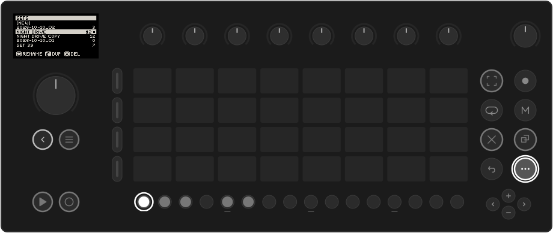
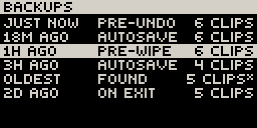

# Sets, saving & undo

## Sets

A **Set** is one whole Movy project: its clips and songs, the instruments on
every track and their settings, the mixer, the send and master effects, tempo
and key. Movy keeps its own list of Sets.

**Shift** + **Step 1** opens the list:

**[NEW]** comes first, then your Sets, newest first. The number is the Set's
clip count and the dot marks the open Set.

| Control | Action |
| --- | --- |
| **Jog** | Move the cursor. **Shift** + jog jumps eight rows. |
| **Jog click** on **[NEW]** | Start a new, empty Set (named for today's date) and open it. |
| **Jog click** on a Set | Open it. |
| **Capture** | Rename the Set under the cursor with the on-screen keyboard. A Set still named for its date gets a suggested name such as *Velvet Echo*: **OK** keeps it, or edit it first. |
| **Copy** | Duplicate the Set (as "*name* Copy"). |
| **Delete** | Delete the Set. It asks first: **jog click** deletes, **Back** cancels. |
| **Back** | Close the list. |

A deleted Set goes to a Trash folder on the Move, from where it can still be
recovered by hand. A Set with no clips and no instruments is not kept.

## Work from older Movy versions and Schwung

Up to version 0.35, Movy ran on top of Move's own software and kept its work
inside Move's Sets: the sequence and the tracks' instruments, alongside the
Schwung instruments and master effects saved with each Move Set.

The first time a current Movy opens, it copies that Movy and Schwung work into
its own Sets list, one Set for each Move Set that had any, named after it. Move's
own clips, instruments and samples are **not** copied: Movy plays Schwung modules
only. Nothing is moved or deleted; Move and Schwung still open their Sets as before.

**Settings → MIGRATE FROM MOVE** does this copy again. It replaces only the Sets
that came from this copy (each one's current state is kept in its
[backups](#backups) first) and never touches Sets you made in Movy.

## Saving

There is no Save button. Movy saves the open Set a few seconds after you stop
changing things, when you switch Sets, when you close Movy and when you power
off. The Set that was open when you left opens again next time.

Sets are kept outside Movy's own folder, so updating or reinstalling Movy keeps them.

## Backups

Movy keeps older versions of every Set and can restore one on the device.
Open **Settings** (**Shift** + **Step 2**) and choose **BACKUPS**:

{ .small }

Each row is a version: how long ago it was kept, why (opened, autosave, before a
wipe, on exit) and how many clips it has. The clip count is the quickest way to
find the one that still has your work. A `*` means *sequence only*: restoring it
brings back the notes and leaves the instruments as they are now.

Click a row, then click again to confirm. **Back** cancels. The current state is
kept as a backup first, so restoring can itself be undone.

Up to 32 versions are kept per Set, reaching back weeks.

## Undo and redo

??? move "Works like Move: Undo, Shift + Undo"

    **Undo** takes back the last edit; **Shift** + **Undo** redoes it. A message
    names what was undone and where:

    { .small }

    **What can be undone:** notes and steps; clip edits (clear, delete, copy, paste,
    length, transpose, loop); step settings and locks; automation; tempo, swing, root
    and key; mute, solo and track volume; synth and LFO parameters; module and preset
    loads, which come back with their settings.

    **What can't:** anything that only changes what you look at (selecting tracks,
    pages, views), Play and Rec, the metronome, octave and the pad layout.

    One gesture is one undo: a whole knob turn, or one pass of live recording. The
    last 64 edits are kept. History is cleared when you switch Sets or close Movy.
