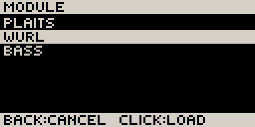
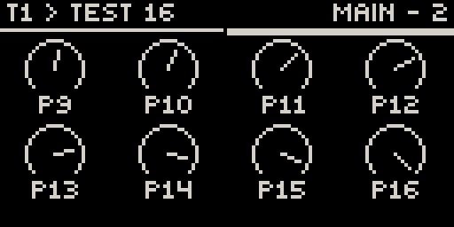
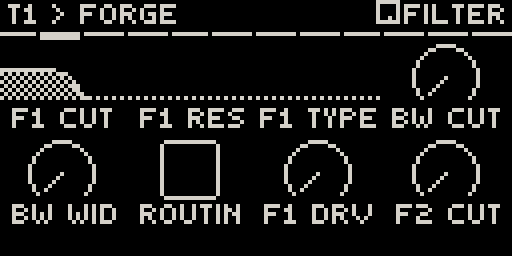
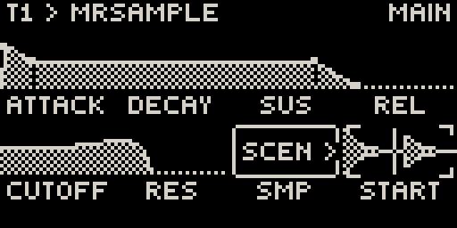
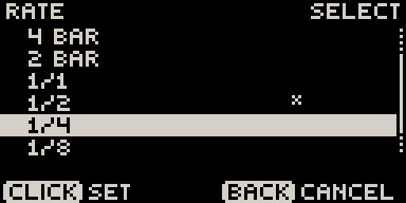
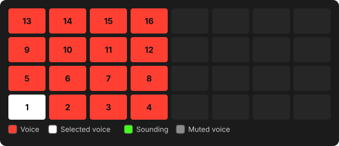
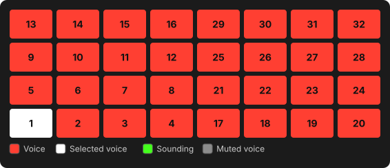
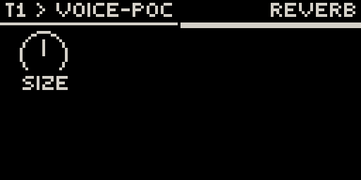

# Tracks & sounds

## Tracks and chains

Movy has **16 tracks**. Each track is a **chain** of slots that sound passes through:

| Slot | Holds |
| --- | --- |
| **MIDI FX** | A MIDI effect (arpeggiator, chord generator…) that changes the notes before the synth. |
| **SYNTH** | The instrument: a synth, sampler or drum machine. |
| **FX 1**, **FX 2** | Two audio effects. |
| **LFO** | The track's two LFOs (see [Locks, automation & LFOs](modulation.md#lfos)). |
| **MIX** | The track's level, pan and send amounts (see [Mixing](mixing.md#the-mix-page)). |

Pick a track with the **track buttons**. They address the four tracks of the
**focused group**. To reach tracks 5–16, see
[Session view → Tracks and groups](session.md#tracks-and-groups).

## The Chain view

**Back** out of a module's pages to see the chain. The header names the slot
under the cursor and the bar under it shows where you are in the chain.

| Control | Action |
| --- | --- |
| **Jog** | Move between slots. |
| **Jog click** on a loaded slot | Open that module's parameter pages. |
| **Jog click** on an empty slot | Open the module browser. |
| **Shift** + **jog click** | Open the browser to replace the slot's module. |
| **Back** | Leave Movy (asks first). |

{ .small }

In the browser, turn the jog and click to load. **Back** cancels. **NONE**
empties the slot. Loading a module is one undo step, so **Undo** brings the old
module back with its settings.

Modules follow Movy's tempo and transport, so a synced arpeggiator or delay locks to your Set.

## Parameter pages

**Jog click** on a loaded slot opens the module's parameters, eight at a time.
Each cell is drawn for what it is: an arc for a continuous value, a switch for
on/off, a word for a choice, a fader for a level, and pictures where the module
provides them: an envelope, a filter curve, a sample's waveform.

{ .small }
{ .small }
{ .small }

| Control | Action |
| --- | --- |
| **Knobs 1–8** | Change the parameter. |
| **Touch a knob** | The header shows its full name and value. |
| **Jog** | Next / previous page. The page bar under the header shows where you are. |
| **Shift** + **jog click** | List the module's sections and jump to one. |

A module that is still loading shows empty cells. Its page appears as soon as
it is ready. Large modules take a few seconds.

### Lists

Turning a list knob (a filter type, a waveform) steps through its options and
shows them in a pop-up. **Click the jog** while touching it to see the whole list as a menu:

{ .small }

### Presets

On a module's preset page, **knob 1** browses presets and loads each one as you
pass it. **Shift** + **knob 1** jumps a whole bank on modules that have banks
(OB-Xd, Dexed). Changing a preset is one undo step, so **Undo** returns the
module exactly as it was, including your tweaks.

### Samples and other files

A parameter that points at a file (a sample, a wavetable, a SoundFont) can't
be turned. Hold its knob: the header names the file and the bottom row reads
`CLK BROWSE`. Click the jog to open the file browser in that parameter's folder:

{ .small }
{ .small }

Turn to move, click to load, **Back** to cancel. Folders are marked `>` and
`..` goes up. On modules that support it, the file under the cursor plays as you
browse, so you can audition samples before choosing. Movy remembers the last
folder for each parameter.

### Module screens

Some modules have a full screen of their own behind one knob, such as DR32's engine
picker or Breakbeat's slice editor. Hold the knob: the bottom row reads `CLK
OPEN`. Click the jog to open it. The module then uses the jog, the click and the
knobs; the pads still play. **Back** steps out a level, **Shift** + **jog** leaves at once.

## Drum modules

Load a drum module and the pads turn into a **drum rack**, one pad per voice.
A rack of up to 16 voices uses the left half of the pads; a 32-voice rack (DR32)
uses both halves. Voices are numbered from the bottom-left pad:

{ width="420" }
{ width="420" }

**Press a pad to choose the voice you edit.** The module's **pad pages** come
first: they edit the selected voice, and their header shows a small pad icon and
the voice name. **Shift** + pad selects a voice without playing it.

{ .small }
{ .small }

- On a pad page, pressing another pad switches to the same page of that voice.
- On a kit-wide page (Reverb, Master…), pressing a pad selects it but stays on the page.
- A playing pattern never changes the page. Only your own presses do.

The selected pad lights white, a sounding pad green. To mute one voice, see
[Playing the pads → Muting one drum voice](playing.md#muting-one-drum-voice).
