# Tracks & sounds

## Tracks and chains

Movy has **16 tracks**. Each track is a **chain** of slots that sound passes through:

| Slot | Holds |
| --- | --- |
| **MIDI FX** | A MIDI effect (arpeggiator, chord generator…) that changes the notes before the synth. |
| **SYNTH** | The instrument: a synth, sampler or drum machine. |
| **FX 1**, **FX 2** | Two audio effects. |
| **LFO** | The track's two LFOs (see [Locks, automation & LFOs](modulation.md#lfos)). |
| **MIX** | The track's level, pan and send amounts (see [Mixing](mixing.md#the-mix-page)). |

Pick a track with the **track buttons**. They address the four tracks of the
**focused group**. To reach tracks 5–16, see
[Session view → Tracks and groups](session.md#tracks-and-groups).

## The Chain view

**Back** out of a module's pages to see the chain. The header names the slot
under the cursor and the bar under it shows where you are in the chain.

| Control | Action |
| --- | --- |
| **Jog** | Move between slots. |
| **Jog click** on a loaded slot | Open that module's parameter pages. |
| **Jog click** on an empty slot | Open the module browser. |
| **Shift** + **jog click** | Open the browser to replace the slot's module. |
| **Back** | Leave Movy (asks first). |

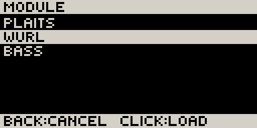{ .small }

In the browser, turn the jog and click to load. **Back** cancels. **NONE**
empties the slot. Loading a module is one undo step, so **Undo** brings the old
module back with its settings.

Modules follow Movy's tempo and transport, so a synced arpeggiator or delay locks to your Set.

## Parameter pages

**Jog click** on a loaded slot opens the module's parameters, eight at a time.
Each cell is drawn for what it is: an arc for a continuous value, a switch for
on/off, a word for a choice, a fader for a level, and pictures where the module
provides them: an envelope, a filter curve, a sample's waveform.

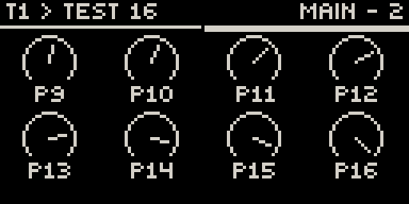{ .small }
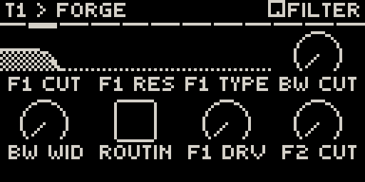{ .small }
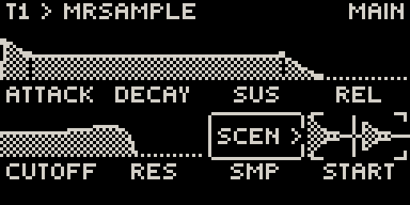{ .small }

| Control | Action |
| --- | --- |
| **Knobs 1–8** | Change the parameter. |
| **Touch a knob** | The header shows its full name and value. |
| **Jog** | Next / previous page. The page bar under the header shows where you are. |
| **Shift** + **jog click** | List the module's sections and jump to one. |

A module that is still loading shows empty cells. Its page appears as soon as
it is ready. Large modules take a few seconds.

### Lists

Turning a list knob (a filter type, a waveform) steps through its options and
shows them in a pop-up. **Click the jog** while touching it to see the whole list as a menu:

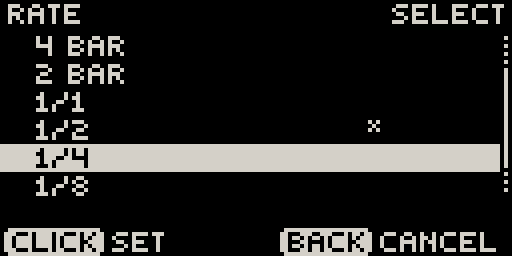{ .small }

### Presets

On a module's preset page, **knob 1** browses presets and loads each one as you
pass it. **Shift** + **knob 1** jumps a whole bank on modules that have banks
(OB-Xd, Dexed). Changing a preset is one undo step, so **Undo** returns the
module exactly as it was, including your tweaks.

### Samples and other files

A parameter that points at a file (a sample, a wavetable, a SoundFont) can't
be turned. Hold its knob: the header names the file and the bottom row reads
`CLK BROWSE`. Click the jog to open the file browser in that parameter's folder:

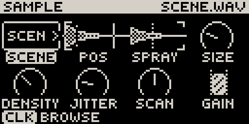{ .small }
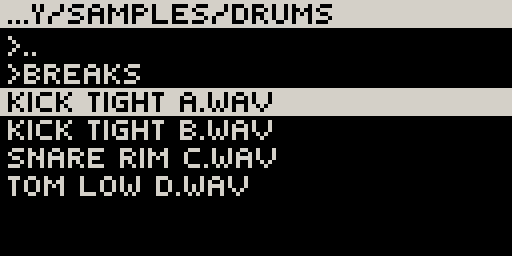{ .small }

Turn to move, click to load, **Back** to cancel. Folders are marked `>` and
`..` goes up. On modules that support it, the file under the cursor plays as you
browse, so you can audition samples before choosing. Movy remembers the last
folder for each parameter.

### Module screens

Some modules have a full screen of their own behind one knob, such as DR32's engine
picker or Breakbeat's slice editor. Hold the knob: the bottom row reads `CLK
OPEN`. Click the jog to open it. The module then uses the jog, the click and the
knobs; the pads still play. **Back** steps out a level, **Shift** + **jog** leaves at once.

## Drum modules

Load a drum module and the pads turn into a **drum rack**, one pad per voice.
A rack of up to 16 voices uses the left half of the pads; a 32-voice rack (DR32)
uses both halves. Voices are numbered from the bottom-left pad:

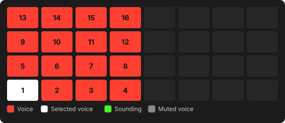{ width="420" }
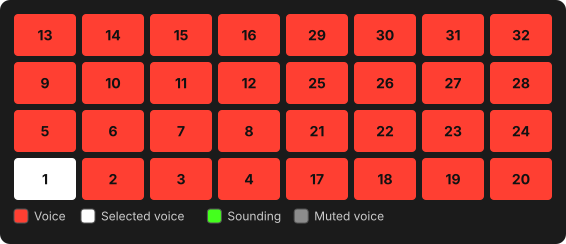{ width="420" }

**Press a pad to choose the voice you edit.** The module's **pad pages** come
first: they edit the selected voice, and their header shows a small pad icon and
the voice name. **Shift** + pad selects a voice without playing it.

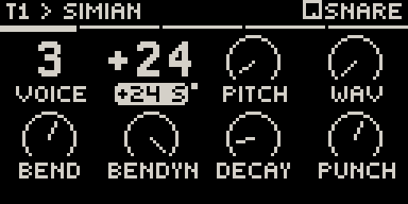{ .small }
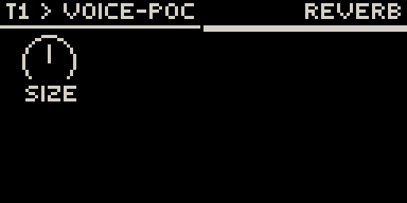{ .small }

- On a pad page, pressing another pad switches to the same page of that voice.
- On a kit-wide page (Reverb, Master…), pressing a pad selects it but stays on the page.
- A playing pattern never changes the page. Only your own presses do.

The selected pad lights white, a sounding pad green. To mute one voice, see
[Playing the pads → Muting one drum voice](playing.md#muting-one-drum-voice).

## Freezing a track

Freezing a track records what its clip plays into a loop, unloads its synth and
effects, and plays the loop in their place. The track sounds the same and its
level, pan, sends, mute and solo keep working, but the processing its chain
used goes back to the rest of the Set. Measured on the device, 16 tracks of
synths playing chords:

| | CPU meter | Dropouts |
| --- | --- | --- |
| Nothing frozen | 39 % | yes |
| 10 of the 16 frozen | 14 % | none |
| All 16 frozen | 0.2 % | none |

**To freeze a track:**

1. Hold **Shift** and **double tap** the track's button (two taps within about
   half a second). The first tap is an ordinary track press.
2. **Freeze T3?** comes up. **Click the jog** to confirm; turn it to **Cancel**,
   or press **Back**, to leave it.
3. **FREEZING T3** counts up while it records, then says **T3 FROZEN**.

It records the track's **selected clip**, which has to be the one playing. It
takes **two passes** of the clip, in real time, so reverb and delay tails from
the end of the loop are already in its start and the loop repeats seamlessly.
With the transport playing, nothing stops: keep playing. With it stopped, the
clip plays for the recording with the output silent, then stops again.

While it records, the Move belongs to the recording: every LED but **Back** goes
dark and every other press is ignored, so a stray **Play** cannot cut it short.
**Back** cancels it, and the track stays as it was.

Movy says no, and why, to a track that is **muted** (it would record silence) or
recording, and to a loop longer than **60 seconds** (a long clip at a slow speed
and a slow tempo gets there quickly). All frozen loops together are kept under
128 MB of memory; past that, unfreeze a track first.

**A frozen track:**

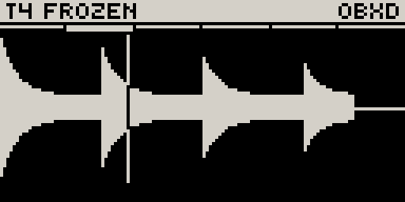{ .small }

- **Plays its loop** in time with its clip, whenever that clip plays. A scene or
  a launch that plays another clip of the track plays nothing on it.
- **Follows tempo changes** like tape: faster and higher, or slower and lower.
  A swing change does not reach it: the loop keeps the swing it was recorded with.
- **Keeps its MIX slot.** Turn the jog to **MIX** for its level, pan and sends;
  muting it fades the loop out over a quarter of a second, as the tails of a
  muted synth would ring out.
- **Cannot be edited** until you unfreeze it: notes, the Clip page, its synth and
  effects, the module browser, recording into it from the pads or a keyboard,
  Capture, muting a single drum voice, deleting or pasting its clips. Movy says
  **UNFREEZE T3 FIRST**. Undo leaves its clips alone.
- **Its pads** scroll **FROZEN** (they play nothing), and the
  [CPU meter](system.md#the-cpu-meter) marks it with an **F**.

**To unfreeze**, **Shift** + **double tap** the track again. The synth and
effects come back with the settings they had when frozen. Loading them pauses
the audio for a moment, so, as in Live, unfreezing stops the transport; while
it plays, Movy asks first:

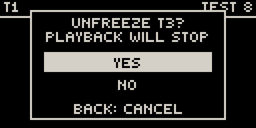{ .small }

**Saved with the Set.** A frozen track opens frozen, without loading its synth,
and renaming or duplicating the Set keeps it. A track opens **unfrozen, with its
chain**, when its chain or its clip is no longer what was frozen, for example
after restoring an older version of the Set.
