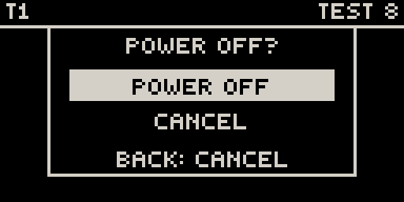
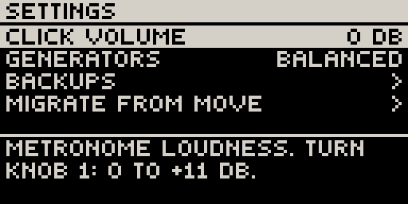
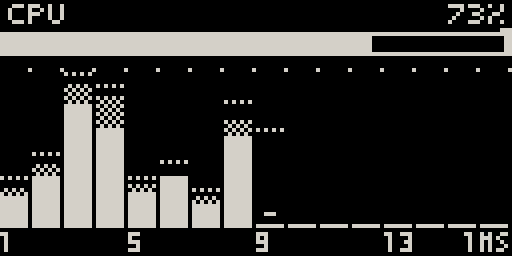

# Settings & system

## Opening and leaving Movy

Open Movy from Schwung's **Tools** menu (hold **Shift**, touch the **volume
knob**, click the **jog**), or set the Move to start in Movy at power-on (see
[Install → Open Movy](../install.md#4-open-movy)).

While Movy starts or a Set loads, the screen shows loading messages and the pads
and knobs stay off until the instruments are ready. **Back** always works.

**To leave**, press **Back** at the top level (the Chain view). **Leave Movy?**
offers **Close Movy**: turn the jog to it and click. Movy saves first, then the
Move returns to its own software with Schwung.

**If Movy stops responding:** hold **Shift**, touch the **volume knob** and
click the **jog**. Movy closes (saving if it can) and gives the device back
within two seconds, whatever state it is in.

## Powering off

Tap the **power button** and Movy asks **Power off?**. Click the jog to confirm,
or **Back** to carry on. Movy saves the Set, then the Move shuts down.

{ .small }

## Settings

**Shift** + **Step 2** opens Settings, a list: **jog** to move, **jog click** to
open a row, **Back** to close. The line at the bottom explains the selected row.

{ .small }

| Row | What it does |
| --- | --- |
| **CLICK VOLUME** | How loud the metronome and count-in are. Turn **knob 1**: 0 dB to +11 dB. Kept for this Move, not per Set. |
| **GENERATORS** | How bold the [generators](generators.md#how-bold-settings-generators) are: SAFE, BALANCED, WILD (knob 1). |
| **BACKUPS** | Older versions of the open Set (see [Backups](sets.md#backups)). |
| **MIGRATE FROM MOVE** | Copy your Move Sets into Movy's list again (see [Your Move Sets](sets.md#your-move-sets)). Click once to arm (`CONFIRM?`), again to run. Each replaced Set's previous state is kept in its backups; Sets you made in Movy are not touched. |

## The CPU meter

**Shift** + **Step 12** shows how much processing your Set uses. **Back** closes
it; pressing **Shift** + **Step 12** again resets the peak marks.

{ .small }

- The **bar under the header** is the whole Set. **Under 80 % is comfortable;
  near 100 % you are at the edge; over 100 % you will hear dropouts.** The notch
  above the bar is the worst moment since you opened the page.
- Each **column** is one track: solid for the instrument, checkered for its
  effects, a dotted line for its peak. A short dash means the track is loaded but
  silent, and costs nothing right now.
- When send effects are loaded, three more columns appear on the right under `SND`.

Six or seven tracks of ordinary synths is typical; light modules go much further.
A silent track costs nothing.

## The built-in speaker

Movy applies the same speaker EQ as Move, so the built-in speaker sounds the
same as under Move. It follows Schwung's **Global Settings → Audio → Spkr EQ**
(Auto / Off / On). If you opened Movy from the Tools menu and the speaker sounds
thin, set it to **On**. Headphones and line out are never affected.

## Recording a video of your screen

Schwung's web mirror works with Movy. On a computer, open
<http://move.local:7700/mirror>. It shows the screen and every pad and button
light, with your hands' presses. **Record** saves a video, **Save PNG** a still.
Sound is included while Schwung's **Mirror Display** setting is on (Schwung
Manager → Settings). Good for sharing a jam, or for showing a bug.
