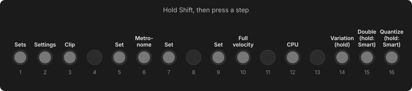

# Controls

Every control in one place. Chapters in the [manual](../manual/index.md) explain each in context.

## Shift + Step shortcuts

| Combo | Action |
| --- | --- |
| **Shift** + **Step 1** | [Sets](../manual/sets.md#sets) |
| **Shift** + **Step 2** | [Settings](../manual/system.md#settings) |
| **Shift** + **Step 3** | [Clip page](../manual/sequencer.md#the-clip-page): speed, length, transpose, quantize (Track view) |
| **Shift** + **Step 5 / 7 / 9** | [Set page](../manual/sequencer.md#the-set-page): tempo, swing, quantize, root, key, mode, layout |
| **Shift** + **Step 6** | Metronome on / off |
| **Shift** + **Step 10** | Full velocity on / off |
| **Shift** + **Step 12** | [CPU meter](../manual/system.md#the-cpu-meter) (again: reset peaks) |
| **Shift** + hold **Step 14** | [Variation](../manual/generators.md#variation), or [New Clip](../manual/generators.md#new-clip) on an empty track |
| **Shift** + **Step 15** | Double the loop. Hold: [Smart Double](../manual/generators.md#smart-double) |
| **Shift** + **Step 16** | Cycle the clip's quantize (0 / default / 100 %). Hold: [Smart Quantize](../manual/generators.md#smart-quantize) |

The shortcuts also work in Session view, except the Clip page and the generators, which need a single clip.

### Shortcuts that differ from Move

| Combo | On Move | In Movy |
| --- | --- | --- |
| **Shift** + **Step 3** | Workflow settings (count-in, quantize…) | The Clip page. Count-in is always one bar; the quantize default is on the Set page. |
| **Shift** + **Step 16** | Quantizes the clip (again on each press) | Moves the clip to the next quantize setting (0 / default / 100 %), never destructive. Hold for Smart Quantize. |
| **Shift** + **Capture** | Clears the capture buffer | Schwung's audio recorder. Clear Capture with hold **Delete** + **Capture**. |
| Hold step + **jog** | Note length | Turns pages, to lock any knob. Length: **LEN** on the Step page, or step A + step B. |
| Hold **Mute** | Shows and toggles automation | The 16-track mute map. |

## Navigation and pages

| Control | Action |
| --- | --- |
| **Jog** | Scroll slots (Chain view), pages (parameter pages) or list rows. |
| **Jog click** | Open the slot / load the selection / open a list knob's menu. |
| **Shift** + **jog click** | Chain view: replace the slot's module. Parameter pages: jump to a section. |
| **Touch the jog** | Show what a click does here. |
| **Back** | One level out; cancel; at the top: **Leave Movy?** |
| **Knobs 1–8** | Edit the parameters on screen. Touch: show name and value. |
| **Knob 1** on a preset page | Browse presets. **Shift** + knob 1: next bank. |
| Hold a **file** knob + **jog click** | Open the file browser (sample, wavetable…). |
| Hold a **module-screen** knob + **jog click** | Open the module's own screen. |
| Hold a **knob** ~1 s | Assign it to LFO 1 or 2 (jog picks, click assigns). |
| **Volume knob** | Master volume. |
| Hold **track button** + **volume knob** | That track's volume. |
| **Shift** + touch **volume** + **jog click** | Close Movy from anywhere. |
| **Power button** | Power off (asks first). |

## Playing

| Control | Action |
| --- | --- |
| **Pads** | Play notes / drum voices. |
| **+** / **−** | Octave up / down (per track). In Session view: move the focused group. |
| **Shift** + **pad** (drums) | Select a voice without playing it. |
| **Mute** + **pad** (drums) | Mute that voice. **Shift** + **Mute** + pad: solo it. |
| **Track buttons** | Select a track in the focused group. Hold: look and come back. |

## Sequencer

| Control | Action |
| --- | --- |
| **Step** | Add / remove a note. |
| Hold **step** + **pads** | Set the step's notes. |
| Hold **step A** + press **step B** | Note length from A to B. |
| Hold **step** + **knob** | Lock a value on that step (Step page on page 0). |
| Hold **step** + **volume knob** | Step velocity. |
| **Play** | Start / stop. |
| **Rec** | Record live (count-in from a stop; punch-in while playing). |
| Hold **Rec** (stopped) | Step recording: pads enter, **▶** rest/tie, **◀** back/untie, step jumps. |
| **Capture** | Keep what you just played. |
| Hold **Delete** + **Capture** | Clear the Capture buffer. |
| Hold **Copy**, press source, then destination(s) | Copy a step, a bar (Loop view) or a clip (Session view). |
| **Delete** alone | Delete the current clip. |
| **Delete** + step / bar / clip | Clear it. |
| Hold step + **Delete** | Clear that step's locks, keep its notes. |
| Hold step + **+** / **−** | Transpose the held step. |
| Hold step + **◀** / **▶** | Nudge the held step. |
| Hold **Delete** + **pad** | Remove that note or voice from the clip. |
| Hold **Delete** + touch **knob** | Clear that parameter's automation on the clip. |
| **Undo** / **Shift** + **Undo** | Undo / redo. |
| **◀** / **▶** | Previous / next bar. |

## Loop view

| Control | Action |
| --- | --- |
| **Loop** | Open the Loop view (tap) or peek (hold). |
| Press a bar | Select it. |
| Double-tap a bar | Loop that bar. |
| Press two bars | Loop the range. |
| Hold **Loop** + **jog** | Grow / shrink the loop by a bar. |

## Session view

| Control | Action |
| --- | --- |
| **Note/Session** | Session view (tap = stay, hold = peek). |
| **Pads** | Launch clips. |
| **Steps** | Open a track (tap = stay, hold = peek). |
| Hold **Note/Session** + **step** | Jump to a track and keep the selector up (any view). |
| Hold **Note/Session** (Session tapped on) | Session mixer: knobs = tracks 1–8, jog = 9–16. |
| Hold **Loop** + **Step 1, 3 … 15** | Launch scenes 1–8. Keep holding and press more to build a song. |

## Mute and solo

| Control | Action |
| --- | --- |
| **Mute** | Mute the current track. |
| **Mute** + **track button** | Mute that track. |
| Hold **Mute** + **step** | Mute any of the 16 tracks (mute map). |
| **Shift** + any of the above | Solo instead. |

## Generator preview

| Control | Action |
| --- | --- |
| **Jog** | Hear ORIG and each option. |
| Touch the **jog** | Show the generator's name. |
| **Knobs** | Reshape the option. Touch: name and value. |
| **Jog click** / **Back** | Keep the option shown. |
| Hold a **track button** | Show the track's pages while held. |
